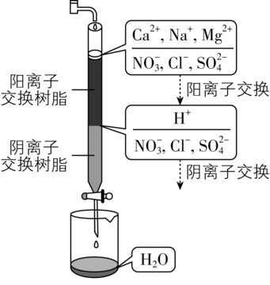

# Chemistry - 题目 39

**ID**: 68ab91d522574344bd47614065a575d7
**年级**: Grade 10
**难度**: Easy
**题型**: 刷真题

## 题目
离子交换法净化水过程如图所示。​​​​​​​‌下列说法中错误的是（      ）

## 解答

1. 从图中可以看出经过阳离子交换树脂后阳离子Ca^{2}^{＋}、Na^{＋}、Mg^{2}^{＋}被交换为H^{＋}，由于Ca^{2}^{＋}和Mg^{2}^{＋}均带2个单位正电荷，所以每个Ca^{2}^{＋}或Mg^{2}^{＋}会相应地交换为2个H^{＋}，故水中阳离子的总数会发生变化，A错误；由图可知水中的SO_{4}^{2}^{－}、Cl^{－}、NO_{3}^{－}通过阴离子交换树脂后被除去，B正确；由于净化处理后溶液中离子浓度降低，故水的导电性下降，C正确；经过阴离子树脂后H^{＋}转化为水，可知存在反应：H^{＋}＋OH^{－}${\rm\hspace{-0.5em}\begin{array}{}{\underline{{\underline{~{\,}{\,}{\,}{\,}{\,}{\,}{\,}~}}}}\atop{}\end{array}\hspace{-0.5em}}$ H_{2}O，D正确。
2. 【关键点拨】离子交换树脂净化水的原理：当含有Na^{＋}、Ca^{2}^{＋}、Mg^{2}^{＋}等阳离子及SO_{4}^{2}^{－}、Cl^{－}、NO_{3}^{－}等阴离子的水通过阳离子交换树脂时，水中的阳离子被树脂所吸附，而树脂上可交换的阳离子H^{＋}则被交换到水中，并和水中的阴离子组成相应的无机酸；当含有无机酸的水再通过阴离子交换树脂时，水中的阴离子也被树脂所吸附，树脂上可交换的阴离子OH^{－}被交换到水中，同时与H^{＋}结合成水。

## 知识点

**中文**:
  - 生活中常见的离子反应

**English**:
  - Common Ionic Reactions in Daily Life

---
