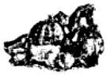

# Chemistry - 题目 173

**ID**: 36eeaaa021f34f0c998fdd4115524df2
**年级**: Grade 10
**难度**: Easy
**题型**: Multiple-choice

## 题目
大蒜是一种调味蔬菜。​​​​​​​‌其贮藏加工部分为其老熟的鳞茎，又称大蒜头。大蒜的储存会用到无水氢化钙或消石灰。氢化钙可作为生氢剂，反应的化学方程式为 ${\rm \mathrm{C}\mathrm{a}{\mathrm{H}}_{2}+2{\mathrm{H}}_{2}\mathrm{O}=\mathrm{C}\mathrm{a}(\mathrm{O}\mathrm{H})_{2}+2{\mathrm{H}}_{2}↑}$ 。下列说法错误的是（      ）

## 解答

1. ${\rm \mathrm{A}.\mathrm{C}\mathrm{a}{\mathrm{H}}_{2}}$ 中 ${\rm \mathrm{H}}$ 元素为 $-1$ 价，在反应中升高为 $0$ ，则为还原剂，而 ${\rm {\mathrm{H}}_{2}\mathrm{O}}$ 中 ${\rm \mathrm{H}}$ 元素为 $+1$ 价，在反应中降低为 $0$ ，则为氧化剂，故A错误；
2. B.由反应可知，氧化产物与还原产物均为氢气，故B正确；
3. C. ${\rm \mathrm{C}\mathrm{a}{\mathrm{H}}_{2}}$ 中 ${\rm \mathrm{H}}$ 元素为 $-1$ 价，在反应中升高为 $0$ ，则为还原剂，而 ${\rm {\mathrm{H}}_{2}\mathrm{O}}$ 中 ${\rm \mathrm{H}}$ 元素为 $+1$ 价，在反应中降低为 $0$ ，则为氧化剂，故C正确；
4. D.氧化产物与还原产物均为氢气，其物质的量相同，则氧化产物与还原产物的质量比为 $1$ ： $1$ ，故D正确；
5. 故选： ${\rm \mathrm{A}}$ 。

## 知识点

**中文**:
  - 氧化剂、还原剂与氧化产物、还原产物

**English**:
  - Oxidizing/Reducing Agents and Oxidation/Reduction Products

---
