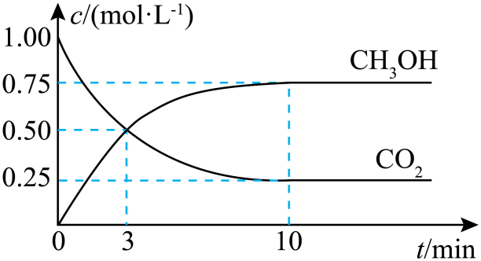

# Chemistry - 题目 14

**ID**: 3a0c9c94f4ae422b8fc22f5115498a5a
**年级**: Grade 10
**难度**: Easy
**题型**: Multiple-choice

## 题目
一定温度下，在2L恒容密闭容器中按物质的量比1:3充入 ${\rm{C}}{\rm{O}}{{}_{{{2}}}}$ 和 ${\rm{H}}{{}_{{{2}}}}$ ，发生反应： ${\rm{C}}{\rm{O}}{{}_{{{2}}}}{\rm{(}}{\rm{g}}{\rm{)}}+{{3}}{\rm{H}}{{}_{{{2}}}}{\rm{(}}{\rm{g}}{\rm{)}}\rightleftharpoons {\rm{C}}{\rm{H}}{{}_{{{3}}}}{\rm{O}}{\rm{H}}{\rm{(}}{\rm{g}}{\rm{)}}+{\rm{H}}{{}_{{{2}}}}{\rm{O}}{\rm{(}}{\rm{g}}{\rm{)}}$ ，测得 ${\rm{C}}{\rm{H}}{{}_{{{3}}}}{\rm{O}}{\rm{H}}{\rm{(}}{\rm{g}}{\rm{)}}$ 和 ${\rm{C}}{\rm{O}}{{}_{{{2}}}}{\rm{(}}{\rm{g}}{\rm{)}}$ 的物质的量浓度随时间变化关系如图所示。​​​​​​​‌下列说法正确的是（      ）

## 解答

1. A．由图可知，反应起始时 ${\rm{c}}\left ({CO{{}_{2}}}\right )=1.0{\rm mol}·{\rm{L}}{^{-1}}$ ，则 ${\rm{n}}\left ({CO{{}_{2}}}\right )=1.0{\rm mol}·{\rm{L}}{^{-1}}\times 2{\rm{L}}=2{\rm mol}$ ，按题意  ${\rm{n}}\left ({CO{{}_{2}}}\right )�:�{\rm{n}}\left ({{\rm{H}}{{}_{2}}}\right )=1:3$ ，则起始时 ${\rm{n}}\left ({{\rm{H}}{{}_{2}}}\right )=6{\rm mol}{\rm ，A}$ 错误；
2. B．由图可知， ${\rm{t}}=0\to 3{\rm \min }$ 内， $CO{{}_{2}}$ 由 $1.0{\rm mol}·{\rm{L}}{^{-1}}$ 减少到 $0.5{\rm mol}·{\rm{L}}{^{-1}}$ ，平均减少 $0.5{\rm mol}·{\rm{L}}{^{-1}}$ ， ${\rm{v}}\left ({CO{{}_{2}}}\right )=\frac {0.5}{3}{\rm mol}/{\rm{L}}·{\rm \min }$ ，按反应方程可知氢气的消耗量是 $CO{{}_{2}}$ 的 $3$ 倍，故氢气平均的速率为： $0.5{\rm mol}/{\rm{L}}·{\rm \min }{\rm ，B}$ 错误；
3. C．由于所有物质均是气体，气体质量前后都不变化，但是反应前后气体的物质的量在变化，当气体平均相对分子质量不变表明反应达到平衡状态，C正确；
4. D．起始时气体总物质的量是 $8{\rm mol}$ ，列出三段式： $\hspace{-0.5em}\begin{array}{}\;&CO{{}_{2}}\left ({{\rm{g}}}\right )&+&3{\rm{H}}{{}_{2}}\left ({{\rm{g}}}\right )&\rightleftharpoons &CH{{}_{3}}OH\left ({{\rm{g}}}\right )&+&{\rm{H}}{{}_{2}}{\rm{O}}\left ({{\rm{g}}}\right )\\开始量\left ({{\rm mol}}\right )&2&\;&6&\;&0&\;&0\\反应量\left ({{\rm mol}}\right )&1.5&\;&4.5&\;&1.5&\;&1.5\\剩余量\left ({{\rm mol}}\right )&0.5&\;&1.5&\;&1.5&\;&1.5\end{array}\hspace{-0.5em}$ ，剩余气体的总物质的量为 $5{\rm mol}$ ，所以平衡时容器内的压强与起始压强之比为 $5:8{\rm ，D}$ 错误；
5. 故选C。

## 知识点

**中文**:
  - 化学反应速率的计算
  - 化学平衡状态的判断

**English**:
  - Calculation of Reaction Rate
  - Determination of Equilibrium State

---
