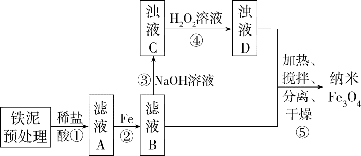

# Chemistry - 题目 201

**ID**: 9852525e95c54350a1418e9a5c07a0ef
**年级**: Grade 10
**难度**: Easy
**题型**: 专题强化练

## 题目
用铁泥(主要成分为Fe_{2}O_{3}、FeO和少量Fe)制备超顺磁性纳米Fe_{3}O_{4}(平均直径为25 nm)的流程图如下(所加试剂均过量,部分步骤已省略):下列叙述正确的是    	（      ）​​​​​​​‌

## 解答

1. 铁泥(主要成分为Fe_{2}O_{3}、FeO和少量Fe)与稀盐酸反应得到的滤液A中溶质为氯化铁、氯化亚铁、过量的HCl;加入铁粉还原铁离子:2Fe^{3+}+Fe→3Fe^{2+},过量的盐酸和Fe反应:2HCl+Fe→FeCl_{2}+H_{2}↑,滤液B中溶质为氯化亚铁,加入氢氧化钠溶液,生成Fe(OH)_{2},向浊液C中加入H_{2}O_{2}溶液,反应完成后需除去剩余的H_{2}O_{2},再与氯化亚铁溶液混合,经一系列操作后得到产品纳米Fe_{3}O_{4}。滤液B中溶质为FeCl_{2},可用KSCN溶液检验是否含有Fe^{3+},A错误;步骤②中发生反应2Fe^{3+}+Fe→3Fe^{2+}、2H^{+}+Fe→Fe^{2+}+H_{2}↑,分别为化合反应、置换反应,B错误;为防止H_{2}O_{2}在步骤⑤中继续氧化Fe^{2+},需除去剩余的H_{2}O_{2},C错误;超顺磁性纳米Fe_{3}O_{4}平均直径为25 nm,均匀分散在水中得到胶体,具有丁达尔效应,D正确。

## 知识点

**中文**:
  - 二价铁离子和三价铁离子的检验
  - 胶体的性质及应用

**English**:
  - Testing for Ferrous and Ferric Ions
  - Properties and Applications of Colloids

---
