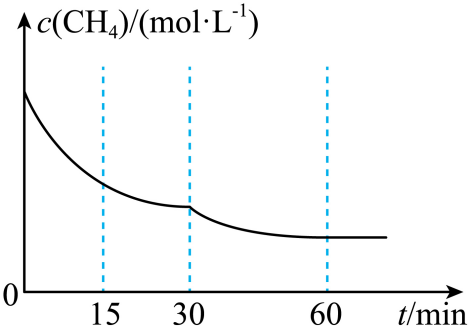

# Chemistry - 题目 335

**ID**: acd809d1cfcf40f898e825eee13d0239
**年级**: Grade 10
**难度**: Hard
**题型**: 非选择题

## 题目
乙炔 $\left ({{\rm{C}}{{}_{2}}{\rm{H}}{{}_{2}}}\right )$ 燃烧会放出大量的热，其火焰温度可达3100℃，利用乙炔和氧气混合燃烧产生高温火焰可进行金属焊接或切割。​​​​​​​‌（1）1 mol乙炔完全燃烧生成 ${\rm{C}}{\rm{O}}{{}_{2}}\left ({{\rm{g}}}\right )$ 和 ${\rm{H}}{{}_{2}}{\rm{O}}\left ({1}\right )$ 放出 $1300{\rm{k}}{\rm{J}}$ 能量，该反应过程的能量转化的主要形式为；若 $a{\rm{m}}{\rm{o}}{\rm{l}}$ 乙炔完全燃烧生成 ${\rm{C}}{\rm{O}}{{}_{2}}\left ({{\rm{g}}}\right )$ 和 ${\rm{H}}{{}_{2}}{\rm{O}}\left ({1}\right )$ 放出 $520{\rm{k}}{\rm{J}}$ 能量，则消耗${\rm{m}}{\rm{o}}{\rm{l}}{\rm{O}}{{}_{2}}$ ；若 $1{\rm{m}}{\rm{o}}{\rm{l}}$ 乙炔完全燃烧生成 ${\rm{C}}{\rm{O}}{{}_{2}}\left ({{\rm{g}}}\right )$ 和 ${\rm{H}}{{}_{2}}{\rm{O}}\left ({{\rm{g}}}\right )$ ，则放出的能量(填“>”、“＜”或“=”) ${{1}}{{3}}{{0}}{{0}}{\rm{k}}{\rm{J}}$ 。（2） $T\mathrm{℃}$ 时，往 $2{\rm{L}}$ 的恒容密闭容器中加入 $4{\rm{m}}{\rm{o}}{\rm{l}}$ 甲烷及催化剂，发生反应： $2{\rm{C}}{\rm{H}}{{}_{4}}\left ({{\rm{g}}}\right )\rightleftharpoons {\rm{C}}{{}_{2}}{\rm{H}}{{}_{2}}\left ({{\rm{g}}}\right )+3{\rm{H}}{{}_{2}}\left ({{\rm{g}}}\right )$ ， $15{\rm{m}}{\rm{i}}{\rm{n}}$ 末，容器内剩余 $1.6{\rm{m}}{\rm{o}}{\rm{l}}$ 甲烷。30 min末，改变一个条件。容器内甲烷的浓度随时间变化如图所示。① $0\sim 15{\rm{m}}{\rm{i}}{\rm{n}}$ 内， $v\left ({{\rm{C}}{{}_{2}}{\rm{H}}{{}_{2}}}\right )=$${\rm{m}}{\rm{o}}{\rm{l}}\cdot {\rm{L}}{^{-1}}\cdot {\rm{m}}{\rm{i}}{\rm{n}}{^{-1}}$ ； $15{\rm{m}}{\rm{i}}{\rm{n}}$ 末，甲烷的转化率为。②下列有关说法正确的是(填字母)。

## 解答

1. （1）乙炔燃烧时，能量转化的主要形式为化学能转化为热能； $1{\rm{m}}{\rm{o}}{\rm{l}}$ 乙炔完全燃烧生成 ${\rm{C}}{\rm{O}}{{}_{2}}\left ({{\rm{g}}}\right )$ 和 ${\rm{H}}{{}_{2}}{\rm{O}}\left ({1}\right )$ ，消耗 $2.5{\rm{m}}{\rm{o}}{\rm{l}}{\rm{O}}{{}_{2}}$ ，放出 $1300{\rm{k}}{\rm{J}}$ 能量，则放出 $520{\rm{k}}{\rm{J}}$ 能量时，消耗 $\frac {520}{1300}\times 2.5{\rm{m}}{\rm{o}}{\rm{l}}=1{\rm{m}}{\rm{o}}{\rm{l}}{\rm{O}}{{}_{2}}$ ；液态水变为气态水时需要吸收热量，则 $1{\rm{m}}{\rm{o}}{\rm{l}}$ 乙炔完全燃烧生成 ${\rm{C}}{\rm{O}}{{}_{2}}\left ({{\rm{g}}}\right )$ 和 ${\rm{H}}{{}_{2}}{\rm{O}}\left ({{\rm{g}}}\right )$ ，放出的能量小于 $1300{\rm{k}}{\rm{J}}$ ；
2. （2）① $2{\rm{C}}{\rm{H}}{{}_{4}}\left ({{\rm{g}}}\right )\rightleftharpoons {\rm{C}}{{}_{2}}{\rm{H}}{{}_{2}}\left ({{\rm{g}}}\right )+3{\rm{H}}{{}_{2}}\left ({{\rm{g}}}\right ){\rm ，15}$  min内消耗 $4{\rm{m}}{\rm{o}}{\rm{l}}-1.6{\rm{m}}{\rm{o}}{\rm{l}}=2.4{\rm{m}}{\rm{o}}{\rm{l}}$ 甲烷，生成 $1.2{\rm{m}}{\rm{o}}{\rm{l}}{\rm{C}}{{}_{2}}{\rm{H}}{{}_{2}}$ 和 $3.6{\rm{m}}{\rm{o}}{\rm{l}}{\rm{H}}{{}_{2}}$ ； $0\sim 15{\rm{m}}{\rm{i}}{\rm{n}}$ 内 $v\left ({{\rm{C}}{{}_{2}}{\rm{H}}{{}_{2}}}\right )=\frac {1.2{\rm{m}}{\rm{o}}{\rm{l}}}{2{\rm{L}}\times 15{\rm{m}}{\rm{i}}{\rm{n}}}=0.04{\rm{m}}{\rm{o}}{\rm{l}}\cdot {\rm{L}}{^{-1}}\cdot {\rm{m}}{\rm{i}}{\rm{n}}{^{-1}}$ ， $15{\rm{m}}{\rm{i}}{\rm{n}}$ 末，甲烷的转化率为 $\frac {2.4{\rm{m}}{\rm{o}}{\rm{l}}}{4{\rm{m}}{\rm{o}}{\rm{l}}}\times 100{\rm{\%}}=60{\rm{\%}}$ ；
3. ②A．反应物与生成物气体的物质的量不相同，未达到平衡时，混合气体的平均摩尔质量会改变，当混合气体的平均摩尔质量不再改变时，可判断反应达到平衡状态，A项正确；混合气体的总质量及容器的总体积不改变，无论反应是否到达平衡，混合气体的密度不会发生改变，B项不正确； 30 min末，甲烷的浓度没有增大，不可能是往容器中通入了甲烷，C项不正确；60 min时，反应达到平衡状态，消耗 $2n{\rm{m}}{\rm{o}}{\rm{l}}$ 甲烷的同时会消耗 $3n{\rm{m}}{\rm{o}}{\rm{l}}$ 氢气，D项正确；
4. 答案选AD；
5. （3） $0.15{\rm{M}}{\rm{P}}{\rm{a}}$ 时达到平衡，甲烷的转化率为 $45{\rm{\%}}$ ，消耗了 $4{\rm{m}}{\rm{o}}{\rm{l}}\times 45{\rm{\%}}=1.8{\rm{m}}{\rm{o}}{\rm{l}}$ 甲烷，则平衡时容器内有 $2.2{\rm{m}}{\rm{o}}{\rm{l}}{\rm{C}}{\rm{H}}{{}_{4}}$ 、 $0.9{\rm{m}}{\rm{o}}{\rm{l}}{\rm{C}}{{}_{2}}{\rm{H}}{{}_{2}}$ 、 $2.7{\rm{m}}{\rm{o}}{\rm{l}}{\rm{H}}{{}_{2}}$ ，混合气体中乙炔的体积分数为 $\frac {0.9{\rm{m}}{\rm{o}}{\rm{l}}}{\left ({2.2+0.9+2.7}\right ){\rm{m}}{\rm{o}}{\rm{l}}}\times 100{\rm{\%}}\approx 15.5{\rm{\%}}$ ； $0.05{\rm{M}}{\rm{P}}{\rm{a}}$ 时的平衡转化率虽然更大，但是反应速率慢，需要很长时间才能达到化学平衡，生产成本高，所以工业常生产采用 $0.15{\rm{M}}{\rm{P}}{\rm{a}}$ 反应制备乙炔。

## 知识点

**中文**:
  - 化学反应速率的计算
  - 化学平衡状态的判断

**English**:
  - Calculation of Reaction Rate
  - Determination of Equilibrium State

---
