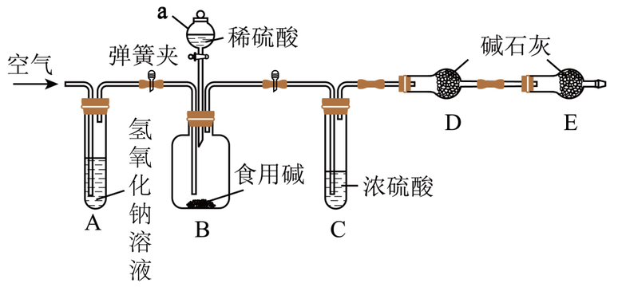

# Chemistry - 题目 188

**ID**: 32542afb5f964565a827aea9132f205d
**年级**: Grade 10
**难度**: Medium-Hard
**题型**: Calculation

## 题目
某种市售食用碱是纯碱与小苏打的混合物，可广泛应用于食品加工，如面条、面包、馒头等，某校化学兴趣小组利用如图所示装置(夹持装置已省略)进行实验测定此种食用碱中纯碱的质量分数。​​​​​​​‌实验步骤：①检验装置的气密性，称取样品(仅由纯碱与小苏打组成)10g，加到装置B中并塞紧橡胶塞；②打开弹簧夹，先通一段时间空气后，关闭弹簧夹，打开分液漏斗活塞滴入稀硫酸至不再有气体生成；③关闭分液漏斗的活塞，打开弹簧夹，继续通入一段时间空气。实验中记录的数据如下表：实验装置CD实验前称得的质量/g30.0120.4实验后称得的质量/g31.4124.8回答下列问题：（1）仪器a的名称为。（2）装置A的作用为；实验结束后，需要继续通入一段时间的空气，其目的为。（3）装置B中稀硫酸与小苏打反应的离子方程式为。（4）装置E的作用是。（5）通过实验装置D的数据计算，设由Na_{2}CO_{3}产生的CO_{2}质量为m g，由NaHCO_{3}产生的CO_{2}质量为n g，则 $\begin{cases}m+n=4.4{\rm{g}}\quad {\rm{C}}{\rm{O}}{{}_{2}}质量\\{\rm{\_}}{\rm{\_}}{\rm{\_}}{\rm{\_}}{\rm{\_}}{\rm{\_}}=10{\rm{g}}\quad 样品质量（只需列出表达式）\end{cases}$ ，联立可求出各成分质量。（6）该兴趣小组受该实验启发，又提出以下实验方案，其中也能测定混合物中纯碱质量分数的是(填字母)。

## 解答

1. （1）仪器a的名称为分液漏斗；
2. （2）根据分析，装置A的作用为除去空气中的CO_{2}，防止影响实验；实验结束后，需要继续通入一段时间的空气，其目的为将装置内的CO_{2}全部赶到装置D中，保证产生的CO_{2}被全部吸收；
3. （3）装置B中稀硫酸与小苏打反应生成二氧化碳和水，离子方程式为 ${\rm H^{+}+}{\rm{H}}{\rm{C}}{\rm{O}}{{}_{3}^{-}}={\rm H_{2}O+CO_{2}↑}$ ；
4. （4）根据分析，装置E的作用是防止空气中的水蒸气和CO_{2}进入装置D；
5. （5）通过实验装置D的数据计算，设由Na_{2}CO_{3}产生的CO_{2}质量为m g，由NaHCO_{3}产生的CO_{2}质量为n g，则 $\begin{cases}m+n=124.8-120.4=4.{{4}}{\rm{\;}}{\rm{g}}\quad {\rm{C}}{\rm{O}}{{}_{2}}质量\\\frac {106m}{44}+\frac {84n}{44}={{1}}{{0}}{\rm{\;}}{\rm{g}}\quad 样品质量（只需列出表达式）\end{cases}$ ，联立可求出各成分质量；
6. （6）A．可利用固体的质量差计算NaHCO_{3}的质量，再计算Na_{2}CO_{3}的质量，能测定出Na_{2}CO_{3}和NaHCO_{3}的混合物中Na_{2}CO_{3}质量分数，A正确；a、b均为混合物的质量，无法计算，不能测定出Na_{2}CO_{3}和NaHCO_{3}的混合物中Na_{2}CO_{3}质量分数，B错误；蒸干得到b g固体为NaCl，可由混合物的质量、NaCl的质量列二元一次方程组计算Na_{2}CO_{3}的质量，能测定出Na_{2}CO_{3}和NaHCO_{3}的混合物中Na_{2}CO_{3}质量分数，C正确；

## 知识点

**中文**:
  - 利用简单方程（组）计算
  - 离子方程式的书写及正误判断

**English**:
  - Calculation using Simple Equations
  - Writing and Verifying Ionic Equations

---
