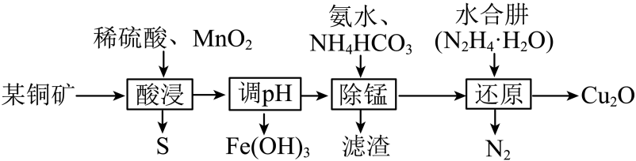

# Chemistry - 题目 260

**ID**: f49b60d557aa460ca61b681049af14b2
**年级**: Grade 10
**难度**: Medium-Hard
**题型**: Calculation

## 题目
氧化亚铜主要用于制造船底防污漆(用来杀死低级海生动物)、杀虫剂，以及各种铜盐、分析试剂、红色玻璃，还用于镀铜及镀铜合金溶液的配制。​​​​​​​‌用某铜矿(主要含CuS、FeO)制备Cu_{2}O的一种工艺流程如图：已知： $Ⅰ$ ．常温下，相关金属离子生成氢氧化物沉淀的pH见表：氢氧化物${\rm{C}}{\rm{u}}\left ({{\rm{O}}{\rm{H}}}\right ){{}_{2}}$${\rm{F}}{\rm{e}}\left ({{\rm{O}}{\rm{H}}}\right ){{}_{3}}$${\rm{F}}{\rm{e}}\left ({{\rm{O}}{\rm{H}}}\right ){{}_{2}}$${\rm{M}}{\rm{n}}\left ({{\rm{O}}{\rm{H}}}\right ){{}_{2}}$开始沉淀的pH4.81.97.58.8沉淀完全的pH6.43.29.710.4$Ⅱ$ ．空气中Cu_{2}O能缓慢被氧化为CuO。$Ⅲ{\rm ．Fe^{2+}}$ 有还原性，Fe^{3+}有氧化性。请回答下列问题：（1）为提高铜元素的浸出率，工艺上可采取的措施有(填字母)。

## 解答

1. （1）A．将铜矿粉碎并搅拌，能够增大固液接触面积，加快反应速率，可以提高铜元素的浸出率，A符合题意；增加铜矿的投料量并没有改变铜矿的浓度，反应速率不变，不能提高铜元素的浸出率，B不合题意；适当提高硫酸浓度能够加快反应速率，可以提高铜元素的浸出率，C符合题意；适当缩短反应时间将使反应不充分，铜元素的浸出率不能提高反而降低，D不合题意；
2. 故答案为：AC；
3. （2）CuS中S显-2价，根据流程可知，“酸浸”过程中得到硫单质，S元素化合价升高，因此MnO_{2}作氧化剂，其反应方程式为MnO_{2}+CuS+2H_{2}SO_{4}=S↓+MnSO_{4}+CuSO_{4}+2H_{2}O，故答案为：作氧化剂；MnO_{2}+CuS+2H_{2}SO_{4}=S↓+MnSO_{4}+CuSO_{4}+2H_{2}O；
4. （3）由分析可知，滤渣的主要成分是MnCO_{3}，滤渣洗涤烘干后可留作其他用途，该滤渣表面含有可溶性杂质硫酸铵，故确定滤渣已洗涤干净的方法是取最后一次洗涤滤液少许于一试管，向其中加入稀盐酸酸化后再加入BaCl_{2}溶液，没有明显现象，故答案为：MnCO_{3}；取最后一次洗涤滤液少许于一试管，向其中加入稀盐酸酸化后再加入BaCl_{2}溶液，没有明显现象；
5. （4）Cu元素以Cu(NH_{3})_{4}(OH)_{2}形式存在，与水合肼发生氧化还原反应，得到Cu_{2}O和氮气，其发生化学反应方程式为4Cu(NH_{3})_{4}(OH)_{2}+N_{2}H_{4}•H_{2}O+9H_{2}O=2Cu_{2}O↓+N_{2}↑+16NH_{3}•H_{2}O；水合肼浓度大于3.25mol/L时，Cu_{2}O的产率下降，[Cu(NH_{3})_{4}]^{2+}的转化率仍增大，可能的原因是Cu_{2}O被N_{2}H_{4}•H_{2}O进一步还原成铜单质，故答案为：Cu_{2}O被N_{2}H_{4}•H_{2}O进一步还原成铜单质；
6. （5）①由得失电子守恒可得关系式5Cu_{2}O~10Fe^{2+}~2KMnO_{4}，由题意可知，25.00mL样品溶解后的溶液平均消耗了10.00×10^{-3}L×1.0000mol•L^{-1}=0.010mol KMnO_{4}，即Cu_{2}O的物质的量为： $\frac {5}{2}{\rm n(KMnO_{4})=}$  $\frac {5}{2}{\rm ×0.010mol=0.025mol}$ ，故样品中Cu_{2}O的纯度为 $\frac {0.025{\rm{m}}{\rm{o}}{\rm{l}}{\rm{×}}144{\rm{g}}{\rm{/}}{\rm{m}}{\rm{o}}{\rm{l}}{\rm{×}}\frac {100{\rm{m}}{\rm{L}}}{25.00{\rm{m}}{\rm{L}}}}{16.00{\rm{g}}}{\rm ×100}$ %=90%，故答案为：90%；
7. ②相同的样品用不同的方法测定纯度，化学分析测定的结果相对偏低，可能造成纯度差异的原因是量取溶液和滴定过程中，亚铁离子被氧化，导致滴定时所用高锰酸钾标准溶液的体积偏小，测定结果偏低。

## 知识点

**中文**:
  - 晶体的洗涤
  - 陌生氧化还原反应方程式的书写
  - 酸碱中和滴定的拓展应用

**English**:
  - Washing of Crystals
  - Writing Equations for Unfamiliar Redox Reactions
  - Extended Applications of Titration

---
