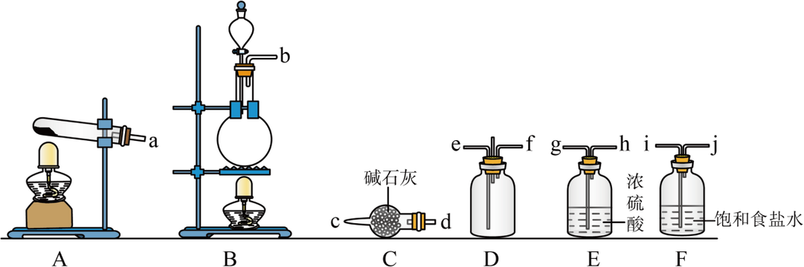
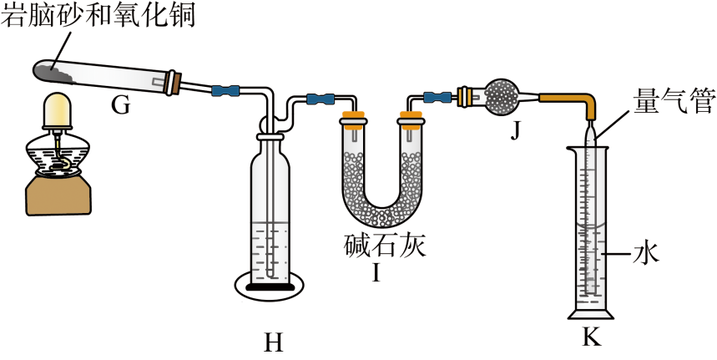

# Chemistry - 题目 37

**ID**: 0f4aea9f3649401899d5bb3bfb0c2f81
**年级**: Grade 10
**难度**: Medium-Hard
**题型**: 非选择题

## 题目
氮及其化合物在工农业生产和生活中有着重要作用。​​​​​​​‌有资料显示过量的氨气和氯气在常温下可合成 ${\rm{N}}{\rm{H}}{{}_{4}}{\rm{C}}{\rm{l}}$ (岩脑砂的主要成分)，某实验小组对该反应进行探究，并对岩脑砂进行元素测定，回答下列问题：Ⅰ ${\rm ．}{\rm{N}}{\rm{H}}{{}_{4}}{\rm{C}}{\rm{l}}$ 的制备：（1）利用装置B制取实验所需的氯气，写出该反应的化学方程式。（2）装置C的名称为。（3）为了使氨气和氯气在D中充分混合，请确定上述装置的合理连接顺序：→e←f←h←g←(用小写字母和箭头表示，箭头方向与气流方向一致)。（4）该实验装置除了D处导管易堵塞外，还存在的不足之处是。（5）验证岩脑砂中所含 ${\rm{N}}{\rm{H}}{{}_{4}^{+}}$ 的操作为。Ⅱ．岩脑砂中元素的定量测定：准确称取ag岩脑砂，与足量的氧化铜混合加热，发生的反应为 $2{\rm{N}}{\rm{H}}{{}_{4}}{\rm{C}}{\rm{l}}+3{\rm{C}}{\rm{u}}{\rm{O}}\hspace{-0.5em}\begin{array}{}{\underline{{\underline{~\Delta ~}}}}\atop{}\end{array}\hspace{-0.5em}3{\rm{C}}{\rm{u}}+{\rm{N}}{{}_{2}}\uparrow +2{\rm{H}}{\rm{C}}{\rm{l}}\uparrow +3{\rm{H}}{{}_{2}}{\rm{O}}$ ，利用下列装置测定岩脑砂中氮元素和氯元素的质量之比(夹持装置省略)。（6）装置H中盛装的试剂是(填试剂名称)。（7）已知装置J中也装有碱石灰，其目的是。

## 解答

1. （1）装置B是制备氯气的发生装置，利用浓盐酸和二氧化锰加热反应得到，其发生反应的化学方程式 ${\rm{M}}{\rm{n}}{\rm{O}}{{}_{{{2}}}}{{+}}{{4}}{\rm{H}}{\rm{C}}{\rm{l}}{\rm{(}}浓{\rm{)}}{{\underline{\underline {\rm{~~~Δ~~~}}}}\atop{}}{\rm{M}}{\rm{n}}{\rm{C}}{\rm{l}}{{}_{{{2}}}}{{+}}{\rm{C}}{\rm{l}}{{}_{{{2}}}}\uparrow {{+}}{{2}}{\rm{H}}{{}_{{{2}}}}{\rm{O}}$ ；
2. （2）装置C的仪器名称是干燥管；
3. （3）A是制备氨气，C是干燥氨气，B是制备氯气，D是氨气和氯气反应发生装置，E为除掉氯气中水蒸气，F为除掉氯气中HCl杂质，因此为了使氨气和氯气在D中充分混合，上述装置的合理连接顺序为：a→d→c→e←f←h←g←j←i←b；
4. （4）该实验装置除了D处导管易堵塞外，还存在的不足之处是无尾气处理装置；
5. （5）验证岩脑砂中所含 ${\rm{N}}{\rm{H}}{{}_{{{4}}}^{{{+}}}}$ 的操作为：取少量岩脑砂于试管中，加少量蒸馏水溶解，再加入适量浓NaOH溶液并加热，若产生使湿润的红色石蕊试纸变蓝的气体，则含有 ${\rm{N}}{\rm{H}}{{}_{{{4}}}^{{{+}}}}$ ；
6. （6）为了测定岩脑砂中氮元素和氯元素的物质的量之比，则将生成的气体先干燥气体，接着用碱石灰吸收HCl气体，最后用量气管测定氮气体积，因此装置H中盛装的试剂为浓硫酸；
7. （7）根据题干信息H装置为了吸收反应产生的水蒸气，I中碱石灰的目的是吸收反应生成的HCl气体，为了保障Ⅰ中测量的HCl气体质量准确，需要排除干扰，因此J中碱石灰的作用是：防止装置K中的水蒸气进入装置I，影响实验结果。

## 知识点

**中文**:
  - 实验室制取氨气
  - 铵盐的性质与铵根离子的检验

**English**:
  - Laboratory Preparation of Ammonia
  - Properties of Ammonium Salts and Test for Ammonium Ion

---
