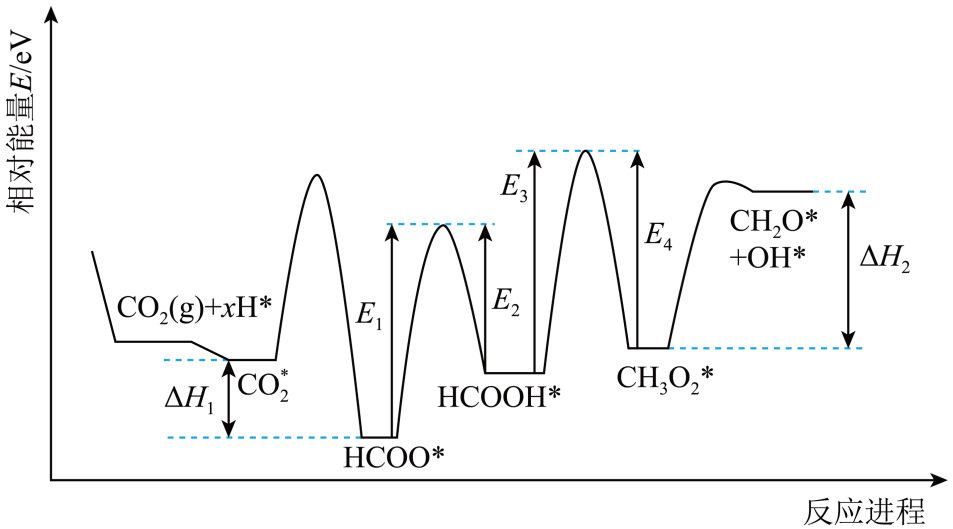
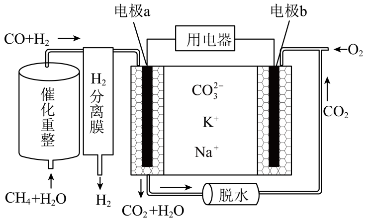

# Chemistry - 题目 338

**ID**: 2f1b8706a2404d28835dc22b71e1bfbf
**年级**: Grade 10
**难度**: Medium-Hard
**题型**: 非选择题

## 题目
“一碳化学”是指以碳单质或分子中含一个碳原子的物质(如 ${\rm{C}}{\rm{O}}{\rm{、}}{\rm{C}}{\rm{O}}{{}_{{{2}}}}{\rm{、}}{\rm{C}}{\rm{H}}{{}_{{{4}}}}{\rm{、}}{\rm{C}}{\rm{H}}{{}_{{{3}}}}{\rm{O}}{\rm{H}}$ 、 ${\rm{H}}{\rm{C}}{\rm{O}}{\rm{O}}{\rm{H}}$ 等)为原料合成工业产品的化学工艺，对开发新能源和控制环境污染有亚要意义。​​​​​​​‌回答下列问题：(1)我国用铜基催化剂，由 ${\rm{C}}{\rm{O}}{{}_{{{2}}}}$ 加氢制甲醇已工业化，部分反应历程如图所示(带*微粒为催化剂表面的吸附物种，氢原子没有全部标出)，由 ${\rm{H}}{\rm{C}}{\rm{O}}{\rm{O}}{^{{\rm{*}}}}\to {\rm{H}}{\rm{C}}{\rm{O}}{\rm{O}}{\rm{H}}{^{{\rm{*}}}}$ 过程的焓变 ${\rm{Δ}}{\rm{H}}{\rm{=}}$(将结果补充完整，用含 ${\rm{E}}{{}_{{{1}}}}、{\rm{E}}{{}_{{{2}}}}、{\rm{E}}{{}_{{{3}}}}、{\rm{E}}{{}_{{{4}}}}$ 的代数式表示，下同)， ${\rm{C}}{\rm{O}}{{}_{{{2}}}}{^{{\rm{*}}}}\to {\rm{C}}{\rm{H}}{{}_{{{2}}}}{\rm{O}}{^{{\rm{*}}}}{{+}}{\rm{O}}{\rm{H}}{^{{\rm{*}}}}$ 过程的焓变 ${\rm{Δ}}{\rm{H}}′={\rm{Δ}}{\rm{H}}{{}_{{{1}}}}{{+}}{\rm{Δ}}{\rm{H}}{{}_{{{2}}}}{{+}}$。(2) ${\rm{C}}{\rm{H}}{{}_{{{4}}}}{{-}}{\rm{C}}{\rm{O}}{{}_{{{2}}}}$ 催化重整技术制合成气是研究热点之一，发生的主要反应如下：主反应： ${\rm{C}}{\rm{H}}{{}_{{{4}}}}{\rm{(}}{\rm{g}}{\rm{)}}{{+}}{\rm{C}}{\rm{O}}{{}_{{{2}}}}{\rm{(}}{\rm{g}}{\rm{)}}{\rm{=}}{{2}}{\rm{C}}{\rm{O}}{\rm{(}}{\rm{g}}{\rm{)}}{{+}}{{2}}{\rm{H}}{{}_{{{2}}}}{\rm{(}}{\rm{g}}{\rm{)}}$ 　 ${\rm{Δ}}{\rm{H}}{{}_{{{1}}}}{\rm{=}}{{+}}{{2}}{{4}}{{7}}{{.}}{{4}}{\rm{k}}{\rm{J}}\cdot {\rm{m}}{\rm{o}}{\rm{l}}{^{{{-}}{{1}}}}$副反应： ${\rm{C}}{\rm{O}}{{}_{{{2}}}}{\rm{(}}{\rm{g}}{\rm{)}}{{+}}{\rm{H}}{{}_{{{2}}}}{\rm{(}}{\rm{g}}{\rm{)}}{\rm{=}}{\rm{C}}{\rm{O}}{\rm{(}}{\rm{g}}{\rm{)}}{{+}}{\rm{H}}{{}_{{{2}}}}{\rm{O}}{\rm{(}}{\rm{g}}{\rm{)}}$ 　 ${\rm{Δ}}{\rm{H}}{{}_{2}}{\rm{=}}{{+}}{{4}}{{1}}{{.}}{{2}}{\rm{k}}{\rm{J}}\cdot {\rm{m}}{\rm{o}}{\rm{l}}{^{{{-}}{{1}}}}$一定温度下，向某 ${{2}}{\rm{L}}$ 恒容密闭容器中充入 ${{1}}{\rm{m}}{\rm{o}}{\rm{l}}{\rm{\;}}{\rm{C}}{\rm{H}}{{}_{{{4}}}}$ 和 ${{2}}{\rm{m}}{\rm{o}}{\rm{l}}{\rm{\;}}{\rm{C}}{\rm{O}}{{}_{{{2}}}}$ ，使起始压强为 ${\rm{p}}{{}_{{{0}}}}$ ，${{3}}{{0}}{\rm{s}}$ 后上述主、副反应达到平衡，此时测得 ${\rm{C}}{\rm{O}}$ 的物质的量为 ${{1}}{{.}}{{7}}{\rm{m}}{\rm{o}}{\rm{l}}$ ， ${\rm{H}}{{}_{{{2}}}}{\rm{O}}$ 的物质的量为 ${{0}}{{.}}{{1}}{\rm{m}}{\rm{o}}{\rm{l}}$ 。①在 $0\sim 30{\rm{s}}$ 内，用 ${\rm{C}}{\rm{O}}{{}_{{{2}}}}$ 表示的平均反应速率 ${\rm{v}}\left ({{\rm{C}}{\rm{O}}{{}_{{{2}}}}}\right ){\rm{=}}$。②平衡时的总压强为(用含 ${\rm{p}}{{}_{{{0}}}}$ 的代数式表示)。③该温度下，副反应的压强平衡常数 ${\rm{K}}{{}_{{\rm{p}}}}{\rm{=}}$(用分数表示)。(3)通过集成甲烷催化重整与熔融碳酸盐燃料电池，可实现低碳产氢，原理示意图如下。①装置中催化重整的化学方程式为。②电极a为(填“正极”或“负极”)，写出 ${\rm{C}}{\rm{O}}$ 在该电极放电的电极反应式：。③若a极产物中 ${\rm{n}}\left ({{\rm{C}}{\rm{O}}{{}_{{{2}}}}}\right ){\rm{:}}{\rm{n}}\left ({{\rm{H}}{{}_{{{2}}}}{\rm{O}}}\right ){\rm{=}}{{5}}{\rm{:}}{{1}}$ ， ${\rm{H}}{{}_{{{2}}}}$ 分离膜中 ${\rm{H}}{{}_{{{2}}}}$ 吸收率约为(精确到 ${{0}}{{.}}{{1}}{\rm{\%}}$ )

## 解答

1. （1）根据图像， ${\rm{H}}{\rm{C}}{\rm{O}}{\rm{O}}{^{{\rm{*}}}}\to {\rm{H}}{\rm{C}}{\rm{O}}{\rm{O}}{\rm{H}}{^{{\rm{*}}}}$ 过程的焓变为 ${\rm{Δ}}{\rm{H}}{\rm{=}}$  ${\rm{E}}{{}_{{{1}}}}{{-}}{\rm{E}}{{}_{{{2}}}}$ ， ${\rm{H}}{\rm{C}}{\rm{O}}{\rm{O}}{\rm{H}}{^{{\rm{*}}}}\to {\rm{C}}{\rm{H}}{{}_{3}}{\rm{O}}{{}_{2}}{^{{\rm{*}}}}$ 过程的焓变为 ${\rm{Δ}}{\rm{H}}{\rm{=}}$  ${\rm{E}}{{}_{3}}{{-}}{\rm{E}}{{}_{4}}$ ，因此根据盖斯定律， ${\rm{C}}{\rm{O}}{{}_{{{2}}}}{^{{\rm{*}}}}\to {\rm{C}}{\rm{H}}{{}_{{{2}}}}{\rm{O}}{^{{\rm{*}}}}{{+}}{\rm{O}}{\rm{H}}{^{{\rm{*}}}}$ 过程的焓变 ${\rm{Δ}}{\rm{H}}^{′}={\rm{Δ}}{\rm{H}}{{}_{{{1}}}}{{+}}{\rm{Δ}}{\rm{H}}{{}_{{{2}}}}{\rm =}$  ${\rm{E}}{{}_{{{1}}}}{{-}}{\rm{E}}{{}_{{{2}}}}{\rm +}$  ${\rm{E}}{{}_{3}}{{-}}{\rm{E}}{{}_{4}}$ ，即 ${\rm{Δ}}{\rm{H}}^{′}={\rm{Δ}}{\rm{H}}{{}_{{{1}}}}{{+}}{\rm{Δ}}{\rm{H}}{{}_{{{2}}}}{\rm =}$  ${\rm{E}}{{}_{{{1}}}}{{+}}{\rm{E}}{{}_{{{3}}}}{{-}}{\rm{E}}{{}_{{{2}}}}{{-}}{\rm{E}}{{}_{{{4}}}}$ 。
2. （2）①平衡时， ${\rm{H}}{{}_{{{2}}}}{\rm{O}}$ 的物质的量为 ${{0}}{{.}}{{1}}{\rm{m}}{\rm{o}}{\rm{l}}$ ，则副反应生成 ${\rm{C}}{\rm{O}}$ 的物质的量为 ${{0}}{{.}}{{1}}{\rm{m}}{\rm{o}}{\rm{l}}$ ，消耗 ${\rm{C}}{\rm{O}}{{}_{{{2}}}}$ 的物质的量为 ${{0}}{{.}}{{1}}{\rm{m}}{\rm{o}}{\rm{l}}$ ；测得 ${\rm{C}}{\rm{O}}$ 的总物质的量为 ${{1}}{{.}}{{7}}{\rm{m}}{\rm{o}}{\rm{l}}$ ，则主反应生成 ${\rm{C}}{\rm{O}}$ 的物质的量为 ${{1}}{{.}}{{6}}{\rm{m}}{\rm{o}}{\rm{l}}$ ，消耗 ${\rm{C}}{\rm{O}}{{}_{{{2}}}}$ 的物质的量为 ${{0}}{{.}}{{8}}{\rm{m}}{\rm{o}}{\rm{l}}$ ；因此在 $0\sim 30{\rm{s}}$ 内，用 ${\rm{C}}{\rm{O}}{{}_{{{2}}}}$ 表示的平均反应速率 ${\rm{v}}\left ({{\rm{C}}{\rm{O}}{{}_{{{2}}}}}\right ){\rm{=}}\frac {{{0}}{{.}}{{9}}{\rm{m}}{\rm{o}}{\rm{l}}}{{{2}}{\rm{L}}\times {{0}}{{.}}{{5}}{\rm{m}}{\rm{i}}{\rm{n}}}{\rm{=}}{{0}}{{.}}{{9}}{\rm{m}}{\rm{o}}{\rm{l}}{\rm{/}}{\rm{(}}{\rm{L}}\cdot {\rm{m}}{\rm{i}}{\rm{n}}{\rm{)}}$ 。
3. ②根据①中分析，副反应生成 ${\rm{H}}{{}_{{{2}}}}{\rm{O}}$ 的物质的量为 ${{0}}{{.}}{{1}}{\rm{m}}{\rm{o}}{\rm{l}}$ ，主反应消耗 ${\rm{C}}{\rm{O}}{{}_{{{2}}}}$ 的物质的量为 ${{0}}{{.}}{{8}}{\rm{m}}{\rm{o}}{\rm{l}}$ ，因此平衡时， ${\rm{C}}{\rm{H}}{{}_{4}}$ 的物质的量为 ${{1}}{\rm{m}}{\rm{o}}{\rm{l}}{{-}}{{0}}{{.}}{{8}}{\rm{m}}{\rm{o}}{\rm{l}}{\rm{=}}{{0}}{{.}}{{2}}{\rm{m}}{\rm{o}}{\rm{l}}$ ， ${\rm{C}}{\rm{O}}{{}_{{{2}}}}$ 的物质的量为 ${{2}}{\rm{m}}{\rm{o}}{\rm{l}}{{-}}{{0}}{{.}}{{8}}{\rm{m}}{\rm{o}}{\rm{l}}{{-}}{{0}}{{.}}{{1}}{\rm{m}}{\rm{o}}{\rm{l}}{\rm{=}}{{1}}{{.}}{{1}}{\rm{m}}{\rm{o}}{\rm{l}}$ ， ${\rm{C}}{\rm{O}}$ 的物质的量为 ${{1}}{{.}}{{7}}{\rm{m}}{\rm{o}}{\rm{l}}$ ， ${\rm{H}}{{}_{{{2}}}}$ 的物质的量为 ${{2}}\times {{0}}{{.}}{{8}}{\rm{m}}{\rm{o}}{\rm{l}}{{-}}{{0}}{{.}}{{1}}{\rm{m}}{\rm{o}}{\rm{l}}{\rm{=}}{{1}}{{.}}{{5}}{\rm{m}}{\rm{o}}{\rm{l}}$ ， ${\rm{H}}{{}_{{{2}}}}{\rm{O}}$ 的物质的量分别为 ${{0}}{{.}}{{1}}{\rm{m}}{\rm{o}}{\rm{l}}$ ，则总压强为 ${\rm{p}}{\rm{=}}\frac {{\rm{(}}{{0}}{{.}}{{2}}{{+}}{{1}}{{.}}{{1}}{{+}}{{1}}{{.}}{{7}}{{+}}{{1}}{{.}}{{5}}{{+}}{{0}}{{.}}{{1}}{\rm{)}}{\rm{m}}{\rm{o}}{\rm{l}}}{{\rm{(}}{{1}}{{+}}{{2}}{\rm{)}}{\rm{m}}{\rm{o}}{\rm{l}}}{\rm{p}}{{}_{{{0}}}}{\rm{=}}\frac {{{2}}{{3}}}{{{1}}{{5}}}{\rm{p}}{{}_{{{0}}}}$ 。
4. ③平衡时气体的总物质的量为 ${\rm{n}}{\rm{=}}{\rm{(}}{{0}}{{.}}{{2}}{{+}}{{1}}{{.}}{{1}}{{+}}{{1}}{{.}}{{7}}{{+}}{{1}}{{.}}{{5}}{{+}}{{0}}{{.}}{{1}}{\rm{)}}{\rm{m}}{\rm{o}}{\rm{l}}{\rm{=}}{{4}}{{.}}{{6}}{\rm{m}}{\rm{o}}{\rm{l}}$ ，该温度下，副反应的压强平衡常数 ${\rm{K}}{{}_{{\rm{p}}}}{\rm{=}}\frac {{\rm{p}}{\rm{(}}{\rm{C}}{\rm{O}}{\rm{)}}{\rm{p}}{\rm{(}}{\rm{H}}{{}_{{{2}}}}{\rm{O}}{\rm{)}}}{{\rm{p}}{\rm{(}}{\rm{H}}{{}_{{{2}}}}{\rm{)}}{\rm{p}}{\rm{(}}{\rm{C}}{\rm{O}}{{}_{{{2}}}}{\rm{)}}}{\rm{=}}\frac {\frac {{{1}}{{.}}{{7}}{\rm{m}}{\rm{o}}{\rm{l}}}{{{4}}{{.}}{{6}}{\rm{m}}{\rm{o}}{\rm{l}}}{\rm{p}}\times \frac {{{0}}{{.}}{{1}}{\rm{m}}{\rm{o}}{\rm{l}}}{{{4}}{{.}}{{6}}{\rm{m}}{\rm{o}}{\rm{l}}}{\rm{p}}}{\frac {{{1}}{{.}}{{1}}{\rm{m}}{\rm{o}}{\rm{l}}}{{{4}}{{.}}{{6}}{\rm{m}}{\rm{o}}{\rm{l}}}{\rm{p}}\times \frac {{{1}}{{.}}{{5}}{\rm{m}}{\rm{o}}{\rm{l}}}{{{4}}{{.}}{{6}}{\rm{m}}{\rm{o}}{\rm{l}}}{\rm{p}}}{\rm{=}}{{0}}{{.}}{{1}}{{0}}{{3}}$ 。
5. （3）①根据反应原理图可知， ${\rm{C}}{\rm{H}}{{}_{4}}$ 与水催化重整生成 ${\rm{C}}{\rm{O}}$ 和 ${\rm{H}}{{}_{{{2}}}}$ ，化学方程式为 ${\rm{C}}{\rm{H}}{{}_{{{4}}}}{{+}}{\rm{H}}{{}_{{{2}}}}{\rm{O}}{\mathop {{\rm{=}}}\limits_{}^{催化剂}}{\rm{C}}{\rm{O}}{{+}}{{3}}{\rm{H}}{{}_{{{2}}}}$ 。
6. ②熔融碳酸盐燃料电池中，电极a通入 ${\rm{C}}{\rm{O}}$ 和 ${\rm{H}}{{}_{{{2}}}}$ ，失电子发生氧化反应，为原电池的负极； ${\rm{C}}{\rm{O}}$ 在该电极失电子与 ${\rm{C}}{\rm{O}}{{}_{{{3}}}^{{{2}}{{-}}}}$ 还原生成 ${\rm{C}}{\rm{O}}{{}_{{{2}}}}$ ，电极反应式为 ${\rm{C}}{\rm{O}}{{-}}{{2}}{\rm{e}}{^{{{-}}}}{{+}}{\rm{C}}{\rm{O}}{{}_{{{3}}}^{{{2}}{{-}}}}{\rm{=}}{{2}}{\rm{C}}{\rm{O}}{{}_{{{2}}}}$ 。
7. ③根据反应 ${\rm{C}}{\rm{H}}{{}_{{{4}}}}{{+}}{\rm{H}}{{}_{{{2}}}}{\rm{O}}{\mathop {{\rm{=}}}\limits_{}^{催化剂}}{\rm{C}}{\rm{O}}{{+}}{{3}}{\rm{H}}{{}_{{{2}}}}$ 可知 ${\rm{n}}\left ({{\rm{C}}{\rm{O}}}\right ){\rm{:}}{\rm{n}}\left ({{\rm{H}}{{}_{{{2}}}}}\right ){\rm{=}}{{1}}{\rm{:}}{{3}}$ ；a极通入 ${\rm{C}}{\rm{O}}$ 和 ${\rm{H}}{{}_{{{2}}}}$ ，电极反应为 ${\rm{C}}{\rm{O}}{{-}}{{2}}{\rm{e}}{^{{{-}}}}{{+}}{\rm{C}}{\rm{O}}{{}_{{{3}}}^{{{2}}{{-}}}}{\rm{=}}{{2}}{\rm{C}}{\rm{O}}{{}_{{{2}}}}$ 、 ${\rm{H}}{{}_{{{2}}}}{{-}}{{2}}{\rm{e}}{^{{{-}}}}{{+}}{\rm{C}}{\rm{O}}{{}_{{{3}}}^{{{2}}{{-}}}}{\rm{=}}{\rm{H}}{{}_{{{2}}}}{\rm{O}}{{+}}{\rm{C}}{\rm{O}}{{}_{{{2}}}}$ ，若产物中 ${\rm{n}}\left ({{\rm{C}}{\rm{O}}{{}_{{{2}}}}}\right ){\rm{:}}{\rm{n}}\left ({{\rm{H}}{{}_{{{2}}}}{\rm{O}}}\right ){\rm{=}}{{5}}{\rm{:}}{{1}}$ ，则消耗 ${\rm{C}}{\rm{O}}$ 和 ${\rm{H}}{{}_{{{2}}}}$ 的物质的量之比为 ${\rm{n}}\left ({{\rm{C}}{\rm{O}}}\right ){\rm{:}}{\rm{n}}\left ({{\rm{H}}{{}_{{{2}}}}}\right ){\rm{=}}{{2}}{\rm{:}}{{1}}$ ，因此 ${\rm{H}}{{}_{{{2}}}}$ 分离膜中 ${\rm{H}}{{}_{{{2}}}}$ 吸收率约为 $\frac {{{3}}{{-}}\frac {{{1}}}{{{2}}}}{{{3}}}\times {{1}}{{0}}{{0}}{\rm{\%}}{\rm{=}}{{8}}{{3}}{{.}}{{3}}{\rm{\%}}$ 。

## 知识点

**中文**:
  - 化学反应原理

**English**:
  - Chemical Reaction Principles

---
