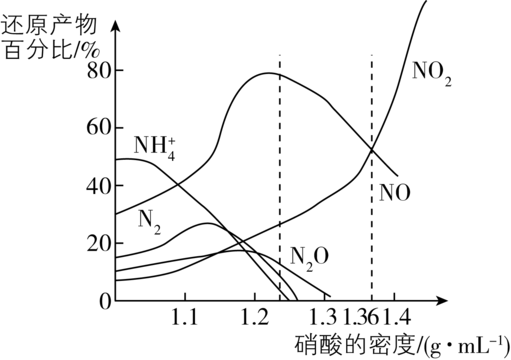

# Chemistry - 题目 66

**ID**: 3a0cd47e565542f183f1f16d60641d2c
**年级**: Grade 10
**难度**: Medium-Hard
**题型**: Multiple-choice

## 题目
（福建福州八县一中高一期末）如图表示铁与不同密度硝酸反应时，还原产物百分比与硝酸密度的关系，下列说法不正确的是（      ）​​​​​​​‌

## 解答

1. 根据图像可知，随硝酸密度的变化，还原产物不同，在硝酸密度为1.4 g·mL^{－}^{1}时，主要还原产物为NO_{2}，当密度为1.36 g·mL^{－}^{1}时，主要还原产物是NO_{2}和NO，当HNO_{3}的密度降到1.1 g·mL^{－}^{1}时，NH_{4}^{＋}成为主要还原产物，故A正确；用一定量的铁粉与足量HNO_{3}溶液反应得到标准状况下气体2.24 L即物质的量为0.1 mol，铁转化为硝酸铁，则硝酸一部分显酸性，一部分显氧化性生成还原产物，由于还原产物为0.1 mol，则参加反应的HNO_{3}的物质的量一定大于0.1 mol，故B错误；还原产物中NO_{2}的百分比随硝酸密度增大而增大，在硝酸密度为1.4 g·mL^{－}^{1}时，主要产物为NO_{2}，则硝酸的密度越大，其还原产物中高价态的成分所占比例越多，故C正确；当硝酸的密度为1.36 g·mL^{－}^{1}时，由图像可看出，生成的NO和NO_{2}所占百分比相等，反应的化学方程式为4Fe＋18HNO_{3}$\begin{array}{}{\underline{{\underline{{\rm{\;}}{\rm{\;}}{\rm{\;}}{\rm{\;}}{\rm{\;}}{\rm{\;}}{\rm{\;}}}}}}\\\;\end{array}$ 4Fe(NO_{3})_{3}＋3NO↑＋3NO_{2}↑＋9H_{2}O，故D正确。

## 知识点

**中文**:
  - 硝酸的化学性质

**English**:
  - Chemical Properties of Nitric Acid

---
