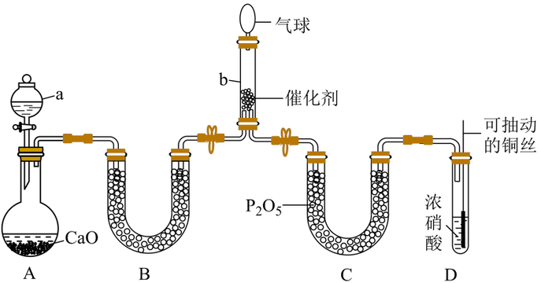

# Chemistry - 题目 124

**ID**: 3deac71d88a24b45a29a329fa199112b
**年级**: Grade 10
**难度**: Medium-Hard
**题型**: 非选择题

## 题目
${\rm{N}}{\rm{O}}{{}_{2}}$ 是大气污染物之一，实验探究用 ${\rm{N}}{\rm{H}}{{}_{3}}$ 还原 ${\rm{N}}{\rm{O}}{{}_{2}}$ 的装置如图所示(夹持仪器已略去，不考虑 ${\rm{H}}{\rm{N}}{\rm{O}}{{}_{3}}$ 挥发)。​​​​​​​‌（1）仪器a的名称是，其中所盛试剂主要成分的化学式是。（2）装置 ${\rm B}$ 中 ${\rm U}$ 形管内盛装的试剂名称是。（3）装置 ${\rm D}$ 中试管内发生反应的化学方程式为，反应的现象是，装置中铜丝可以抽动的优点是。（4）硬质玻璃管b中反应生成两种对环境友好的物质，反应的化学方程式为，b中观察到的现象是。

## 解答

1. （1）仪器a的名称是分液漏斗，其中所盛试剂主要成分的化学式是： ${\rm{N}}{\rm{H}}{{}_{3}}\cdot {\rm{H}}{{}_{2}}{\rm{O}}$ ；
2. （2）根据分析，装置 ${\rm B}$ 中 ${\rm U}$ 形管内盛装的试剂名称是：碱石灰；
3. （3）装置 ${\rm D}$ 中铜和浓硝酸反应制备NO_{2}，化学方程式为： ${\rm{C}}{\rm{u}}+4{\rm{H}}{\rm{N}}{\rm{O}}{{}_{3}}($ 浓 $)={\rm{C}}{\rm{u}}({\rm{N}}{\rm{O}}{{}_{3}}){{}_{2}}+2{\rm{N}}{\rm{O}}{{}_{2}}\uparrow +2{\rm{H}}{{}_{2}}{\rm{O}}$ ，反应的现象是：铜丝表面有气泡产生，试管上部有红棕色气体，溶液呈蓝色，铜丝逐渐溶解，装置中铜丝可以抽动的优点是：方便控制反应的发生与停止；
4. （4）根据题意，b中反应的化学方程式为： ${\rm 8NH_{3}+6NO_{2}}\hspace{-0.5em}\begin{array}{}{\underline{{\underline{~~催化剂~~}}}}\atop{}\end{array}\hspace{-0.5em}{\rm 7N_{2}+12H_{2}O}$ ；b中观察到的现象是：气体红棕色逐渐变浅(或变为无色)，玻璃管内壁有液滴。

## 知识点

**中文**:
  - 二氧化氮的性质
  - 氨的理化性质
  - 硝酸的强氧化性

**English**:
  - Properties of Nitrogen Dioxide
  - Physicochemical Properties of Ammonia
  - Strong Oxidizing Property of Nitric Acid

---
