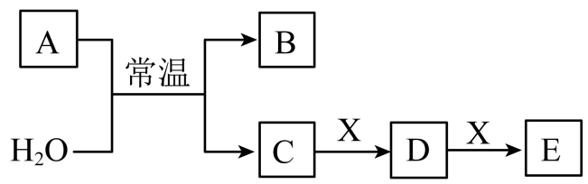

# Chemistry - 题目 103

**ID**: 3ea7d0a4578049ea8ed3bebc773beb73
**年级**: Grade 10
**难度**: Medium-Hard
**题型**: 非选择题

## 题目
A、B、C、D、E、X是中学常见的无机物，存在如图转化关系(部分生成物和反应条件略去)。​​​​​​​‌Ⅰ．若A为一种淡黄色粉末，且A为化合物，回答下列问题：(1)A与 ${\rm{H}}{{}_{2}}{\rm{O}}$ 反应的化学方程式为。(2)若X为具有较强还原性的非金属单质，通常为黑色粉末，写出D的化学式。(3)若X为一种造成温室效应的气体，则鉴别等浓度的D、E两种溶液，可选择的试剂为。

## 解答

1. （1）由分析可知，A为Na_{2}O_{2}，Na_{2}O_{2}与水反应生成NaOH和O_{2}，反应的化学方程式为：2Na_{2}O_{2}+2H_{2}O=4NaOH+O_{2}↑；
2. （2）若X为强还原性的非金属单质，通常为黑色粉末，则X为碳单质，对应的产物C为O_{2}，D为CO_{2}；
3. （3）若X为一种造成温室效应的气体，则X为CO_{2}，对应的产物C为NaOH，D为Na_{2}CO_{3}，E为NaHCO_{3}，则：
4. A．将NaCl溶液分别加入至Na_{2}CO_{3}和NaHCO_{3}溶液均无明显现象，无法鉴别，A不符合题意；
5. B．分别向Na_{2}CO_{3}和NaHCO_{3}溶液中加入同浓度的盐酸溶液，Na_{2}CO_{3}溶液中开始时无气泡产生，后逐渐产生气泡，而NaHCO_{3}溶液中一开始就有气泡产生，两者现象不同，可鉴别，B符合题意；
6. C．将Ca(OH)_{2}溶液分别加入至Na_{2}CO_{3}和NaHCO_{3}溶液均生成白色沉淀，无法鉴别，C不符合题意；
7. D．加入酚酞溶液后，溶液均变红，但Na_{2}CO_{3}溶液的红色比NaHCO_{3}溶液深，可鉴别，D符合题意；
8. 故选BD；
9. （4）若A为黄绿色气体，则A为Cl_{2}，Cl_{2}与水反应生成HCl和HClO，故将气体A持续通入紫色石蕊试液中，导致溶液变为红色的微粒Ⅰ是H^{+}，生成的HClO具有漂白性，能漂白红色石蕊试液，则Ⅱ是HClO，当Cl_{2}过量时将使溶液变为浅黄绿色，则Ⅲ是Cl_{2}；
10. （5）气体A为Cl_{2}，新配制A的水溶液久置易变质，发生反应： ${\rm Cl_{2}+H_{2}O}\rightleftharpoons {\rm HCl+HClO}$ 、 ${\rm 2HClO}{\mathop {=}\limits_{}^{光照}}{\rm 2HCl+O_{2}↑}$ ，新配制A的水溶液具有强氧化性、漂白性和酸性，而久置变质后的溶液只有酸性，故可用紫色石蕊试液来检验该溶液是否已经完全变质，加入紫色石蕊试液，若溶液先变红后褪色，说明未完全变质；若溶液变红后不褪色，说明已经完全变质，而该溶液是否已经完全变质，加入硝酸银溶液均能产生白色沉淀，加入酚酞溶液均无明显现象，加入碳酸钠溶液均能产生气泡，故选D；
11. （6）由分析可知，若C溶液显强酸性，则C为HCl，则：
12. A．HCl与NaHCO_{3}l反应生成NaCl、CO_{2}和H_{2}O，三者均不能继续与NaHCO_{3}反应，A不符合题意；
13. B．HCl与Na_{2}CO_{3}反应生成CO_{2}，CO_{2}与Na_{2}CO_{3}、H_{2}O反应生成NaHCO_{3}，B符合题意；
14. C．HCl与Na_{2}SO_{4}不反应，C不符合题意；
15. D．HCl与Al(OH)_{3}反应生成AlCl_{3}和H_{2}O，二者均不能继续与Al(OH)_{3}反应，D不符合题意；
16. 故选B。

## 知识点

**中文**:
  - 氯气与水的反应
  - 碳酸钠与碳酸氢钠的性质对比
  - 碳酸钠与碳酸氢钠的鉴别、除杂、转化

**English**:
  - Reaction with Water
  - Comparison of Properties
  - Identification, Impurity Removal, and Transformation

---
