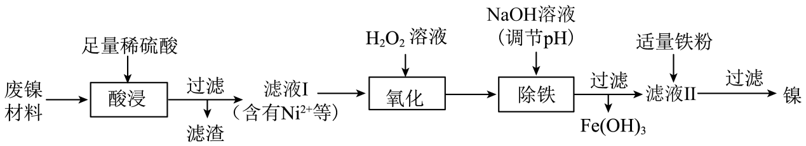

# Chemistry - 题目 65

**ID**: 3f029ded7bdc40fb8776f40c3b1776c7
**年级**: Grade 10
**难度**: Medium-Hard
**题型**: 非选择题

## 题目
兴趣小组利用某废镍材料(含有金属Ni及少量Fe、Cu)回收金属镍，设计流程如图所示(部分产物略去)。​​​​​​​‌请分析作答：(1)过滤操作过程中玻璃棒的作用是。(2)已知金属Ni的活动性介于铁和锡之间，请任意写出一个“酸浸”时发生反应的化学方程式：。(3)过氧化氢具有氧化性，“氧化”时发生反应的化学方程式为 $2{\rm{F}}{\rm{e}}{\rm{S}}{\rm{O}}{{}_{4}}+{\rm{H}}{{}_{2}}{\rm{S}}{\rm{O}}{{}_{4}}+{\rm{H}}{{}_{2}}{\rm{O}}{{}_{2}}={\rm{F}}{\rm{e}}{{}_{2}}\left ({{\rm{S}}{\rm{O}}{{}_{4}}}\right ){{}_{3}}+2{\rm{X}}$ ，则X的化学式为。(4)已知 ${\rm{F}}{\rm{e}}{^{3+}}$ 和 ${\rm{N}}{\rm{i}}{^{2+}}$ 开始沉淀和完全沉淀时的pH如表所示，“除铁”过程中加入NaOH溶液调节pH范围应是，目的是。离子开始沉淀时的pH完全沉淀时的pH${\rm{F}}{\rm{e}}{^{3+}}$2.73.2${\rm{N}}{\rm{i}}{^{2+}}$7.28.7

## 解答

1. （1）过滤时，玻璃棒的作用为引流；
2. （2）在金属活动性顺序中，铁>镍>氢>铜，则铁能与硫酸反应生成硫酸亚铁和氢气，镍能与硫酸反应生成硫酸镍和氢气，反应的化学方程式为Fe+H_{2}SO_{4}=FeSO_{4}+H_{2}↑或Ni+H_{2}SO_{4}=NiSO_{4}+H_{2}↑；
3. （3）反应前后，原子的种类和个数不变，等号左边有2Fe、3S、4H和14O，等号右边除2X外，有2Fe、3S和12O，则2X中含有4H和2O，则X的化学式为H_{2}O；
4. （4）由于Fe^{3+}完全沉淀时pH为3.2，而Ni^{2+}开始沉淀时的pH为7.2，则若想使Fe^{3+}完全沉淀而Ni^{2+}不沉淀，pH的范围为3.2~7.2。

## 知识点

**中文**:
  - 沉淀的溶解与生成
  - 物质分离和提纯的综合应用

**English**:
  - Dissolution and Formation of Precipitates
  - Comprehensive Applications

---
