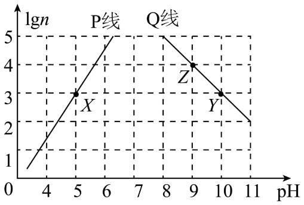

# Chemistry - 题目 254

**ID**: 4b7dd7cd03844687876a13757962b016
**年级**: Grade 10
**难度**: Medium-Hard
**题型**: Multiple-choice

## 题目
常温下，分别取未知浓度的NaOH和HA溶液，加水稀释至原体积的n倍。​​​​​​​‌稀释过程中，两溶液pH的变化如图所示。下列叙述正确的是（      ）

## 解答

1. A．根据图中分析P线代表HA的稀释图像，再根据lg n与pH变化分析稀释10倍pH变化不到1个单位，说明HA为弱酸，故A正确；
2. B．Y点pH=10，Z点pH=9，则Y点碱性更强，抑制水的电离能力更强，因此水电离程度更小，Z点pH=9，X点pH=5，两者抑制水的电离能力相同，水电离程度相等，因此X、Y、Z三点溶液中水的电离程度： Z =X＞Y，故B错误；
3. C．酸溶液无论稀释多少倍，pH始终小于7，不可能大于7，故C错误；
4. D．向HA的溶液中加入少量NaOH固体，则氢离子浓度减小，促进HA电离，但是 ${\rm{K}}{{}_{{\rm{a}}}}\left ({{\rm{H}}{\rm{A}}}\right )$ 只与温度有关，温度不变，其数值不变，故D错误；
5. 故选A。

## 知识点

**中文**:
  - 浓度对电离平衡的影响
  - 酸碱溶液稀释时pH的变化图像

**English**:
  - Effect of Concentration
  - pH Changes during Dilution

---
