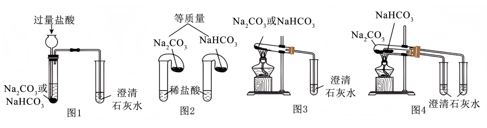
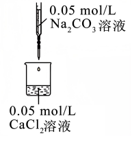
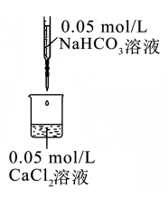
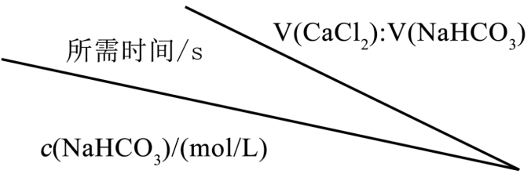

# Chemistry - 题目 206

**ID**: 5175ae3918274be795a1d1e1bb7e4240
**年级**: Grade 10
**难度**: Medium-Hard
**题型**: 非选择题

## 题目
某小组对碳酸钠和碳酸氢钠的性质进行探究，并测定混合物中碳酸氢钠的质量分数。​​​​​​​‌（1）碳酸钠和碳酸氢钠的鉴别与稳定性探究①图1、2所示实验，能够鉴别Na_{2}CO_{3}和NaHCO_{3}的是图(填“1”或“2”)，另一种装置不能鉴别碳酸钠和碳酸氢钠的理由是。②图(填“3”或“4”)能更好说明二者的稳定性，写出固体分解的化学方程式。（2）利用已鉴别出的NaHCO_{3}和Na_{2}CO_{3}，对“能否用CaCl_{2}鉴别NaHCO_{3}和Na_{2}CO_{3}”的问题进行探究。编号实验操作实验现象原因分析或离子方程式ⅠCa^{2+}与 ${\rm{C}}{\rm{O}}{{}_{{{3}}}^{{{2}}{{-}}}}$ 生成CaCO_{3}Ⅱ烧杯中产生白色沉淀和无色气泡反应的离子方程式：（3）该小组对NaHCO_{3}与CaCl_{2}的反应深入探究，利用气体压力传感器得到的部分实验数据如下：(注：CaCl_{2}溶液浓度相同，所需时间指容器内气体浓度达到10000ppm所需时间)1：52：54：51：11.01421241141560.53682642442840.258824503546320.1112613168161816由实验数据可得出的结论是：①当V(CaCl_{2})：V(NaHCO_{3})一定时，随着，气体逸出速率减小；②NaHCO_{3}浓度在0.1～1.0mol/L，V(CaCl_{2})与V(NaHCO_{3})的比值为时，气体逸出速率最快，可获得理想的实验观察效果。（4）加热10.00g的碳酸钠和碳酸氢钠的混合物，一段时间后，质量减少了2.48g且不再改变，则混合物中碳酸氢钠的质量分数为。

## 解答

1. （1）①等质量Na_{2}CO_{3}和NaHCO_{3}和足量盐酸反应时：Na_{2}CO_{3}+2HCl=2NaCl+H_{2}O+CO_{2}↑，NaHCO_{3}+HCl=NaCl+H_{2}O+CO_{2}↑，则是Na_{2}CO_{3}释放的二氧化碳少、且反应不够剧烈，NaHCO_{3}释放的二氧化碳多、且反应剧烈，则图1、2所示实验，能够鉴别Na_{2}CO_{3}和NaHCO_{3}的是图2，另一种装置即图1不能鉴别碳酸钠和碳酸氢钠的理由是：碳酸钠和碳酸氢钠都能与盐酸反应产生二氧化碳，均使澄清石灰水变浑浊。
2. ②Na_{2}CO_{3}稳定，受热不分解，而NaHCO_{3}不稳定受热易分解，因此若将稳定性比较强的Na_{2}CO_{3}放在温度高的外管，再将NaHCO_{3}放在温度比较低的内管进行实验，根据石灰水变浑浊的情况，更能比较二者的稳定性的强弱，即图4能更好说明二者的稳定性，固体分解的化学方程式： ${{2}}{\rm{N}}{\rm{a}}{\rm{H}}{\rm{C}}{\rm{O}}{{}_{{{3}}}}\hspace{-0.5em}\begin{array}{}{\underline{{\underline{~{\rm{Δ}}~}}}}\atop{}\end{array}\hspace{-0.5em}{\rm{N}}{\rm{a}}{{}_{{{2}}}}{\rm{C}}{\rm{O}}{{}_{{{3}}}}{{+}}{\rm{C}}{\rm{O}}{{}_{{{2}}}}\uparrow {{+}}{\rm{H}}{{}_{{{2}}}}{\rm{O}}$ 。
3. （2）实验Ⅰ中，Ca^{2+}与 ${\rm{C}}{\rm{O}}{{}_{{{3}}}^{{{2}}{{-}}}}$ 生成CaCO_{3}，则实验现象为：烧杯中产生白色沉淀；Ⅱ中，烧杯中产生白色沉淀和无色气泡，即生成了碳酸钙沉淀和二氧化碳气体，则反应的离子方程式： ${\rm 2}{\rm{H}}{\rm{C}}{\rm{O}}{{}_{{{3}}}^{{{-}}}}{\rm +Ca^{2+}=CaCO_{3}↓+H_{2}O+CO_{2}↑}$ ；
4. （3）①由表可知，当V(CaCl_{2})：V(NaHCO_{3})一定时，随着c(NaHCO_{3})的减小，容器内气体浓度达到10000ppm所需时间递增，即气体逸出速率减小；
5. ②由表可知，NaHCO_{3}浓度依次为1.0mol/L、0.0mol/L、0.25mol/L、0.1mol/L时，容器内气体浓度达到10000ppm所需时间的最少分别为114s、244s、354s、8146，对应的V(CaCl_{2})与V(NaHCO_{3})的比值均为4:5；则在0.1～1.0mol/L，V(CaCl_{2})与V(NaHCO_{3})的比值为4:5时，气体逸出速率最快，可获得理想的实验观察效果。
6. （4）加热10.00g的碳酸钠和碳酸氢钠的混合物， ${\rm{N}}{\rm{a}}{\rm{H}}{\rm{C}}{\rm{O}}{{}_{3}}$ 受热发生分解反应： $2{\rm{N}}{\rm{a}}{\rm{H}}{\rm{C}}{\rm{O}}{{}_{3}}\hspace{-0.5em}\begin{array}{}{\underline{{\underline{~\vartriangle ~}}}}\atop{}\end{array}\hspace{-0.5em}{\rm{N}}{\rm{a}}{{}_{2}}{\rm{C}}{\rm{O}}{{}_{3}}+{\rm{C}}{\rm{O}}{{}_{2}}\uparrow +{\rm{H}}{{}_{2}}{\rm{O}}$ ，而 ${\rm{N}}{\rm{a}}{{}_{2}}{\rm{C}}{\rm{O}}{{}_{3}}$ 不反应，一段时间后，质量减少了2.48g且不再改变，则 $m\left ({{\rm{N}}{\rm{a}}{\rm{H}}{\rm{C}}{\rm{O}}{{}_{3}}}\right )=\frac {84\times 2.48}{31}{\rm{g}}{\rm{=}}{{6}}{{.}}{{7}}{{2}}{\rm{g}}$ ，则混合物中碳酸氢钠的质量分数为 $\frac {{{6}}{{.}}{{7}}{{2}}{\rm{g}}}{10.00{\rm{g}}}\times {{1}}{{0}}{{0}}{\rm{\%}}{\rm{=}}{{6}}{{7}}{{.}}{{2}}{\rm{\%}}$ 。

## 知识点

**中文**:
  - 碳酸钠与碳酸氢钠的性质对比
  - 离子方程式的书写及正误判断
  - 碳酸钠与碳酸氢钠的鉴别、除杂、转化

**English**:
  - Comparison of Properties
  - Writing and Verifying Ionic Equations
  - Identification, Impurity Removal, and Transformation

---
