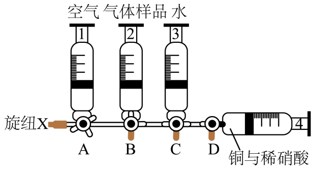

# Chemistry - 题目 287

**ID**: 5e55c271f723432b98255bde40566c90
**年级**: Grade 10
**难度**: Medium-Hard
**题型**: Multiple-choice

## 题目
利用三通阀进行气体的性质探究装置如图所示，先通过旋转阀门连通注射器2、4收集气体，再进行探究实验。​​​​​​​‌下列说法不正确的是

## 解答

1. A．装置4的反应中，稀硝酸与铜反应，生成硝酸铜、一氧化氮和水，硝酸体现出氧化性和酸性，A正确；B．注射器2中充满NO与注射器1中，空气中氧气反应生成红棕色NO_{2}气体，颜色改变，B错误；C．连通装置1、2实验后生成NO_{2}气体，再连通装置3，与水反应生成硝酸，C正确；D．装置4若换成浓氨水和碱石灰，会生成NH_{3}，可进行NH_{3}与空气和水反应的性质探究，D正确。

## 知识点

**中文**:
  - 氨的理化性质
  - 硝酸的强氧化性

**English**:
  - Physicochemical Properties of Ammonia
  - Strong Oxidizing Property of Nitric Acid

---
