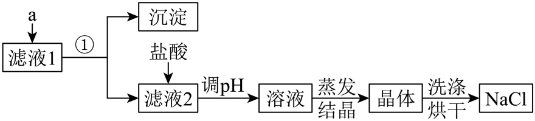
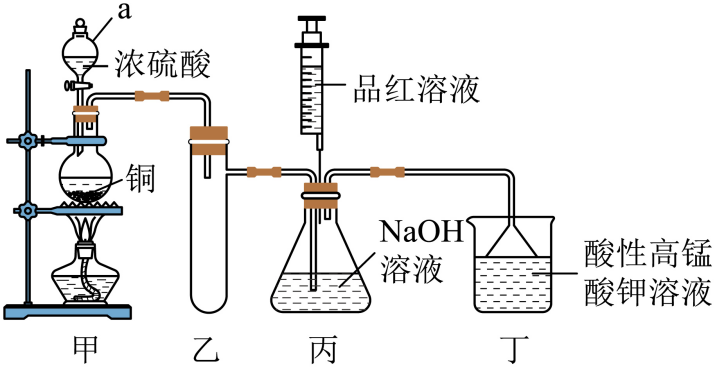

# Chemistry - 题目 276

**ID**: 5f925f0a87aa45ce82d9b21a0089c105
**年级**: Grade 10
**难度**: Medium-Hard
**题型**: 非选择题

## 题目
请回答下列问题：I．氯化钠是生活必需品，也是重要的化工原料。​​​​​​​‌小明查阅相关资料得知：粗盐中除含泥沙等不溶性杂质外，还含有少量的MgCl_{2}、CaCl_{2}、Na_{2}SO_{4}等可溶性杂质。为了得到较纯净的氯化钠，小明将上述流程图中滤液1做了如下处理：提供的试剂：Na_{2}CO_{3}溶液、K_{2}CO_{3}溶液、NaOH溶液、KOH溶液、BaCl_{2}溶液和NaCl溶液。(1)操作①的名称为，所需玻璃仪器为烧杯、玻璃棒、。(2)从提供的试剂中选择，a所代表的试剂顺序是、、NaOH溶液(各试剂均稍过量)。(3)实验结束后称量获得的NaCl，最终得到NaCl产率(填“偏大”“偏小”或“不变”)。Ⅱ．实验室用浓硫酸、铜与NaOH溶液为原料制取少量NaHSO_{3}(装置如图所示)。(4)仪器a的名称是。(5)写出装置甲中发生的化学方程式。(6)装置丁的作用有吸收尾气，防止环境污染；通过溶液颜色变化判断丙中NaOH完全转化为NaHSO_{3}和防倒吸的作用，写出丁装置反应的离子方程式。

## 解答

1. （1）操作①后得到固体沉淀和滤液2，操作①应为过滤；所需玻璃仪器有烧杯、玻璃棒、漏斗；
2. （2）①MgCl_{2}、CaCl_{2}、Na_{2}SO_{4}分别用过量的NaOH、Na_{2}CO_{3}、BaCl_{2}溶液除去，滴加三种试剂时，为把过量的钡离子除去，要使Na_{2}CO_{3}在BaCl_{2}后面加，因此a所代表的试剂顺序是BaCl_{2}溶液、Na_{2}CO_{3}溶液、NaOH溶液；
3. （3）结合分析可知，除去可溶性杂质过程中有一定的MgCl_{2}、CaCl_{2}、Na_{2}SO_{4}转化为NaCl，因此实验结束后称量获得的NaCl，最终得到NaCl产率偏大；
4. （4）仪器a的名称是分液漏斗；
5. （5）装置甲中铜和浓硫酸共热制备 ${\rm{S}}{\rm{O}}{{}_{2}}$ ，化学方程式为 ${\rm{C}}{\rm{u}}{{+}}{{2}}{\rm{H}}{{}_{{{2}}}}{\rm{S}}{\rm{O}}{{}_{{{4}}}}{\rm{(}}浓{\rm{)}}{\mathop {=}\limits_{}^{Δ}}CuSO{{}_{4}}+{\rm{S}}{\rm{O}}{{}_{2}}\uparrow {{+}}{{2}}{\rm{H}}{{}_{{{2}}}}{\rm{O}}$ ；
6. （6）装置丁中酸性高锰酸钾溶液吸收尾气 ${\rm{S}}{\rm{O}}{{}_{2}}$ ，离子方程式为 ${{5}}{\rm{S}}{\rm{O}}{{}_{2}}{{+}}{{2}}{\rm{M}}{\rm{n}}{\rm{O}}{{}_{4}^{-}}{{+}}2{\rm{H}}{{}_{{{2}}}}{\rm{O}}{\rm{=}}{{2}}{\rm{M}}{\rm{n}}{^{2+}}{{+}}{{5}}{\rm{S}}{\rm{O}}{{}_{4}^{2-}}{{+}}4{\rm{H}}{^{+}}$ 。

## 知识点

**中文**:
  - 亚硫酸及其盐
  - 粗盐提纯

**English**:
  - Sulfurous Acid and Sulfites
  - Purification of Crude Salt

---
