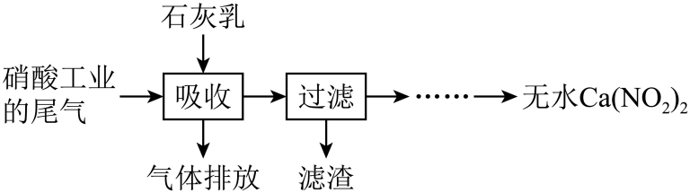
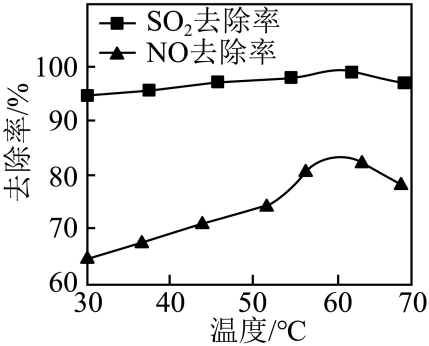

# Chemistry - 题目 108

**ID**: 63d2e96fca3b4ac5aac43058c397ce16
**年级**: Grade 10
**难度**: Medium-Hard
**题型**: 非选择题

## 题目
硫、氮的氧化物是大气的主要污染物，汽车尾气、工业废气、烟道气等均含有硫或氮元素的氧化物，以 ${\rm{S}}{\rm{O}}{{}_{2}}$ 和 ${\rm{N}}{\rm{O}}{{}_{x}}$ 为主要存在形式。​​​​​​​‌回答下列问题：Ⅰ．(1)研究 ${\rm{S}}{\rm{O}}{{}_{2}}$ 、 ${\rm{N}}{\rm{O}}{{}_{x}}$ 等性质对减少酸雨有重要作用，酸雨是指pH(填数值范围)的雨水。硝酸型酸雨的形成过程中涉及的化学方程式有：① ${\rm{N}}{{}_{2}}+{\rm{O}}{{}_{2}}\hspace{-0.5em}\begin{array}{}{\underline{{\underline{~~放电~~}}}}\atop{}\end{array}\hspace{-0.5em}2{\rm{N}}{\rm{O}}$ ；② $2{\rm{N}}{\rm{O}}+{\rm{O}}{{}_{2}}=2{\rm{N}}{\rm{O}}{{}_{2}}$ ；③，该过程属于(填“自然固氮”或“人工固氮”)。Ⅱ．利用石灰乳和硝酸工业的尾气(含NO、 ${\rm{N}}{\rm{O}}{{}_{2}}$ )反应，既能净化尾气，又能获得应用广泛的 ${\rm{C}}{\rm{a}}\left ({{\rm{N}}{\rm{O}}{{}_{2}}}\right ){{}_{2}}$ ，其部分工艺流程如图。(2)上述工艺中采用气-液逆流接触吸收(尾气从吸收塔底进入，石灰乳从吸收塔顶喷淋)，其目的是；滤渣可循环使用，滤渣的主要成分是(填化学式)。(3)生产中溶液需保持弱碱性，在酸性溶液中 ${\rm{C}}{\rm{a}}\left ({{\rm{N}}{\rm{O}}{{}_{2}}}\right ){{}_{2}}$ 会发生分解，产物之一是NO，其反应的离子方程式为。Ⅲ．有研究团队指出： ${\rm{N}}{\rm{a}}{\rm{C}}{\rm{l}}{\rm{O}}{{}_{2}}$ / ${\rm{H}}{{}_{2}}{\rm{O}}{{}_{2}}$ 酸性复合吸收剂可同时有效脱硫、脱硝。如图所示为复合吸收剂组成一定时，温度对脱硫、脱硝的影响。(4)温度高，NO去除率随温度升高而下降的原因为。(5)写出废气中的 ${\rm{S}}{\rm{O}}{{}_{2}}$ 与 ${\rm{N}}{\rm{a}}{\rm{C}}{\rm{l}}{\rm{O}}{{}_{2}}$ 反应的离子方程式：。

## 解答

1. （1）酸雨是指pH小于5.6的雨水。硝酸型酸雨的形成过程中涉及的化学方程式有：① ${\rm{N}}{{}_{2}}+{\rm{O}}{{}_{2}}\hspace{-0.5em}\begin{array}{}{\underline{{\underline{~~放电~~}}}}\atop{}\end{array}\hspace{-0.5em}2{\rm{N}}{\rm{O}}$ ；② $2{\rm{N}}{\rm{O}}+{\rm{O}}{{}_{2}}=2{\rm{N}}{\rm{O}}{{}_{2}}$ ；③ $3{\rm{N}}{\rm{O}}{{}_{2}}+{\rm{H}}{{}_{2}}{\rm{O}}=2{\rm{H}}{\rm{N}}{\rm{O}}{{}_{3}}+{\rm{N}}{\rm{O}}$ ，该过程属于：自然固氮；
2. （2）石灰乳从吸收塔顶喷淋，其目的是使尾气中的NO、 ${\rm{N}}{\rm{O}}{{}_{2}}$ 被充分吸收；滤渣可循环使用，滤渣的主要成分是： ${\rm{C}}{\rm{a}}\left ({{\rm{O}}{\rm{H}}}\right ){{}_{2}}$ ；
3. （3）在酸性溶液中 ${\rm{C}}{\rm{a}}\left ({{\rm{N}}{\rm{O}}{{}_{2}}}\right ){{}_{2}}$ 会发生分解，产物之一是NO，根据氧化还原反应原理，产物中含 ${\rm{N}}{\rm{O}}{{}_{{{3}}}^{{{-}}}}$ ，离子方程式为： $3{\rm{N}}{\rm{O}}{{}_{2}^{-}}+2{\rm{H}}{^{+}}={\rm{N}}{\rm{O}}{{}_{3}^{-}}+2{\rm{N}}{\rm{O}}\uparrow +{\rm{H}}{{}_{2}}{\rm{O}}$ ；
4. （4）H_{2}O_{2}受热易分解，温度高，NO去除率随温度升高而下降的原因为：温度升高， ${\rm{H}}{{}_{2}}{\rm{O}}{{}_{2}}$ 分解速率加快；
5. （5）废气中的 ${\rm{S}}{\rm{O}}{{}_{2}}$ 与 ${\rm{N}}{\rm{a}}{\rm{C}}{\rm{l}}{\rm{O}}{{}_{2}}$ 发生氧化还原反应，离子方程式为： $2{\rm{H}}{{}_{2}}{\rm{O}}+{\rm{C}}{\rm{l}}{\rm{O}}{{}_{2}^{-}}+2{\rm{S}}{\rm{O}}{{}_{2}}={\rm{C}}{\rm{l}}{^{-}}+2{\rm{S}}{\rm{O}}{{}_{4}^{2-}}+4{\rm{H}}{^{+}}$ 。

## 知识点

**中文**:
  - 二氧化氮的性质
  - 离子方程式的书写及正误判断

**English**:
  - Properties of Nitrogen Dioxide
  - Writing and Verifying Ionic Equations

---
