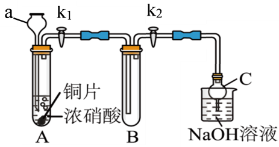
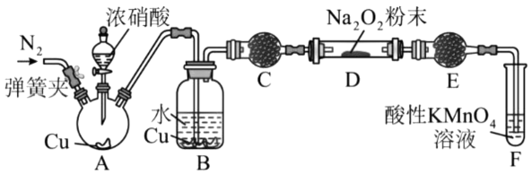

# Chemistry - 题目 285

**ID**: 704de4e9179b4f049e616d48458c0b62
**年级**: Grade 10
**难度**: Medium-Hard
**题型**: 非选择题

## 题目
某实验小组对NO、NO_{2}与Na_{2}O_{2}的反应进行探究。​​​​​​​‌Ⅰ．NO_{2}与Na_{2}O_{2}的反应【理论分析】根据化合价升降原则，Na_{2}O_{2}和NO_{2}都既有氧化性又有还原性。【提出猜想】猜想1：Na_{2}O_{2}氧化NO_{2 }猜想2：NO_{2}氧化Na_{2}O_{2}(1)若猜想2成立，氧化产物为(写化学式)。【实验验证】(2)甲同学用如图装置(部分夹持装置略)进行实验。①仪器a的名称是。②干燥管C的作用是。③待试管B中充满红棕色气体，关闭旋塞k_{1}和k_{2}，取下试管B，向其中加入适量Na_{2}O_{2}粉末，塞上塞子，观察到红棕色气体迅速消失，再将带火星的木条迅速伸进试管内，木条复燃。甲同学认为猜想2正确。(3)乙同学认为上述实验存在缺陷，提出在A、B间和B、C间各增加一个装置，作用是，用改进后的装置完成实验，观察到红棕色气体迅速消失、带火星的木条没有复燃。【得出结论】(4)猜想1正确，NO_{2}和Na_{2}O_{2}反应的化学方程式是。Ⅱ．NO与Na_{2}O_{2}的反应丙同学认为NO会被Na_{2}O_{2}氧化，为验证猜想并检验氧化产物，用如图所示装置(部分夹持装置略)完成实验。已知①2NaNO_{2}+ 2HCl = 2NaCl + NO_{2}↑+ NO↑+ H_{2}O②NO可被酸性KMnO_{4}溶液吸收(5)反应前，打开弹簧夹，通入一段时间N_{2}，目的是。(6)B中发生反应的化学方程式是。(7)充分反应后，检验D装置中产物有NaNO_{2}的实验方法是。

## 解答

1. （1）若猜想2成立，即 ${\rm{N}}{\rm{O}}{{}_{{{2}}}}$ 氧化 ${\rm{N}}{\rm{a}}{{}_{{{2}}}}{\rm{O}}{{}_{{{2}}}}$ ， ${\rm{N}}{\rm{a}}{{}_{{{2}}}}{\rm{O}}{{}_{{{2}}}}$ 作还原剂，O元素化合价升高，氧化产物为 ${\rm{O}}{{}_{{{2}}}}$ ，故答案为： ${\rm{O}}{{}_{{{2}}}}$ ；
2. （2）由仪器构造可知，仪器a的名称是长颈漏斗；干燥管C的作用是防止倒吸，因为 ${\rm{N}}{\rm{O}}{{}_{{{2}}}}$ 易溶于 ${\rm{N}}{\rm{a}}{\rm{O}}{\rm{H}}$ 溶液，装置内压强减小，容易发生倒吸，干燥管可起到防倒吸作用，故答案为：长颈漏；防倒吸；
3. （3）甲同学实验中，A中铜与浓硝酸反应生成的 ${\rm{N}}{\rm{O}}{{}_{{{2}}}}$ 中混有水蒸气， ${\rm{N}}{\rm{a}}{{}_{{{2}}}}{\rm{O}}{{}_{{{2}}}}$ 与水反应也会生成 ${\rm{O}}{{}_{{{2}}}}$ ，干扰实验。所以在A、B间和B、C间各增加一个装置，作用是防止水蒸气进入B，故答案为：防止水蒸气进入B；
4. （4）猜想1正确，即 ${\rm{N}}{\rm{a}}{{}_{{{2}}}}{\rm{O}}{{}_{{{2}}}}$ 氧化 ${\rm{N}}{\rm{O}}{{}_{{{2}}}}$ ，则 ${\rm{N}}{\rm{O}}{{}_{{{2}}}}$ 作还原剂，N元素化合价升高，结合实验现象及元素守恒等，反应的化学方程式是 ${\rm{N}}{\rm{a}}{{}_{{{2}}}}{\rm{O}}{{}_{{{2}}}}{{+}}{{2}}{\rm{N}}{\rm{O}}{{}_{{{2}}}}{\rm{=}}{\rm{\;}}{{2}}{\rm{N}}{\rm{a}}{\rm{N}}{\rm{O}}{{}_{{{3}}}}$ ，故答案为： ${\rm{N}}{\rm{a}}{{}_{{{2}}}}{\rm{O}}{{}_{{{2}}}}{{+}}{{2}}{\rm{N}}{\rm{O}}{{}_{{{2}}}}{\rm{=}}{\rm{\;}}{{2}}{\rm{N}}{\rm{a}}{\rm{N}}{\rm{O}}{{}_{{{3}}}}$ ；
5. （5）装置中含有空气，空气中的氧气能氧化NO，会干扰实验，所以反应前，打开弹簧夹，通入一段时间 ${\rm{N}}{{}_{2}}$ ，目的是排尽装置中的氧气(空气)，防止空气中的 ${\rm{O}}{{}_{{{2}}}}$ 氧化 ${\rm{N}}{\rm{O}}$ ，干扰实验，故答案为：将装置中的氧气(空气)排出；
6. （6）A中反应生成的 ${\rm{N}}{\rm{O}}{{}_{{{2}}}}$ 进入B中与水反应生成 ${\rm{H}}{\rm{N}}{\rm{O}}{{}_{3}}$ ， ${\rm{H}}{\rm{N}}{\rm{O}}{{}_{3}}$ 再与 ${\rm{C}}{\rm{u}}$ 反应，B中发生反应的化学方程式是 ${{3}}{\rm{N}}{\rm{O}}{{}_{{{2}}}}{{+}}{\rm{\;}}{\rm{H}}{{}_{{{2}}}}{\rm{O}}{\rm{\;}}{\rm{=}}{\rm{\;}}{{2}}{\rm{H}}{\rm{N}}{\rm{O}}{{}_{{{3}}}}{{+}}{\rm{N}}{\rm{O}}$ 、 ${{3}}{\rm{C}}{\rm{u}}{\rm{\;}}{{+}}{\rm{\;}}{{8}}{\rm{H}}{\rm{N}}{\rm{O}}{{}_{{{3}}}}{\rm{(}}稀{\rm{)}}{\rm{=}}{\rm{\;}}{{3}}{\rm{C}}{\rm{u}}\left ({{\rm{N}}{\rm{O}}{{}_{{{3}}}}}\right ){{}_{{{2}}}}{{+}}{\rm{\;}}{{2}}{\rm{N}}{\rm{O}}\uparrow {{+}}{{4}}{\rm{H}}{{}_{{{2}}}}{\rm{O}}$ ，故答案为： ${{3}}{\rm{N}}{\rm{O}}{{}_{{{2}}}}{{+}}{\rm{\;}}{\rm{H}}{{}_{{{2}}}}{\rm{O}}{\rm{\;}}{\rm{=}}{\rm{\;}}{{2}}{\rm{H}}{\rm{N}}{\rm{O}}{{}_{{{3}}}}{{+}}{\rm{N}}{\rm{O}}$ 、 ${{3}}{\rm{C}}{\rm{u}}{\rm{\;}}{{+}}{\rm{\;}}{{8}}{\rm{H}}{\rm{N}}{\rm{O}}{{}_{{{3}}}}{\rm{(}}稀{\rm{)}}{\rm{=}}{\rm{\;}}{{3}}{\rm{C}}{\rm{u}}\left ({{\rm{N}}{\rm{O}}{{}_{{{3}}}}}\right ){{}_{{{2}}}}{{+}}{\rm{\;}}{{2}}{\rm{N}}{\rm{O}}\uparrow {{+}}{{4}}{\rm{H}}{{}_{{{2}}}}{\rm{O}}$
7. （7）已知 ${{2}}{\rm{N}}{\rm{a}}{\rm{N}}{\rm{O}}{{}_{{{2}}}}{{+}}{{2}}{\rm{H}}{\rm{C}}{\rm{l}}{\rm{=}}{{2}}{\rm{N}}{\rm{a}}{\rm{C}}{\rm{l}}{{+}}{\rm{N}}{\rm{O}}{{}_{{{2}}}}\uparrow +{\rm{N}}{\rm{O}}\uparrow +{\rm{H}}{{}_{{{2}}}}{\rm{O}}$ ，所以充分反应后，检验D装置中产物有 ${\rm{N}}{\rm{a}}{\rm{N}}{\rm{O}}{{}_{2}}$ 的实验方法是：取少量D装置中的固体于试管中，加入足量稀盐酸，若产生红棕色气体，则证明有 ${\rm{N}}{\rm{a}}{\rm{N}}{\rm{O}}{{}_{2}}$ ，故答案为：取D装置中少许产物于试管，加入足量盐酸，若产生红棕色气体，则产物有亚硝酸钠。

## 知识点

**中文**:
  - 一氧化氮的性质
  - 二氧化氮的性质

**English**:
  - Properties of Nitric Oxide
  - Properties of Nitrogen Dioxide

---
