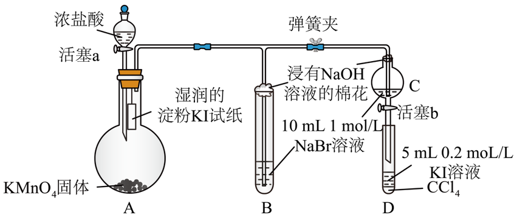

# Chemistry - 题目 23

**ID**: 7234d39443994c37b5b2ac0a21b1a896
**年级**: Grade 10
**难度**: Medium-Hard
**题型**: 非选择题

## 题目
化学实验探究不仅是化学学习的重要组成部分，也是科学研究的基础。​​​​​​​‌通过实验，我们能够更深入地理解化学现象和规律。为探究卤素单质 ${\rm{C}}{\rm{l}}{{}_{2}}、{\rm{B}}{\rm{r}}{{}_{2}}、{\rm{I}}{{}_{2}}$ 氧化性的相对强弱，同学们用如图所示装置进行实验(夹持仪器已略去，气密性已检验)。资料：稀溴水的颜色是黄色，浓溴水的颜色为红棕色。实验过程：过程I．打开弹簧夹，打开活塞a，滴加浓盐酸。过程Ⅱ．当B和C中的溶液都变为黄色时，夹紧弹簧夹。过程Ⅲ．当B中溶液由黄色变为红棕色时，关闭活塞a．过程Ⅳ．……请回答下列问题：（1）A中产生黄绿色气体的反应的离子方程式为。（2）写出 ${\rm{C}}{\rm{C}}{\rm{l}}{{}_{4}}$ 的电子式：（3）验证氯气的氧化性强于碘的实验现象是。（4）为验证溴的氧化性强于碘，过程Ⅳ的操作和现象是。（5）浸有NaOH溶液的棉花的作用是，反应的离子方程式为。（6）为了验证氯元素的非金属性比硫元素的强，应关闭弹簧夹，将B中试剂换为，反应的离子方程式为。（7）下列方法可以证明非金属性 ${\rm{F}}>{\rm{C}}{\rm{l}}$ 的是。

## 解答

1. （1）A中，KMnO_{4}与浓盐酸发生反应制得氯气，化学方程式为 $2{\rm{M}}{\rm{n}}{\rm{O}}{{}_{4}^{-}}+16{\rm{H}}{^{+}}{{+}}{{1}}{{0}}{\rm{C}}{\rm{l}}{^{-}}=2{\rm{M}}{\rm{n}}{^{2+}}+5{\rm{C}}{\rm{l}}{{}_{2}}\uparrow +8{\rm{H}}{{}_{{{2}}}}{\rm{O}}$ ，故答案为： $2{\rm{M}}{\rm{n}}{\rm{O}}{{}_{4}^{-}}+16{\rm{H}}{^{+}}{{+}}{{1}}{{0}}{\rm{C}}{\rm{l}}{^{-}}=2{\rm{M}}{\rm{n}}{^{2+}}+5{\rm{C}}{\rm{l}}{{}_{2}}\uparrow +8{\rm{H}}{{}_{{{2}}}}{\rm{O}}$ ；
2. （2）
3. ${\rm{C}}{\rm{C}}{\rm{l}}{{}_{4}}$ 中，碳原子与氯原子以共价键结合，其电子式为，故答案为：；
4. （3）Cl_{2}与KI发生反应2KI+Cl_{2}=2KCl+I_{2}，生成的I_{2}使淀粉变蓝色，则验证氯气的氧化性强于碘的实验现象是：湿润的淀粉KI试纸变蓝；
5. （4）为验证溴的氧化性强于碘，过程Ⅳ的操作和现象是：打开活塞b，放出少量溶液，然后关闭活塞b，振荡D并静置，观察到D中下层溶液呈紫红色；
6. （5）B和C仪器口放置浸有 ${\rm{N}}{\rm{a}}{\rm{O}}{\rm{H}}$ 溶液的棉花的作用是吸收未反应的氯气，防止其对空气造成污染，其离子方程式为： ${\rm{C}}{\rm{l}}{{}_{2}}+2{\rm{O}}{\rm{H}}{^{-}}={\rm{C}}{\rm{l}}{^{-}}+{\rm{C}}{\rm{l}}{\rm{O}}{^{-}}+{\rm{H}}{{}_{{{2}}}}{\rm{O}}$ ，故答案为：吸收未反应的氯气，防止污染空气； ${\rm{C}}{\rm{l}}{{}_{2}}+2{\rm{O}}{\rm{H}}{^{-}}={\rm{C}}{\rm{l}}{^{-}}+{\rm{C}}{\rm{l}}{\rm{O}}{^{-}}+{\rm{H}}{{}_{{{2}}}}{\rm{O}}$ ；
7. （6）将氯气通入Na_{2}S溶液中，氯气将硫离子氧化为硫单质，说明氯元素的非金属性比硫元素的强，所以需将B中试剂换为Na_{2}S溶液，反应的离子方程式为 ${\rm{C}}{\rm{l}}{{}_{2}}+{\rm{S}}{^{2-}}=2{\rm{C}}{\rm{l}}{^{-}}+{\rm{S}}\downarrow $ ，故答案为：Na_{2}S溶液； ${\rm{C}}{\rm{l}}{{}_{2}}+{\rm{S}}{^{2-}}=2{\rm{C}}{\rm{l}}{^{-}}+{\rm{S}}\downarrow $ ；
8. （7）A．气态氢化物的稳定性越强，其非金属性越强，A项正确；F无正价，无法比较F、Cl最高价氧化物对应的水化物的酸性，则无法证明F、Cl非金属性强弱，B项错误；F_{2}黑暗即可与H_{2}化合，Cl_{2}需光照或点燃条件才可与H_{2}化合，单质与氢气化合的越容易，其非金属性越强，C项正确；将氟单质通入氯化钠溶液中，氟单质与水反应产生氧气，不产生氯气，检验是否有氯气生成无法证明F、Cl非金属性强弱，D项错误。

## 知识点

**中文**:
  - 同主族元素性质递变规律及其与原子结构的关系

**English**:
  - Trends in Groups

---
