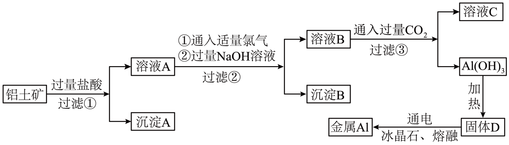

# Chemistry - 题目 340

**ID**: 7436b22ad1e945d68513528d7194e3c1
**年级**: Grade 10
**难度**: Medium-Hard
**题型**: 非选择题

## 题目
工业上以铝土矿(主要成分为 ${\rm{A}}{\rm{l}}{{}_{2}}{\rm{O}}{{}_{3}}$ ，含有少量 ${\rm{F}}{\rm{e}}{{}_{3}}{\rm{O}}{{}_{4}}$ 、 ${\rm{M}}{\rm{g}}{\rm{O}}$ 和 ${\rm{S}}{\rm{i}}{\rm{O}}{{}_{2}}$ )为原料冶炼金属铝，可经过如下过程，其工艺流程示意图如下：已知： ${\rm{S}}{\rm{i}}{\rm{O}}{{}_{2}}$ 为酸性氧化物。​​​​​​​‌结合上述工艺流程，回答下列问题。（1）沉淀A的成分为，加盐酸时 ${\rm{F}}{\rm{e}}{{}_{3}}{\rm{O}}{{}_{4}}$ 发生反应的离子方程式。（2）往溶液A中通往氯气时反应的离子方程式，检验溶液B中是否含 ${\rm{F}}{\rm{e}}{^{3+}}$ 方法是。（3）溶液B中主要是 ${\rm{N}}{\rm{a}}\left [{\rm{A}}{\rm{l}}({\rm{O}}{\rm{H}}){{}_{4}}\right ]$ ，生成 ${\rm{N}}{\rm{a}}\left [{\rm{A}}{\rm{l}}({\rm{O}}{\rm{H}}){{}_{4}}\right ]$ 的离子方程式为。（4）溶液C中的溶质主要有，写出溶液B中通入过量 ${\rm{C}}{\rm{O}}{{}_{2}}$ 发生反应的离子方程式。（5）镓 $({\rm{G}}{\rm{a}})$ 与铝同主族，其单质及其化合物具有广泛的工业应用。镓的卤化物都有较高的催化活性，可用于聚合和脱水等工艺，查得：物质${\rm{G}}{\rm{a}}{\rm{B}}{\rm{r}}{{}_{3}}$${\rm{G}}{\rm{a}}{\rm{C}}{\rm{l}}{{}_{3}}$${\rm{G}}{\rm{a}}{\rm{F}}{{}_{3}}$熔点 $/{}\degree {\rm{C}}$124781000${\rm{G}}{\rm{a}}{\rm{B}}{\rm{r}}{{}_{3}}$ 的熔点高于 ${\rm{G}}{\rm{a}}{\rm{C}}{\rm{l}}{{}_{3}}$ ，却远低于 ${\rm{G}}{\rm{a}}{\rm{F}}{{}_{3}}$ ，原因是。

## 解答

1. （1）SiO_{2}不与盐酸反应，所以沉淀A为不溶物SiO_{2}；Fe_{3}O_{4}与盐酸反应分别得到FeCl_{2}、FeCl_{3}、H_{2}O，离子方程式为： ${\rm{F}}{\rm{e}}{{}_{{{3}}}}{\rm{O}}{{}_{{{4}}}}{{+}}{{8}}{\rm{H}}{^{{{+}}}}{\rm{=}}{\rm{F}}{\rm{e}}{^{{{2}}{{+}}}}{{+}}{{2}}{\rm{F}}{\rm{e}}{^{{{3}}{{+}}}}{{+}}{{4}}{\rm{H}}{{}_{{{2}}}}{\rm{O}}$ ；
2. （2）往溶液A中通入适量Cl_{2}，Cl_{2}将Fe^{2+}氧化为Fe^{3+}，反应的离子方程式为 ${{2}}{\rm{F}}{\rm{e}}{^{{{2}}{{+}}}}{{+}}{\rm{C}}{\rm{l}}{{}_{{{2}}}}{\rm{=}}{{2}}{\rm{F}}{\rm{e}}{^{{{3}}{{+}}}}{{+}}{{2}}{\rm{C}}{\rm{l}}{^{-}}$ ；Fe^{3+}遇到KSCN溶液变为血红色，则检验溶液B中是否含Fe^{3+}方法是取少量B溶液，滴加KSCN溶液，若溶液不变红色，则无Fe^{3+}；
3. （3）溶液A中含有AlCl_{3}等，加入过量氢氧化钠溶液，生成 ${\rm{N}}{\rm{a}}\left [{\rm{A}}{\rm{l}}({\rm{O}}{\rm{H}}){{}_{4}}\right ]$ ，离子方程式为 ${\rm{A}}{\rm{l}}{^{{{3}}{{+}}}}+4OH{^{-}}=\left [Al\left ({OH}\right ){{}_{4}}\right ]{^{-}}$ ；
4. （4）由分析可知，溶液C中的溶质主要有NaHCO_{3}；根据分析，往溶液B中通入过量CO_{2}，CO_{2}与 $Na[Al\left ({OH}\right ){{}_{{{4}}}}{\rm{]}}$ 反应生成Al(OH)_{3}沉淀和NaHCO_{3}，NaOH和过量CO_{2}反应生成NaHCO_{3}，离子方程式为 $CO{{}_{2}}+OH{^{-}}=HCO{{}_{3}^{-}}$ ， $[Al\left ({{\rm{O}}{\rm{H}}}\right ){{}_{{{4}}}}{\rm{]}}{^{-}}+CO{{}_{2}}=Al\left ({{\rm{O}}{\rm{H}}}\right ){{}_{3}}\downarrow +HCO{{}_{3}^{-}}$ ；
5. （5） ${\rm{G}}{\rm{a}}{\rm{B}}{\rm{r}}{{}_{3}}$ 的熔点高于 ${\rm{G}}{\rm{a}}{\rm{C}}{\rm{l}}{{}_{3}}$ ，却远低于 ${\rm{G}}{\rm{a}}{\rm{F}}{{}_{3}}$ ，原因是 ${\rm{G}}{\rm{a}}{\rm{F}}{{}_{3}}$ 是离子晶体， ${\rm{G}}{\rm{a}}{\rm{B}}{\rm{r}}{{}_{3}}$ 和 ${\rm{G}}{\rm{a}}{\rm{C}}{\rm{l}}{{}_{3}}$ 均为分子晶体，分子晶体的熔沸点低于离子晶体，而 ${\rm{G}}{\rm{a}}{\rm{B}}{\rm{r}}{{}_{3}}$ 相对分子质量较大，分子间作用力更强，熔点更高。

## 知识点

**中文**:
  - 晶体的类型与物质熔点、硬度、导电性的关系
  - 离子方程式的书写及正误判断

**English**:
  - Relationship with Melting Point, Hardness, Conductivity
  - Writing and Verifying Ionic Equations

---
