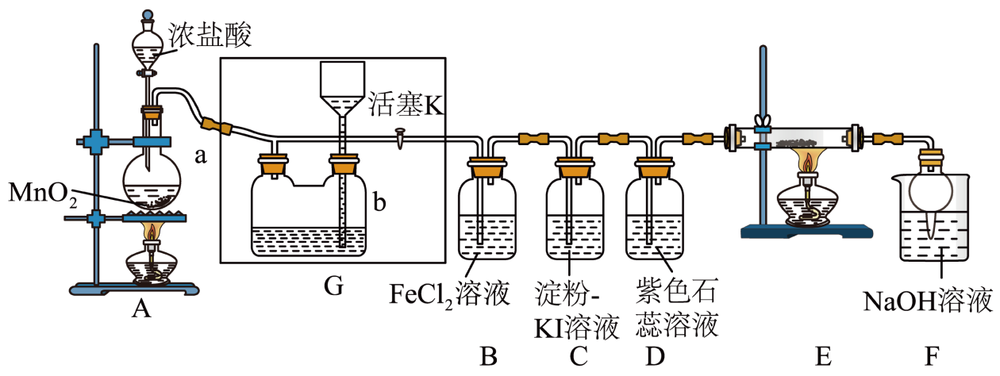

# Chemistry - 题目 222

**ID**: 7e050c133bf14cbc811c26bf241db4d7
**年级**: Grade 10
**难度**: Medium-Hard
**题型**: 非选择题

## 题目
某化学兴趣小组设计了如图装置，该装置能制取 ${\rm {\rm{C}}{\rm{l}}{{}_{2}}}$ ，并进行相关性质实验，且可利用装置G储存多余的氯气。​​​​​​​‌(1)A中发生反应的化学方程式为。(2)①实验开始时，打开分液漏斗旋塞和活塞K。先点燃(填“A”或“E”)处酒精灯。②在装置D中能看到的实验现象是。③由C中出现的现象可以判断两种非金属单质的氧化性强弱为。④装置F中发生反应的离子方程式为。(3)装置F中球形干燥管的作用是。(4)储气瓶b内盛放的试剂是。

## 解答

1. （1）A中发生二氧化锰和浓盐酸共热制取氯气的反应的化学方程式为： ${\rm\hspace{-0.5em}\begin{array}{l}\rm {\rm{M}}{\rm{n}}{\rm{O}}{{}_{2}}+4{\rm{H}}{\rm{C}}{\rm{l}}\left ({浓}\right )\hspace{-0.5em}\begin{array}{}{\underline{\underline {{\rm{Δ}}}}}\\\;\end{array}\hspace{-0.5em}{\rm{M}}{\rm{n}}{\rm{C}}{\rm{l}}{{}_{2}}+2{\rm{H}}{{}_{2}}{\rm{O}}+{\rm{C}}{\rm{l}}{{}_{2}}\uparrow\end{array}\hspace{-0.5em}}$ ；
2. （2）①实验开始，先点燃A中的酒精灯。
3. ②氯气通入紫色石蕊试液，先和水反应生成盐酸和次氯酸，溶液显酸性，变红，次氯酸有强氧化性，会将石蕊氧化所以会褪色。
4. ③氯气具有强的氧化性能够氧化能够氧化碘化钾溶液生成单质碘，故氧化性 ${\rm {\rm{C}}{\rm{l}}{{}_{2}}>{\rm{I}}{{}_{2}}}$ 。
5. ④氯气和氢氧化钠溶液反应生成氯化钠、次氯酸钠和水，故离子方程式为 ${\rm {\rm{C}}{\rm{l}}{{}_{2}}+2{\rm{O}}{\rm{H}}{^{-}}={\rm{C}}{\rm{l}}{^{-}}+{\rm{C}}{\rm{l}}{\rm{O}}{^{-}}+{\rm{H}}{{}_{2}}{\rm{O}}}$ 。
6. （3）氯气和氢氧化钠溶液剧烈反应，因此容易发生倒吸，球形干燥管提供缓冲，防倒吸；
7. （4）此种方法制取的氯气含有氯化氢杂质，b中饱和食盐水可以除去HCl。

## 知识点

**中文**:
  - 氯气与碱的反应
  - 氯气的实验室制法
  - 氯气的氧化性

**English**:
  - Reaction with Bases
  - Laboratory Preparation of Chlorine
  - Oxidizing Property of Chlorine

---
