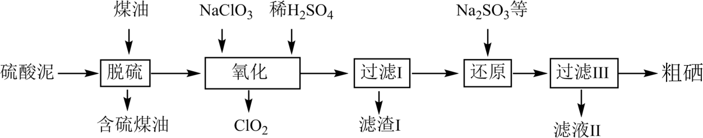
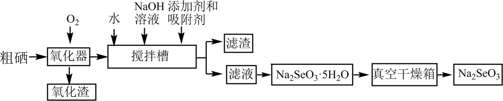

# Chemistry - 题目 331

**ID**: 8ed96a4dacab4337856964e68383bb0f
**年级**: Grade 10
**难度**: Medium-Hard
**题型**: 非选择题

## 题目
亚硒酸钠(Na_{2}SeO_{3})为白色晶体，易溶于水，不溶于乙醇，有剧毒，可作为硒元素福补充药，在医学上可用于防治癌症、高血压、冠心病、心肌炎等疾病。​​​​​​​‌I.工业上用烟气制酸的废料(主要含S、Se、Fe_{2}O_{3}、CuO、ZnO、SiO_{2}等)为原料提取硒，流程如图：(1)硒与硫是同主族的相邻元素，其在周期表中的位置是。(2)“脱硫”过程中，温度控制在95℃，原因是。(3)“氧化”过程中，Se转化成弱酸H_{2}SeO_{3}，该反应的离子方程式为。(4)“还原”过程中，生成粗硒的离子方程式为。II.粗硒经过下列流程可获得亚硒酸钠(Na_{2}SeO_{3})。(5)已知在氧化器中粗硒转化为SeO_{2}，则搅拌槽中发生主要反应的离子方程式为。(6)Na_{2}SeO_{3}·5H_{2}O脱水制取Na_{2}SeO_{3}时，须在真空干燥箱中进行，原因是。(7)在上述流程中粗硒在转化为SeO_{2}时损失4%，搅拌槽中SeO_{2}的利用率为95%，其他损耗忽略不计，则利用1t含硒79%的粗硒最终可生产t含亚硒酸钠95%的产品(计算结果精确到0.01t)。

## 解答

1. （1）硒与硫是同主族的相邻元素，其在周期表中的位置是第四周期第ⅥA族；
2. （2）“脱硫”过程中，温度控制在95℃，原因是温度低于95℃，脱硫速率偏低（硫在煤油中的溶解度降低），温度高于95℃，煤油挥发量加大；
3. （3）“氧化”过程中，Se转化成弱酸H_{2}SeO_{3}，该反应的离子方程式为 ${\rm Se+4}{\rm{C}}{\rm{l}}{\rm{O}}{{}_{{{3}}}^{{{-}}}}{\rm +4H^{+}=H_{2}SeO_{3}+4ClO_{2}↑+H_{2}O}$ ；
4. （4）“还原”过程中，H_{2}SeO_{3}转化为Se，该反应的离子方程式为 ${\rm H_{2}SeO_{3}+2}{\rm{S}}{\rm{O}}{{}_{{{3}}}^{{{2}}{{-}}}}{\rm =Se+2}$  ${\rm{S}}{\rm{O}}{{}_{{{4}}}^{{{2}}{{-}}}}{\rm +H_{2}O}$ ；
5. （5）在搅拌槽中，SeO_{2}转化为Na_{2}SeO_{3}，该反应的离子方程式为 ${\rm SeO_{2}+2OH^{-}=}{\rm{S}}{\rm{e}}{\rm{O}}{{}_{{{3}}}^{{{2}}{{-}}}}{\rm +H_{2}O}$ ；
6. （6）Na_{2}SeO_{3}具有还原性，Na_{2}SeO_{3}·5H_{2}O脱水制取Na_{2}SeO_{3}时，须在真空干燥箱中进行，是为了防止Na_{2}SeO_{3}被空气中的氧气氧化；
7. （7）根据Se原子守恒，可知Se~SeO_{2}~Na_{2}SeO_{3}，1t含硒79%的粗硒中，m(Se)=0.79t，其转化为Na_{2}SeO_{3}的质量 ${\rm \mathit{m}(Na_{2}SeO_{3})=}\frac {{{0}}{{.}}{{7}}{{9}}{\rm{t}}\times {\rm{(}}{{1}}{{-}}{{4}}{\rm{\%}}{\rm{)}}\times {{9}}{{5}}{\rm{\%}}\times {{1}}{{7}}{{3}}}{{{7}}{{9}}}{\rm =1.58t}$ ，则利用1t含硒79%的粗硒最终可生产含亚硒酸钠95%的产品的质量为 $\frac {{{1}}{{.}}{{5}}{{8}}{\rm{t}}}{{{9}}{{5}}{\rm{\%}}}{\rm =1.66t}$ 。

## 知识点

**中文**:
  - 元素周期表的结构及其应用
  - 守恒法与关系式法
  - 离子方程式的书写及正误判断
  - 物质分离和提纯的综合应用

**English**:
  - Structure and Applications of the Periodic Table
  - Conservation Method and Relationship Method
  - Writing and Verifying Ionic Equations
  - Comprehensive Applications

---
