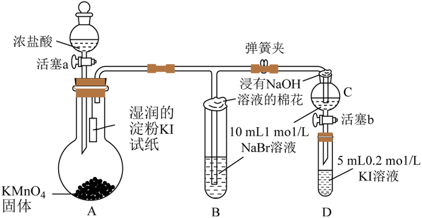

# Chemistry - 题目 67

**ID**: 8fd20dec8b3340fb984ae8516603e48b
**年级**: Grade 10
**难度**: Medium-Hard
**题型**: 非选择题

## 题目
为验证卤素单质氧化性的相对强弱，可用下图所示装置进行实验。​​​​​​​‌(夹持仪器已略去)实验过程：I．打开弹簧夹，打开活塞a，滴加浓盐酸。II．当B和C中的溶液都变为棕黄色时，夹紧弹簧夹。III．关闭活塞a，待连接B和C的玻璃导管中无黄绿色气体后，进行下一步。IV．打开活塞b，将少量C中的溶液滴入D中，关闭活塞b，取下D振荡后观察溶液颜色。(1)加入药品前，需要进行的操作是。(2)装置A中可以说明氯气的氧化性强于碘的实验现象是。(3)装置B试管口浸有 ${\rm{N}}{\rm{a}}{\rm{O}}{\rm{H}}$ 溶液的棉花的作用是。(4)仪器C的名称是，其中发生反应的离子方程式是。(5)为验证溴的氧化性强于碘，过程IV能观察到的现象是D中溶液变色，且比C中溶液颜色(“深”或“浅”)。(6)过程III实验的目的是。(7)结合实验结论，推断卤族元素中最高价氧化物对应水化物酸性最强的是(填化学式)。

## 解答

1. （1）加入药品前，需要进行的操作是检验装置气密性；
2. （2）装置A内产生黄绿色气体，上方湿润的淀粉KI试纸变蓝色，说明氯气的氧化性强于碘；
3. （3）B试管口浸有 ${\rm{N}}{\rm{a}}{\rm{O}}{\rm{H}}$ 溶液的棉花作用是吸收未反应的有毒害的氯气，防止污染空气；
4. （4）仪器C：分液漏斗；氯气与溴化钠溶液反应生成溴；
5. （5）过程Ⅳ能观察到的现象是D中溶液变为棕黄色，且比C中溶液颜色深，说明装置D中发生溴单质置换碘单质的反应，从而验证溴的氧化性比碘强；
6. （6）由题意可知，过程Ⅲ实验目的是确认C中的黄色溶液无氯气，排除氯气对溴置换碘实验的干扰；
7. （7）由元素周期律可知，氯、溴、碘三种元素的非金属性依次减弱，最高价氧化物对应水化物酸性依次减弱，最高价氧化物对应水化物酸性最强的是高氯酸。

## 知识点

**中文**:
  - 同主族元素性质递变规律及其与原子结构的关系
  - 性质实验

**English**:
  - Trends in Groups
  - Property Experiments

---
