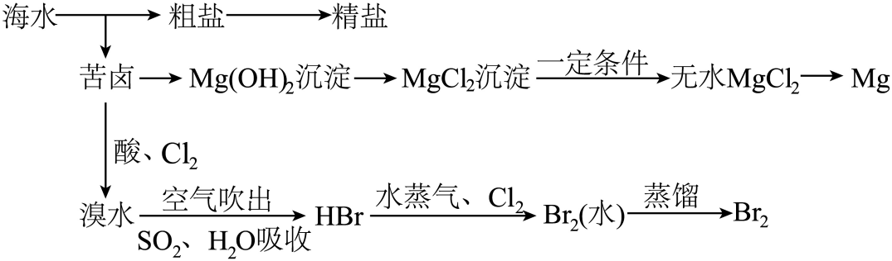

# Chemistry - 题目 304

**ID**: 9d7e2db865ba4f59ad5bb78b96186877
**年级**: Grade 10
**难度**: Medium-Hard
**题型**: 非选择题

## 题目
海水蕴含着丰富的化学资源，海水资源的综合开发工艺流程如下：回答下列问题：(1)工业上从苦卤中得到 ${\rm{M}}{\rm{g}}\left ({{\rm{O}}{\rm{H}}}\right ){{}_{2}}$ 沉淀最好选用的试剂为，分离得到 ${\rm{M}}{\rm{g}}\left ({{\rm{O}}{\rm{H}}}\right ){{}_{2}}$ 沉淀的方法是。​​​​​​​‌(2)写出工业上冶炼金属镁的化学方程式。(3)在苦卤中通入氯气之前，要先用硫酸酸化母液，这样做的目的是。(4)从苦卤中得到溴水后还要经过吹出、吸收等环节处理，这样做的目的是。(5)根据上述流程判断： ${\rm{S}}{\rm{O}}{{}_{2}}、{\rm{C}}{\rm{l}}{{}_{2}}、{\rm{B}}{\rm{r}}{{}_{2}}$ 三种物质氧化性由强到弱的顺序是。

## 解答

1. （1）工业上从苦卤中得到Mg(OH)_{2}沉淀最好选用的试剂为石灰乳，主要成分Ca(OH)_{2}，因为石灰乳来源广泛、价格低廉 。分离固体和液体混合物的方法是过滤，所以分离得到沉淀的方法是过滤。
2. 故本问答案依次为：石灰乳；过滤。
3. （2）工业上通过电解熔融的氯化镁来冶炼金属镁，化学方程式为 ${\rm{M}}{\rm{g}}{\rm{C}}{\rm{l}}{{}_{2}}\left ({熔融}\right )\hspace{-0.5em}\begin{array}{}{\underline{{\underline{~~电解~~}}}}\atop{}\end{array}\hspace{-0.5em}{\rm{M}}{\rm{g}}+{\rm{C}}{\rm{l}}{{}_{2}}\uparrow $ 。
4. （3）在苦卤中通入氯气之前，先用硫酸酸化母液，这样做的目的是抑制Cl_{2}、 Br_{2}与水的反应（因为Cl_{2}、 Br_{2}在碱性或中性条件下会与水发生歧化反应，酸性条件可抑制该反应）。
5. （4）从苦卤中得到溴水后还要经过吹出、吸收等环节处理，这样做的目的是富集溴元素，因为海水中溴元素含量较低，通过这些环节可以提高溴的浓度。
6. （5）在Cl_{2}将Br^{-}氧化为 Br_{2}的反应中， Cl_{2}是氧化剂，Br_{2}是氧化产物，根据氧化剂的氧化性大于氧化产物的氧化性，可得氧化性Cl_{2}>Br_{2}；在SO_{2}与Br_{2}、H_{2}O的反应SO_{2}+ Br_{2}+ 2H_{2}O=H_{2}SO_{4}+ 2HBr中，Br_{2}是氧化剂，SO_{2}是还原剂，所以氧化性Br_{2}>SO_{2}，故SO_{2}、Cl_{2}、Br_{2}三种物质氧化性由强到弱的顺序是 ${\rm{C}}{\rm{l}}{{}_{2}}>{\rm{B}}{\rm{r}}{{}_{2}}>{\rm{S}}{\rm{O}}{{}_{2}}$ 。

## 知识点

**中文**:
  - 海水提溴
  - 电解法冶炼金属
  - 海水提镁
  - 物质分离和提纯的综合应用

**English**:
  - Bromine Extraction
  - Electrolysis
  - Magnesium Extraction
  - Comprehensive Applications

---
