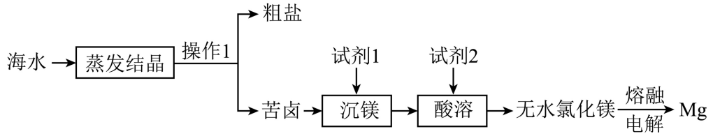

# Chemistry - 题目 163

**ID**: a5c7dcd045594420986df379048dba5a
**年级**: Grade 10
**难度**: Medium-Hard
**题型**: 非选择题

## 题目
海洋是巨大的资源宝库，人类可以从海洋中获取多种化工原料。​​​​​​​‌回答下列问题：Ⅰ．海水提镁已知：苦卤是海水经蒸发浓缩析出食盐后所得的母液，主要含有KCl、 ${\rm{M}}{\rm{g}}{\rm{C}}{\rm{l}}{{}_{2}}、{\rm{M}}{\rm{g}}{\rm{S}}{\rm{O}}{{}_{4}}$ 和KBr等。(1)操作1的名称为。(2)考虑到节约成本，试剂1最好选用（填字母，下同）；试剂2应选用；电解无水氯化镁的化学方程式为。

## 解答

1. （1）操作1为分离粗盐和苦卤的操作，为固液分离操作，名称为过滤；
2. （2）要使氯化镁变成氢氧化镁沉淀，需要加入碱性物质，但氢氧化钠太贵且碱性太强，故选用B.石灰乳。试剂2使得氢氧化镁转化为氯化镁且不引入其它杂质，应该选A.稀盐酸；电解无水氯化镁生成镁单质和氯气，化学方程式为 ${\rm{M}}{\rm{g}}{\rm{C}}{\rm{l}}{{}_{2}}\left ({熔融}\right )\hspace{-0.5em}\begin{array}{}{\underline{{\underline{~~电解~~}}}}\atop{}\end{array}\hspace{-0.5em}{\rm{M}}{\rm{g}}+{\rm{C}}{\rm{l}}{{}_{2}}\uparrow $ ；
3. （3）①通入氯气时，发生置换反应为氯气和溴离子生成氯离子和溴单质，离子方程式为 ${\rm{C}}{\rm{l}}{{}_{2}}+2{\rm{B}}{\rm{r}}{^{-}}={\rm{B}}{\rm{r}}{{}_{2}}+2{\rm{C}}{\rm{l}}{^{-}}$ 。
4. ②通入热空气可以吹出 ${\rm{B}}{\rm{r}}{{}_{2}}\left ({{\rm{g}}}\right )$ 的原因是 ${\rm{B}}{\rm{r}}{{}_{2}}$ 具有挥发性，能随热空气逸出；
5. （4）“浸泡”已经进行完全，则浸出液中不再含碘离子，碘离子能被硫酸酸化的 ${\rm{H}}{{}_{2}}{\rm{O}}{{}_{2}}$ 溶液氧化为使得淀粉溶液变蓝色的碘单质，故实验为：取最后一次浸出液于试管中，加入几滴淀粉溶液，再加入硫酸酸化的 ${\rm{H}}{{}_{2}}{\rm{O}}{{}_{2}}$ 溶液，振荡，观察到溶液不变蓝；
6. （5）“氧化”步骤发生反应为碘离子被硫酸酸化的 ${\rm{H}}{{}_{2}}{\rm{O}}{{}_{2}}$ 溶液氧化为碘单质，离子方程式为 ${\rm{H}}{{}_{2}}{\rm{O}}{{}_{2}}+2{\rm{I}}{^{-}}+2{\rm{H}}{^{+}}=2{\rm{H}}{{}_{2}}{\rm{O}}+{\rm{I}}{{}_{2}}$ 。

## 知识点

**中文**:
  - 海带提碘
  - 离子方程式的书写及正误判断
  - 电解法冶炼金属
  - 海水提镁

**English**:
  - Iodine Extraction from Kelp
  - Writing and Verifying Ionic Equations
  - Electrolysis
  - Magnesium Extraction

---
