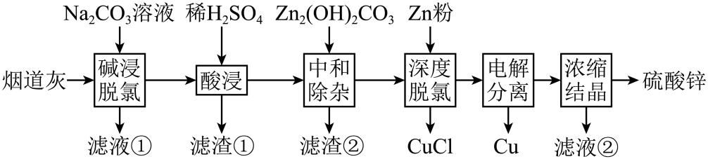

# Chemistry - 题目 13

**ID**: b1112cb3cd024c5b9505dd9c87a05d87
**年级**: Grade 10
**难度**: Medium-Hard
**题型**: 非选择题

## 题目
为了节约资源，减少重金属对环境的污染，一研究小组对某有色金属冶炼厂的高氯烟道灰(主要含有 ${\rm{C}}{\rm{u}}{\rm{C}}{\rm{l}}{{}_{2}}$ 、 ${\rm{Z}}{\rm{n}}{\rm{C}}{\rm{l}}{{}_{2}}$ 、 ${\rm{C}}{\rm{u}}{\rm{O}}$ 、 ${\rm{Z}}{\rm{n}}{\rm{O}}$ 、 ${\rm{P}}{\rm{b}}{\rm{O}}$ 、 ${\rm{F}}{\rm{e}}{{}_{2}}{\rm{O}}{{}_{3}}$ 、 ${\rm{S}}{\rm{i}}{\rm{O}}{{}_{2}}$ 等；其中 ${\rm{C}}{\rm{u}}{\rm{O}}$ 、 ${\rm{P}}{\rm{b}}{\rm{O}}$ 、 ${\rm{F}}{\rm{e}}{{}_{2}}{\rm{O}}{{}_{3}}$ 为碱性氧化物， ${\rm{S}}{\rm{i}}{\rm{O}}{{}_{2}}$ 为酸性氧化物， ${\rm{Z}}{\rm{n}}{\rm{O}}$ 为两性氧化物)进行研究，设计如下工艺流程。​​​​​​​‌实现了铜和锌的分离回收。回答下列问题：(1)铜元素是第29号元素，铜元素原子核外最外层 ${\rm{N}}$ 层只有一个电子，铜元素的原子结构示意图为。(2)“碱浸脱氯”使可溶性铜盐、锌盐转化为碱式碳酸盐沉淀；“碱浸脱氯”步骤中氧化物均几乎不反应。其中，铜盐发生反应的化学方程式为。(3)滤渣①中，除 ${\rm{P}}{\rm{b}}{\rm{S}}{\rm{O}}{{}_{4}}$ 外，主要还有。(4)“深度脱氯”时， ${\rm{C}}{\rm{l}}{^{-}}$ 的存在使锌粉还原产生的 ${\rm{C}}{\rm{u}}$ 与 ${\rm{C}}{\rm{u}}{^{2+}}$ 反应，生成能被空气氧化的 ${\rm{C}}{\rm{u}}{\rm{C}}{\rm{l}}$ 沉淀，使 ${\rm{C}}{\rm{l}}{^{-}}$ 被脱除。欲脱除 $1.0{\rm{m}}{\rm{o}}{\rm{l}}{\rm{C}}{\rm{l}}{^{-}}$ ，理论上需要锌粉${\rm{m}}{\rm{o}}{\rm{l}}$ 。(5) ${\rm{C}}{\rm{u}}{\rm{C}}{\rm{l}}$ 可以通过(填序号)将其溶解，并返回到步骤中。a．盐酸酸化、双氧水氧化            b．硫酸酸化、 ${\rm{K}}{\rm{M}}{\rm{n}}{\rm{O}}{{}_{4}}$ 氧化c．硝酸酸化和氧化                    d．硫酸酸化、双氧水氧化(6)“电解分离”采用无隔膜电解槽，以石墨为阳极，铜为阴极。“电解分离”前，需要脱氯的原因有。(7)准确称取“深度脱氯”所得的氯化亚铜样品1.250g，将其置于过量的 ${\rm{F}}{\rm{e}}{\rm{C}}{\rm{l}}{{}_{3}}$ 溶液中，待样品完全溶解后，加入适量稀硫酸，用 $0.1000{\rm{m}}{\rm{o}}{\rm{l}}\cdot {\rm{L}}{^{-1}}$ 的 ${\rm{K}}{{}_{2}}{\rm{C}}{\rm{r}}{{}_{2}}{\rm{O}}{{}_{7}}$ 溶液滴定到终点，消耗 ${\rm{K}}{{}_{2}}{\rm{C}}{\rm{r}}{{}_{2}}{\rm{O}}{{}_{7}}$ 溶液 $20.00{\rm{m}}{\rm{L}}$ 。已知： ${\rm{F}}{\rm{e}}{^{3+}}+{\rm{C}}{\rm{u}}{\rm{C}}{\rm{l}}={\rm{F}}{\rm{e}}{^{2+}}+{\rm{C}}{\rm{u}}{^{2+}}+{\rm{C}}{\rm{l}}{^{-}}$ ； $6{\rm{F}}{\rm{e}}{^{2+}}+{\rm{C}}{\rm{r}}{{}_{2}}{\rm{O}}{{}_{7}^{2-}}+14{\rm{H}}{^{+}}=6{\rm{F}}{\rm{e}}{^{3+}}+2{\rm{C}}{\rm{r}}{^{3+}}+7{\rm{H}}{{}_{2}}{\rm{O}}$ ；该条件下 ${\rm{K}}{{}_{2}}{\rm{C}}{\rm{r}}{{}_{2}}{\rm{O}}{{}_{7}}$ ，的氧化性不足以氧化 ${\rm{C}}{\rm{l}}{^{-}}$ 。计算样品中 ${\rm{C}}{\rm{u}}{\rm{C}}{\rm{l}}$ 的质量分数为(写出计算过程)。

## 解答

1. （1）
2. 铜元素是第29号元素，铜元素原子核外最外层 ${\rm{N}}$ 层只有一个电子，第一层有2个电子，第二层有8个电子，可得第三层的电子数为29-2-8-1=18个，铜元素的原子结构示意图为。
3. （2）“碱浸脱氯”使可溶性铜盐转化为碱式碳酸盐沉淀，铜盐发生反应的化学方程式为 $2{\rm{C}}{\rm{u}}{\rm{C}}{\rm{l}}{{}_{2}}+3{\rm{N}}{\rm{a}}{{}_{2}}{\rm{C}}{\rm{O}}{{}_{3}}+2{\rm{H}}{{}_{2}}{\rm{O}}={\rm{C}}{\rm{u}}{{}_{2}}\left ({{\rm{O}}{\rm{H}}}\right ){{}_{2}}{\rm{C}}{\rm{O}}{{}_{3}}\downarrow +4{\rm{N}}{\rm{a}}{\rm{C}}{\rm{l}}+2{\rm{N}}{\rm{a}}{\rm{H}}{\rm{C}}{\rm{O}}{{}_{3}}$ 或 $2{\rm{C}}{\rm{u}}{\rm{C}}{\rm{l}}{{}_{2}}+2{\rm{N}}{\rm{a}}{{}_{2}}{\rm{C}}{\rm{O}}{{}_{3}}+{\rm{H}}{{}_{2}}{\rm{O}}={\rm{C}}{\rm{u}}{{}_{2}}\left ({{\rm{O}}{\rm{H}}}\right ){{}_{2}}{\rm{C}}{\rm{O}}{{}_{3}}\downarrow +4{\rm{N}}{\rm{a}}{\rm{C}}{\rm{l}}+{\rm{C}}{\rm{O}}{{}_{2}}\uparrow $  。
4. （3）根据分析，滤渣①中，除 ${\rm{P}}{\rm{b}}{\rm{S}}{\rm{O}}{{}_{4}}$ 外，主要还有 ${\rm{S}}{\rm{i}}{\rm{O}}{{}_{2}}$ 。
5. （4）“深度脱氯”时发生的反应为 ${\rm{C}}{\rm{u}}{^{{{2}}{{+}}}}{{+}}{\rm{C}}{\rm{u}}{{+}}{{2}}{\rm{C}}{\rm{l}}{^{{{-}}}}{\rm{=}}{{2}}{\rm{C}}{\rm{u}}{\rm{C}}{\rm{l}}$ ，从反应可知脱除2 mol  ${\rm{C}}{\rm{l}}{^{-}}{\rm -}$ 需要1 mol Cu，而Zn与 ${\rm{C}}{\rm{u}}{^{2+}}$ 反应生成Cu的反应为 ${\rm{C}}{\rm{u}}{^{{{2}}{{+}}}}{{+}}{\rm{Z}}{\rm{n}}{\rm{=}}{\rm{C}}{\rm{u}}{{+}}{\rm{Z}}{\rm{n}}{^{2+}}$ ，即生成1 mol Cu需要1 mol Zn。所以脱除1.0 mol  ${\rm{C}}{\rm{l}}{^{-}}$ ，根据反应比例关系，理论上需要锌粉0.5 mol。
6. （5） ${\rm{C}}{\rm{u}}{\rm{C}}{\rm{l}}$ 可在酸性条件下法歧化反应形成Cu、 ${\rm{C}}{\rm{u}}{^{2+}}{\rm ，Cu}$ 不与硫酸反应故再加入 ${\rm{H}}{{}_{{{2}}}}{\rm{O}}{{}_{{{2}}}}$ 利用其氧化性将Cu氧化为 ${\rm{C}}{\rm{u}}{^{2+}}$ ，故选d；
7. 硫酸酸化、双氧水氧化后的溶液是氯化铜溶液，可以返回到碱浸脱氯步骤。
8. （6）“电解分离”前，需要脱氯的原因有若不脱氯， ${\rm{C}}{\rm{l}}{^{-}}$ 在阳极被氧化生成 ${\rm{C}}{\rm{l}}{{}_{2}}$ 污染环境，氯气可与阴极产生的氢气反应可能会发生爆炸，存在安全隐患，且影响铜、锌分离效果。
9. （7）根据已知方程式可得物质之间关系 ${{6}}{\rm{C}}{\rm{u}}{\rm{C}}{\rm{l}}{\rm{\sim }}{{6}}{\rm{F}}{\rm{e}}{^{{{2}}{{+}}}}{\rm{\sim }}{\rm{C}}{\rm{r}}{{}_{{{2}}}}{\rm{O}}{{}_{{{7}}}^{{{2}}{{-}}}}$ ，则 ${\rm{n}}\left ({{\rm{C}}{\rm{u}}{\rm{C}}{\rm{l}}}\right ){\rm{=}}{{6}}\times {{0}}{{.}}{{1}}{{0}}{{0}}{{0}}{\rm{\;}}{\rm{m}}{\rm{o}}{\rm{l}}\cdot {\rm{L}}{^{-1}}\times 20.00\times 10{^{-3}}{\rm{L}}{\rm{=}}{{0}}{{.}}{{0}}{{1}}{{2}}{{0}}{{0}}{\rm{\;}}{\rm{m}}{\rm{o}}{\rm{l}}$
10. ${\rm{m}}\left ({{\rm{C}}{\rm{u}}{\rm{C}}{\rm{l}}}\right ){\rm{=}}99.5{\rm{g}}\cdot {\rm{m}}{\rm{o}}{\rm{l}}{^{-1}}\times {{0}}{{.}}{{0}}{{1}}{{2}}{{0}}{{0}}{\rm{\;}}{\rm{m}}{\rm{o}}{\rm{l}}{\rm{=}}{{1}}{{.}}{{1}}{{9}}{{4}}{\rm{\;}}{\rm{g}}$
11. 则样品中CuCl的质量分数为 $\frac {1.194{\rm{g}}}{1.250{\rm{g}}}\times 100{\rm{\%}}=95.52{\rm{\%}}$ 。

## 知识点

**中文**:
  - 原子（离子）结构示意图
  - 物质检验与含量测定

**English**:
  - Atomic/Ionic Structure Diagrams
  - Substance Identification and Content Determination

---
