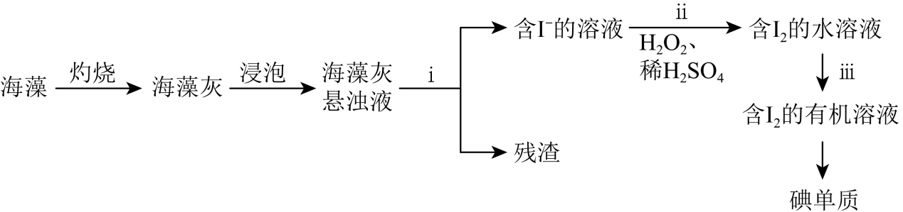

# Chemistry - 题目 210

**ID**: b1cfa678521242759d1e8fe65fc341c9
**年级**: Grade 10
**难度**: Medium-Hard
**题型**: 非选择题

## 题目
海水中富含氯、溴、碘等卤族元素。​​​​​​​‌Ⅰ．碘是人体必须的微量元素之一，海洋植物如海带、海藻中含有丰富的碘元素。在实验室中，从海藻里提取碘的流程如下：（1）指出上述过程中有关实验操作的名称，步骤i：，步骤iii：。（2）以上步骤不需要用到的仪器是。

## 解答

1. （1）过滤适用于不溶于水的固体和液体，步骤i分离固体和液体用过滤；利用溶质在互不相溶的溶剂里溶解度不同，用一种溶剂把溶质从它跟另一种溶剂所组成的溶液里提取出来，这种方法叫做萃取分液，步骤iii将碘水中的碘单质萃取出来，选择合适的萃取剂即可；
2. （2）步骤涉及灼烧、浸泡、过滤、萃取分液，需要用到的仪器有烧杯、漏斗、分液漏斗等，图A是蒸发皿，在蒸发时使用，以上步骤不需要，故选A；
3. （3）步骤ⅱ为在溶液中过氧化氢和硫酸，将碘离子氧化得到含I_{2}的水溶液，发生反应的离子反应方程式为： ${{2}}{\rm{I}}{^{-}}+2{\rm{H}}{^{+}}+{\rm{H}}{{}_{{{2}}}}{\rm{O}}{{}_{{{2}}}}={\rm{I}}{{}_{{{2}}}}+2{\rm{H}}{{}_{{{2}}}}{\rm{O}}$ ；
4. （4）步骤ⅱ为在溶液中过氧化氢和硫酸，将碘离子氧化得到含I_{2}的水溶液，为了提高化学反应速率，可采取的措施有升高温度、增大H_{2}O_{2}或稀硫酸浓度等；
5. （5）①ICl中Cl为-1价，I元素的化合价是+1；
6. ②ICl与稀NaOH溶液可以发生非氧化还原反应，说明I和Cl元素化合价没有发生变化，则生成NaCl和NaIO，离子方程式为： ${\rm{I}}{\rm{C}}{\rm{l}}{{+}}{{2}}{\rm{O}}{\rm{H}}{^{-}}{\rm{=}}{\rm{C}}{\rm{l}}{^{-}}{{+}}{\rm{I}}{\rm{O}}{^{-}}{{+}}{\rm{H}}{{}_{{{2}}}}{\rm{O}}$ 。

## 知识点

**中文**:
  - 温度对于化学反应速率的影响
  - 离子方程式的书写及正误判断
  - 过滤
  - 萃取与分液

**English**:
  - Effect of Temperature
  - Writing and Verifying Ionic Equations
  - Filtration
  - Extraction and Separation

---
