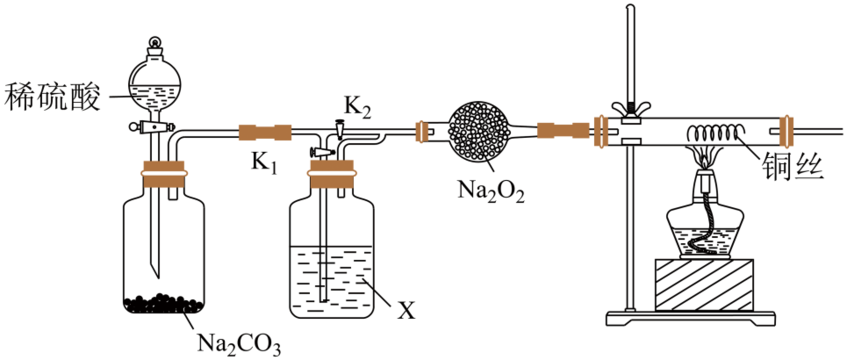
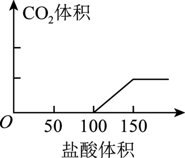

# Chemistry - 题目 182

**ID**: b3c6c8a11f964ef08f69559a5241910c
**年级**: Grade 10
**难度**: Medium-Hard
**题型**: 非选择题

## 题目
某课外活动小组为了研究“干燥的 ${\rm {\rm{C}}{\rm{O}}{{}_{2}}}$ 不能与 ${\rm {\rm{N}}{\rm{a}}{{}_{2}}{\rm{O}}{{}_{2}}}$ 反应”和“潮湿的 ${\rm {\rm{C}}{\rm{O}}{{}_{2}}}$ 才能与 ${\rm {\rm{N}}{\rm{a}}{{}_{2}}{\rm{O}}{{}_{2}}}$ 反应”，设计了如图1实验装置。​​​​​​​‌(1)写出过氧化钠与 ${\rm {\rm{C}}{\rm{O}}{{}_{2}}}$ 反应的方程式。(2)如图装置，在干燥管中装入 ${\rm {\rm{N}}{\rm{a}}{{}_{2}}{\rm{O}}{{}_{2}}}$ 后，打开活塞加入稀硫酸，生成 ${\rm {\rm{C}}{\rm{O}}{{}_{2}}}$ 。打开 ${\rm {\rm{K}}{{}_{1}}}$ ，关闭 ${\rm {\rm{K}}{{}_{2}}}$ ，加热铜丝，X是。(3)若打开 ${\rm {\rm{K}}{{}_{2}}}$ ，关闭 ${\rm {\rm{K}}{{}_{1}}}$ ，出现现象，可证明潮湿的 ${\rm {\rm{C}}{\rm{O}}{{}_{2}}}$ 与 ${\rm {\rm{N}}{\rm{a}}{{}_{2}}{\rm{O}}{{}_{2}}}$ 反应产生了 ${\rm {\rm{O}}{{}_{2}}}$ 。某同学提出质疑，认为不一定是 ${\rm {\rm{C}}{\rm{O}}{{}_{2}}}$ 与 ${\rm {\rm{N}}{\rm{a}}{{}_{2}}{\rm{O}}{{}_{2}}}$ 反应产生了 ${\rm {\rm{O}}{{}_{2}}}$ 导致该现象的产生，请用化学方程式解释该同学的提出质疑原因。(4)通过实验测得反应结束后，球形干燥管中仅有 ${\rm {\rm{N}}{\rm{a}}{{}_{2}}{\rm{C}}{\rm{O}}{{}_{3}}}$ 和未反应完的 ${\rm {\rm{N}}{\rm{a}}{{}_{2}}{\rm{O}}{{}_{2}}}$ 固体，为测得固体混合物的组成，某实验小组将1.45g固体混合物溶于水中。然后向溶液中滴加盐酸，产生气体的体积随盐酸的加入量如图所示。①加入盐酸0~100时间段，溶液中发生的离子反应方程式有：。②若在加入盐酸体积为150时，收集到 ${\rm {\rm{C}}{\rm{O}}{{}_{2}}}$ 共0.44g，则固体混合物中 ${\rm {\rm{N}}{\rm{a}}{{}_{2}}{\rm{O}}{{}_{2}}}$ 的质量分数为。

## 解答

1. （1）过氧化钠与二氧化碳反应生成碳酸钠和氧气，反应的方程式为：2Na_{2}O_{2}+2CO_{2}=2Na_{2}CO_{3}+O_{2}；
2. （2）由上述分析可知，试剂X是浓硫酸，除去二氧化碳中的水蒸气；
3. （3）打开K_{2}，关闭K_{1}，出现红色铜丝变黑，可证明有水时CO_{2}与Na_{2}O_{2}反应产生了O_{2}，只有水时也能和Na_{2}O_{2}反应生成O_{2}，反应的化学方程式为：2H_{2}O+2Na_{2}O_{2}=4NaOH+O_{2}↑；
4. （4）①加入盐酸0～100时间段，溶液中发生的离子反应方程式有：CO ${{}_{{\rm{3}}}^{{\rm{2}}-}}$ +H^{+}=HCO_{3}^{-}、H^{+}+OH^{-}=H_{2}O；
5. ②根据发生反应CO_{3}^{2-}+H^{+}=HCO_{3}^{-}；HCO_{3}^{-}+H^{+}=CO_{2}↑+H_{2}O；碳元素守恒，n(Na_{2}CO_{3})=n(CO_{2})=0.01mol，m(Na_{2}CO_{3})=0.01mol×106g/mol=1.06g，则固体混合物中Na_{2}O_{2}的质量分数为= $\frac {{\rm{1}}{\rm{.}}{\rm{4}}{\rm{5}}{\rm{g}}{\rm{-}}{\rm{1}}{\rm{.}}{\rm{0}}{\rm{6}}{\rm{g}}}{{\rm{1}}{\rm{.}}{\rm{4}}{\rm{5}}{\rm{g}}}\times 100\%$ ≈26.9%。

## 知识点

**中文**:
  - 物质检验与含量测定
  - 离子方程式的书写及正误判断

**English**:
  - Substance Identification and Content Determination
  - Writing and Verifying Ionic Equations

---
