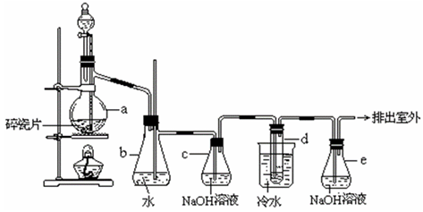

# Chemistry - 题目 142

**ID**: b47625cb386d4d5185c50a681827c6d4
**年级**: Grade 10
**难度**: Medium-Hard
**题型**: 非选择题

## 题目
1，2-二溴乙烷可作汽油抗爆剂的添加剂，常温下它是无色液体，密度 2.18 g·cm^{-3}，沸点131.4℃，熔点9.79℃，不溶于水，易溶于醇、醚、丙酮等有机溶剂。​​​​​​​‌在实验室中可以用下图所示装置制备1，2-二溴乙烷。其中分液漏斗和烧瓶a中装有乙醇和浓硫酸的混合液，试管d中装有液溴(表面覆盖少量水)。填写下列空白：(1) 写出本题中由乙醇制备1，2-二溴乙烷的两个化学反应方程式：①，反应类型为。②，反应类型为。(2)装置b可以充当安全瓶，防止倒吸，例如：若装置a、b上方气体压强减小，则装置b中的现象为。(3)容器c中NaOH溶液的作用是：；若无c装置，则d中发生副反应的离子方程式为。(4)在做此实验时，应使a装置中的液体温度迅速升高到所需温度，请用化学方程式表示其原因。

## 解答

1. （1）实验室中用乙醇和浓硫酸加热来制取乙烯,然后用乙烯和溴单质的加成反应来制得1,2-二溴乙烷,发生反应的化学方程式为CH_{3}CH_{2}OH→CH_{2}=CH_{2}+H_{2}O 、 消去反应    CH_{2}=CH_{2}+Br_{2}→CH_{2}BrCH_{2}Br 、  加成反应；
2. 本题答案为：CH_{3}CH_{2}OH→CH_{2}=CH_{2}+H_{2}O 、 消去反应，CH_{2}=CH_{2}+Br_{2}→CH_{2}BrCH_{2}Br 、加成反应。
3. （2）b为安全瓶,可以防止倒吸, 若装置a、b上方气体压强减小，则装置b中的现象为：空气从长导管进入 b瓶中(b中长导管有气泡冒出)；
4. 本题答案为：空气从长导管进入 b瓶中(b中长导管有气泡冒出)。
5. （3）氢氧化钠可以和制取乙烯中产生的杂质气体二氧化碳和二氧化硫发生反应,防止造成污染,所以C中NAOH的作用是，除去乙烯中带出的酸性气体(或除去（CO_{2}、SO_{2}）；若无C装置则在D中会发生，SO_{2}和Br_{2}的氧化还原反应，其离子方程式为SO_{2}+ Br_{2}+ 2 H_{2}O = 4H+ + SO_{4}^{2—}+ 2Br^{-}；
6. 本题答案为：除去乙烯中带出的酸性气体(或除去（CO_{2}、SO_{2}），SO_{2}+ Br_{2}+ 2 H_{2}O = 4H+ + SO_{4}^{2—}+ 2Br^{-}。
7. （4）温度在 ${\rm 140}℃$ 时，会有副反应发生；所以要求迅速升高到 ${\rm 170}℃$ ，其副反应是2CH_{3}CH_{2}OH→CH_{3}CH_{2}OCH_{2}CH_{3}+H_{2}O；
8. 本题答案为：2CH_{3}CH_{2}OH→CH_{3}CH_{2}OCH_{2}CH_{3}+H_{2}O。

## 知识点

**中文**:
  - 乙烯的加成反应
  - 乙醇的消去反应
  - 制备实验

**English**:
  - Addition Reaction
  - Elimination Reaction
  - Preparation Experiments

---
