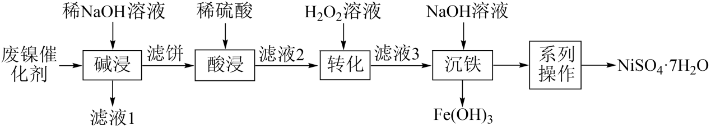

# Chemistry - 题目 156

**ID**: be33b78fa7eb4fb8966d254cc176cd98
**年级**: Grade 10
**难度**: Medium-Hard
**题型**: 非选择题

## 题目
利用油脂厂废弃的镍( ${\rm{N}}{\rm{i}}$ )催化剂(主要含有 ${\rm{N}}{\rm{i}}$ 、 ${\rm{A}}{\rm{l}}$ 、 ${\rm{F}}{\rm{e}}$ ，还含少量的 ${\rm{N}}{\rm{i}}{\rm{O}}$ 、 ${\rm{A}}{\rm{l}}{{}_{2}}{\rm{O}}{{}_{3}}$ 、 ${\rm{F}}{\rm{e}}{{}_{2}}{\rm{O}}{{}_{3}}$ )制备 ${\rm{N}}{\rm{i}}{\rm{S}}{\rm{O}}{{}_{4}}\cdot 7{\rm{H}}{{}_{2}}{\rm{O}}$ 的工艺流程如下：回答下列问题：(1)为加快“碱浸”的速率，可采取的措施有(任写一条)。​​​​​​​‌(2)油脂的下列性质或用途与其含有的不饱和碳碳双键有关的是(填标号)。

## 解答

1. （1）为加快“碱浸”的速率可采取的措施是适当升温或适当提高NaOH溶液的浓度或将废镍催化剂粉碎为更小的颗粒等；
2. （2）A．某些油脂兼有酯和烯烃的一些性质与其含有不饱和碳碳双键有关，故A选；
3. B．油脂发生水解反应可生产甘油，与不饱和碳碳双键无关，故B不选；
4. C．油脂可以为人体提供能量是通过氧化反应提供能量，与不饱和碳碳双键无关，故C不选；
5. D．植物油可用于生产氢化植物油发生了加成反应，与不饱和碳碳双键有关，故D选；
6. 答案为AD；
7. （3）
8. 金属 ${\rm{A}}{\rm{l}}$ 与 ${\rm{N}}{\rm{a}}{\rm{O}}{\rm{H}}$ 溶液反应的离子方程式为2Al+6H_{2}O+2OH^{－}=2[Al(OH)_{4}]^{－}+3H_{2}↑，反应中Al失去电子，H_{2}O中H得到电子，用双线桥法标明电子转移的方向和数目为；
9. （4）据分析“滤液2”中主要有：Fe^{2+}、Fe^{3+}、Ni^{2+}等；
10. （5）
11. H_{2}O_{2}为共价化合物，电子式为；
12. （6）由分析可知，系列操作为：蒸发浓缩、冷却结晶、过滤、洗涤、干燥；
13. （7）①该电池属于二次电池，因为可以反应充电、放电，电池的充电反应与放电反应不属于可逆反应，因为不是同时进行的，条件也不同；
14. ②NiSO_{4}在强碱溶液中用NaClO氧化，可制得碱性镍镉电池电极材料NiOOH，该反应的离子方程式是： ${\rm{C}}{\rm{l}}{\rm{O}}{^{-}}+4{\rm{O}}{\rm{H}}{^{-}}+2{\rm{N}}{\rm{i}}{^{2+}}=2{\rm{N}}{\rm{i}}{\rm{O}}{\rm{O}}{\rm{H}}\downarrow +{\rm{C}}{\rm{l}}{^{-}}+{\rm{H}}{{}_{2}}{\rm{O}}$ 。

## 知识点

**中文**:
  - 二次电池
  - 单线桥、双线桥法分析氧化还原反应
  - 离子方程式的书写及正误判断
  - 电子式、结构式、结构简式、化学式、比例模型、球棍模型、化学符号及名称的综合

**English**:
  - Secondary Batteries
  - Single and Double Line Bridge Methods
  - Writing and Verifying Ionic Equations
  - Comprehensive Chemical Notation and Models

---
