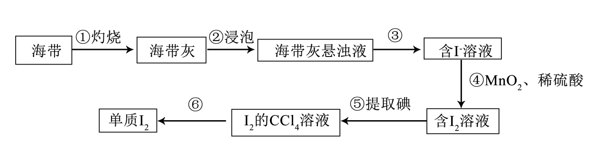

# Chemistry - 题目 82

**ID**: ccb819dec98b4defbdfd9f69e8bdd650
**年级**: Grade 10
**难度**: Medium-Hard
**题型**: 非选择题

## 题目
目前我国利用海洋资源获取溴、碘等元素已成规模。​​​​​​​‌I．在实验室中，某研究性学习小组设计以下实验，从海带中提取碘：(1)步骤①灼烧海带时，海带应放在（填仪器名称）内灼烧。(2)步骤④反应的离子方程式为。(3)步骤⑤的实验操作可分解为如下几步：

## 解答

1. （1）灼烧固体需在坩埚中进行；
2. （2）碘离子的溶液加入二氧化锰生成碘单质和二价锰，离子方程式为 ${\rm{M}}{\rm{n}}{\rm{O}}{{}_{{{2}}}}{{+}}{{2}}{\rm{I}}{^{{{-}}}}{{+}}{{4}}{\rm{H}}{^{{{+}}}}{\rm{=}}{\rm{I}}{{}_{{{2}}}}{{+}}{\rm{M}}{\rm{n}}{^{{{2}}{{+}}}}{{+}}{{2}}{\rm{H}}{{}_{{{2}}}}{\rm{O}}$ ；
3. （3）步骤⑤的名称为萃取分液。其实验操作可分解为如下几步：检验分液漏斗活塞和上口的玻璃塞是否漏液；把50mL碘水和15mL苯加入分液漏斗中，并盖好玻璃塞；振荡时，应避免分液漏斗内压强过大；倒转漏斗用力振荡，并不时旋开活塞放气，最后关闭活塞把分液漏斗放正；把盛有溶液的分液漏斗放在铁架台的铁圈中；静置，分层；为使液体顺利流下，应使分液漏斗内外压强相等；将漏斗上口的玻璃塞打开或使塞上的凹槽或小孔对准漏斗口上的小孔；四氯化碳密度比水大，下层为碘的四氯化碳溶液，旋开活塞，用烧杯接收溶液；使漏斗下端管口紧靠烧杯内壁；及时关闭活塞，不要让上层液体流出；从分液漏斗上口倒出上层溶液；该实验操作顺序是：CBD→A→H→G→E→F(用上述编号字母填写)；E步骤中操作应注意使漏斗下端管口紧靠烧杯内壁；及时关闭活塞，不要让上层液体流出；故操作顺序是：CBDAHGEF；
4. （4）通入热空气吹出Br_{2}，利用了Br_{2}的易挥发性；用热空气吹出，用二氧化硫来吸收，反应生成氢溴酸和硫酸，离子方程式： ${\rm{B}}{\rm{r}}{{}_{{{2}}}}{{+}}{\rm{S}}{\rm{O}}{{}_{{{2}}}}{{+}}{{2}}{\rm{H}}{{}_{{{2}}}}{\rm{O}}{\rm{=}}{{4}}{\rm{H}}{^{{{+}}}}{{+}}{{2}}{\rm{B}}{\rm{r}}{\rm{\;}}{^{{{-}}}}{{+}}{\rm{S}}{\rm{O}}{{}_{{{4}}}^{{{2}}{{-}}}}$ ；“操作II”是从含 ${\rm{B}}{\rm{r}}{{}_{2}}$ 的溶液中提取液溴，利用 ${\rm{B}}{\rm{r}}{{}_{2}}$ 易挥发，沸点的不同进行分离，故可选A。

## 知识点

**中文**:
  - 海带提碘
  - 离子方程式的书写及正误判断
  - 海水提溴

**English**:
  - Iodine Extraction from Kelp
  - Writing and Verifying Ionic Equations
  - Bromine Extraction

---
