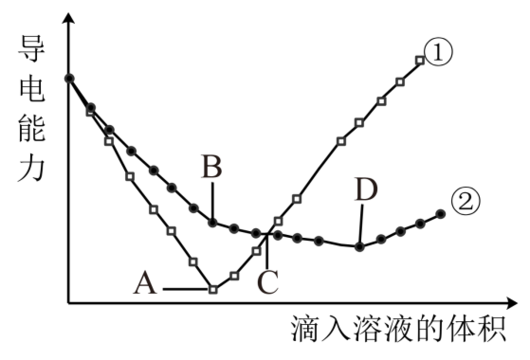

# Chemistry - 题目 87

**ID**: e33effee9aaf45b2aff431a154cf577d
**年级**: Grade 10
**难度**: Medium-Hard
**题型**: 非选择题

## 题目
现有：①酒精  ②稀硝酸  ③ ${\rm{S}}{\rm{O}}{{}_{{{2}}}}$  ④ ${\rm{B}}{\rm{a}}\left ({{\rm{O}}{\rm{H}}}\right ){{}_{{{2}}}}$ 溶液  ⑤铁  ⑥ ${\rm{N}}{\rm{a}}{\rm{H}}{\rm{S}}{\rm{O}}{{}_{{{4}}}}$  ⑦ ${\rm{F}}{\rm{e}}\left ({{\rm{O}}{\rm{H}}}\right ){{}_{{{3}}}}$ 胶体  ⑧纯碱(1)上述物质中，属于电解质的有(填序号)。​​​​​​​‌(2)⑥在水中的电离方程式为。(3)上述物质中有两种物质之间可发生反应： ${\rm{H}}{^{{{+}}}}{{+}}{\rm{O}}{\rm{H}}{^{{{-}}}}{\rm{=}}{\rm{H}}{{}_{{{2}}}}{\rm{O}}$ ，写出该离子反应对应的化学方程式：。(4)将铁粉加入到⑥的水溶液中，写出反应的离子方程式：。(5)向两份相同的④溶液中，分别滴入浓度相等的稀硫酸、NaHSO_{4}溶液，溶液的导电能力随滴入溶液体积变化的曲线如图所示：滴加稀硫酸的是图中的曲线。曲线②中B点之前发生反应的离子方程式为。

## 解答

1. （1）电解质是指在水溶液中或熔融状态下能够导电的化合物，其导电的本质是自身电离出自由移动的离子， ${\rm{N}}{\rm{a}}{\rm{H}}{\rm{S}}{\rm{O}}{{}_{{{4}}}}$ 和纯碱（ ${\rm{N}}{\rm{a}}{{}_{{{2}}}}{\rm{C}}{\rm{O}}{{}_{{{3}}}}$ ）符合电解质的定义，稀硝酸、氢氧化钡溶液，氢氧化铁胶体均是混合物，铁是单质，酒精、二氧化硫是非电解质；
2. （2） ${\rm{N}}{\rm{a}}{\rm{H}}{\rm{S}}{\rm{O}}{{}_{{{4}}}}$ 是强酸的酸式盐，完全电离，电离方程式为： ${\rm{N}}{\rm{a}}{\rm{H}}{\rm{S}}{\rm{O}}{{}_{4}}={\rm{N}}{\rm{a}}{^{+}}+{\rm{H}}{^{+}}+{\rm{S}}{\rm{O}}{{}_{4}^{2-}}$ ；
3. （3）两种物质之间可发生反应： ${\rm{H}}{^{{{+}}}}{{+}}{\rm{O}}{\rm{H}}{^{{{-}}}}{\rm{=}}{\rm{H}}{{}_{{{2}}}}{\rm{O}}$ ，方程式应为强酸和强碱反应生成可溶盐和水，符合该离子反应对应的化学方程式为 $2{\rm{H}}{\rm{N}}{\rm{O}}{{}_{3}}+{\rm{B}}{\rm{a}}\left ({{\rm{O}}{\rm{H}}}\right ){{}_{2}}={\rm{B}}{\rm{a}}\left ({{\rm{N}}{\rm{O}}{{}_{3}}}\right ){{}_{2}}+2{\rm{H}}{{}_{2}}{\rm{O}}$ ；
4. （4）将铁粉加入到⑥ ${\rm{N}}{\rm{a}}{\rm{H}}{\rm{S}}{\rm{O}}{{}_{{{4}}}}$ 的水溶液中，反应的本质是铁和氢离子反应，离子方程式为： ${\rm{F}}{\rm{e}}+2{\rm{H}}{^{+}}={\rm{F}}{\rm{e}}{^{2+}}+$  ${\rm{H}}{{}_{2}}\uparrow $ ；
5. （5）向 ${\rm{B}}{\rm{a}}\left ({{\rm{O}}{\rm{H}}}\right ){{}_{{{2}}}}$ 溶液中滴加 ${\rm{H}}{{}_{{{2}}}}{\rm{S}}{\rm{O}}{{}_{{{4}}}}$ 溶液，反应方程式为 ${\rm{B}}{\rm{a}}\left ({{\rm{O}}{\rm{H}}}\right ){{}_{{{2}}}}{{+}}{\rm{H}}{{}_{{{2}}}}{\rm{S}}{\rm{O}}{{}_{{{4}}}}{\rm{=}}{\rm{B}}{\rm{a}}{\rm{S}}{\rm{O}}{{}_{{{4}}}}\downarrow {{+}}{{2}}{\rm{H}}{{}_{{{2}}}}{\rm{O}}$ ，向 ${\rm{B}}{\rm{a}}\left ({{\rm{O}}{\rm{H}}}\right ){{}_{{{2}}}}$ 溶液中滴加 ${\rm{N}}{\rm{a}}{\rm{H}}{\rm{S}}{\rm{O}}{{}_{{{4}}}}$ 溶液，反应分为两步： ${\rm{N}}{\rm{a}}{\rm{H}}{\rm{S}}{\rm{O}}{{}_{{{4}}}}{{+}}{\rm{B}}{\rm{a}}\left ({{\rm{O}}{\rm{H}}}\right ){{}_{{{2}}}}{\rm{=}}{\rm{B}}{\rm{a}}{\rm{S}}{\rm{O}}{{}_{{{4}}}}\downarrow {{+}}{\rm{N}}{\rm{a}}{\rm{O}}{\rm{H}}{{+}}{\rm{H}}{{}_{{{2}}}}{\rm{O}}$ 、 ${\rm{N}}{\rm{a}}{\rm{O}}{\rm{H}}{{+}}{\rm{N}}{\rm{a}}{\rm{H}}{\rm{S}}{\rm{O}}{{}_{{{4}}}}{\rm{=}}{\rm{N}}{\rm{a}}{{}_{{{2}}}}{\rm{S}}{\rm{O}}{{}_{{{4}}}}{{+}}{\rm{H}}{{}_{{{2}}}}{\rm{O}}$ ，溶液导电能力与离子浓度成正比，根据图知，曲线①在A点溶液导电能力接近0，说明该点溶液离子浓度最小，应该为 ${\rm{B}}{\rm{a}}\left ({{\rm{O}}{\rm{H}}}\right ){{}_{{{2}}}}$ 溶液和 ${\rm{H}}{{}_{{{2}}}}{\rm{S}}{\rm{O}}{{}_{{{4}}}}$ 溶液反应，则曲线②为 ${\rm{B}}{\rm{a}}\left ({{\rm{O}}{\rm{H}}}\right ){{}_{{{2}}}}$ 溶液和 ${\rm{N}}{\rm{a}}{\rm{H}}{\rm{S}}{\rm{O}}{{}_{{{4}}}}$ 溶液反应，即①代表滴加 ${\rm{H}}{{}_{{{2}}}}{\rm{S}}{\rm{O}}{{}_{{{4}}}}$ 溶液的变化曲线，曲线②中B点之前发生反应的化学方程式： ${\rm{N}}{\rm{a}}{\rm{H}}{\rm{S}}{\rm{O}}{{}_{{{4}}}}{{+}}{\rm{B}}{\rm{a}}\left ({{\rm{O}}{\rm{H}}}\right ){{}_{{{2}}}}{\rm{=}}{\rm{B}}{\rm{a}}{\rm{S}}{\rm{O}}{{}_{{{4}}}}\downarrow {{+}}{\rm{N}}{\rm{a}}{\rm{O}}{\rm{H}}{{+}}{\rm{H}}{{}_{{{2}}}}{\rm{O}}$ ，离子方程式为 ${\rm{B}}{\rm{a}}{^{2+}}+{\rm{O}}{\rm{H}}{^{-}}+{\rm{H}}{^{+}}+{\rm{S}}{\rm{O}}{{}_{4}^{2-}}={\rm{B}}{\rm{a}}{\rm{S}}{\rm{O}}{{}_{4}}\downarrow +{\rm{H}}{{}_{2}}{\rm{O}}$ 。

## 知识点

**中文**:
  - 电离方程式的书写及正误判断
  - 电解质的概念及判断
  - 离子方程式的书写及正误判断

**English**:
  - Writing and Verifying Ionization Equations
  - Concept and Identification of Electrolytes
  - Writing and Verifying Ionic Equations

---
