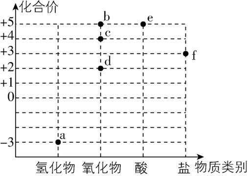

# Chemistry - 题目 126

**ID**: ee1b1d58946749b584bbd581e670d288
**年级**: Grade 10
**难度**: Medium-Hard
**题型**: Multiple-choice

## 题目
（湖北黄冈高一期末）以物质类别为横坐标，化合价为纵坐标，可以绘制某一元素的价类图。​​​​​​​‌氮元素的价类图如图所示，下列有关说法不正确的是（      ）

## 解答

1. 实验室用单质铜与稀硝酸反应制取d即NO的化学方程式为3Cu＋8HNO_{3}(稀) $\begin{array}{}{\underline{{\underline{{\rm{\;}}{\rm{\;}}{\rm{\;}}{\rm{\;}}{\rm{\;}}{\rm{\;}}{\rm{\;}}}}}}\\\;\end{array}$ 3Cu(NO_{3})_{2}＋2NO↑＋4H_{2}O，由关系式：3Cu～2NO可知，生成标准状况下5.6 L(即0.25 mol)气体d时，消耗铜的质量为24 g，A正确；由图知，从a→d→c→e的转化过程中，N元素化合价均升高、均发生氧化反应，故必须向每个步骤中提供氧化剂，B不正确；c、d分别为NO和NO_{2}，同时通入NaOH溶液中发生氧化还原反应，仅生成f一种盐即亚硝酸钠，反应的离子方程式为NO＋NO_{2}＋2OH^{－}$\begin{array}{}{\underline{{\underline{{\rm{\;}}{\rm{\;}}{\rm{\;}}{\rm{\;}}{\rm{\;}}{\rm{\;}}{\rm{\;}}}}}}\\\;\end{array}$ 2NO_{2}^{－}＋H_{2}O，C正确；a与c分别为氨气和二氧化氮，在一定条件下发生氧化还原反应，生成无污染的物质即氮气和水：8NH_{3}＋6NO_{2}$\begin{array}{}{\underline{{\underline{{\rm{\;}}{\rm{\;}}{\rm{\;}}{\rm{\;}}{\rm{\;}}{\rm{\;}}{\rm{\;}}}}}}\\\;\end{array}$ 7N_{2}＋12H_{2}O，该反应中氧化剂为二氧化氮、还原剂为氨气，氧化剂与还原剂的物质的量之比为3∶4，D正确。

## 知识点

**中文**:
  - 一氧化氮的性质
  - 二氧化氮的性质

**English**:
  - Properties of Nitric Oxide
  - Properties of Nitrogen Dioxide

---
