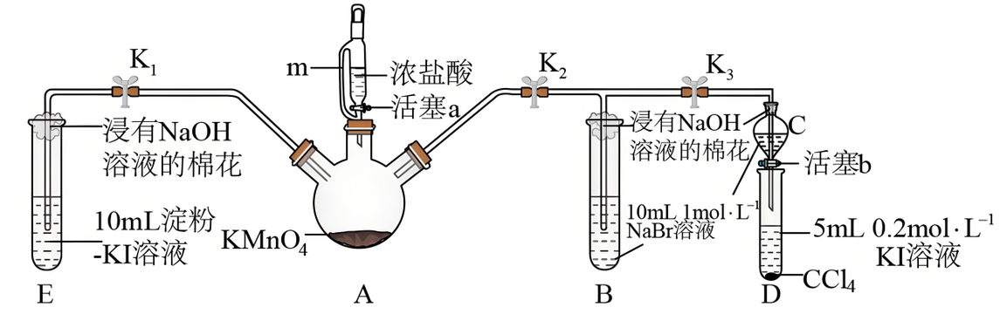
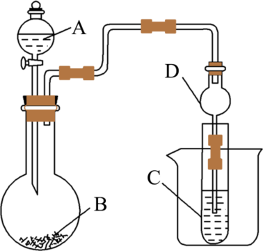

# Chemistry - 题目 127

**ID**: f5193fc5f25a4f9eab69b1d642fe5551
**年级**: Grade 10
**难度**: Medium-Hard
**题型**: 非选择题

## 题目
为验证卤素单质氧化性的相对强弱，某小组用如图所示装置进行实验(夹持仪器已略去，气密性已检验)。​​​​​​​‌实验过程：I．打开 ${\rm{K}}{{}_{{{1}}}}$ ，关闭 ${\rm{K}}{{}_{2}}$ ， ${\rm{K}}{{}_{3}}$ ，打开活塞a，滴加浓盐酸。Ⅱ．关闭 ${\rm{K}}{{}_{{{1}}}}$ ，打开 ${\rm{K}}{{}_{2}}$ ， ${\rm{K}}{{}_{3}}$ ，当B和C中的溶液都变为黄色时，关闭 ${\rm{K}}{{}_{3}}$ 。Ⅲ．B中继续通气体，当B中溶液由黄色变为棕红色时，关闭活塞a。Ⅳ．……回答下列问题：（1）装置A中m的作用。（2）能说明氯气的氧化性强于碘的实验现象是。（3）用离子方程式解释过程Ⅱ中溶液变为黄色的原因。过程Ⅲ的实验目的是。（4）请用原子结构的知识解释氯、溴、碘单质的氧化性还渐减弱的原因。（5）(氰 $\left ({{\rm{C}}{\rm{N}}}\right ){{}_{{{2}}}}$ 和硫氰 $\left ({{\rm{S}}{\rm{C}}{\rm{N}}}\right ){{}_{{{2}}}}$ 的化学性质和卤素很相似，化学上称为“类卤素”，它们阴离子的还原性强弱为： ${\rm{C}}{\rm{l}}{^{-}}<{\rm{B}}{\rm{r}}{^{-}}<{\rm{C}}{\rm{N}}{^{-}}<{\rm{S}}{\rm{C}}{\rm{N}}{^{-}}<{\rm{I}}{^{-}}$ 。试写出：在NaBr和KSCN的混合溶液中加入少量 $\left ({{\rm{C}}{\rm{N}}}\right ){{}_{{{2}}}}$ 发生反应的离子方程式。（6）利用下图装置也可以验证非金属性的变化规律。若要证明非金属性： ${\rm{C}}{\rm{l}}>{\rm{C}}>{\rm{S}}{\rm{i}}$ ，则A中加入试剂、B中加 ${\rm{N}}{\rm{a}}{{}_{{{2}}}}{\rm{C}}{\rm{O}}{{}_{{{3}}}}$ 、C中加入试剂。

## 解答

1. （1）m的作用是连通容器和分液漏斗的气体，达到平衡气压的目的，使液体（浓盐酸）能顺利滴下；
2. （2）E中产生I_{2}就说明Cl_{2}的氧化性比I_{2}强，故当E中淀粉KI溶液变蓝，即说明有碘单质生成；
3. （3）Ⅱ实验，BC均为NaBr溶液，变为黄色，说明通入Cl_{2}后，有Br_{2}生成，反应的离子方程式为 ${\rm{C}}{\rm{l}}{{}_{{{2}}}}+2{\rm{B}}{\rm{r}}{^{-}}={\rm{B}}{\rm{r}}{{}_{{{2}}}}+2{\rm{C}}{\rm{l}}{^{-}}$ ；
4. 为了使C中没有Cl_{2}干扰后续试验，需要确保装置内没有Cl_{2}，故通过继续向B中通氯气，待B中颜色变成红棕色，说明NaBr被完全反应，保证装置内Cl_{2}被完全反应，故过程Ⅲ的实验目的是确认C黄色溶液中无 ${\rm{C}}{\rm{l}}{{}_{2}}$ ，排除 ${\rm{C}}{\rm{l}}{{}_{2}}$ 对溴置换碘实验的干扰；
5. （4）同主族元素从上到下电子层数逐渐增多，原子半径逐渐增大，得电子能力逐渐减弱，单质的氧化性逐渐减弱；
6. （5）在NaBr和KSCN的混合溶液中加入少量(CN)_{2}，由于还原性强弱为： ${\rm{B}}{\rm{r}}{^{{{-}}}}{\rm{<}}{\rm{C}}{\rm{N}}{^{{{-}}}}{\rm{<}}{\rm{S}}{\rm{C}}{\rm{N}}{^{{{-}}}}$ ，所以只有SCN^{-}能被(CN)_{2}氧化，发生反应的离子方程式为 $2{\rm{S}}{\rm{C}}{\rm{N}}{^{-}}+{\rm{(}}{\rm{C}}{\rm{N}}{\rm{)}}{{}_{2}}=2{\rm{C}}{\rm{N}}{^{-}}+{\rm{(}}{\rm{S}}{\rm{C}}{\rm{N}}{\rm{)}}{{}_{{{2}}}}$ ；
7. （6）元素的非金属性越强，最高价氧化物对应水化物的酸性越强，若要证明非金属性Cl>C>Si，由强酸能和弱酸盐反应生成弱酸可知，A中加高氯酸，B中加碳酸钠，高氯酸和碳酸钠反应制取二氧化碳，证明氯元素非金属性强于碳元素，反应生成的二氧化碳和C中硅酸钠溶液反应生成硅酸，证明碳的非金属性强于硅。

## 知识点

**中文**:
  - 同主族元素性质递变规律及其与原子结构的关系

**English**:
  - Trends in Groups

---
