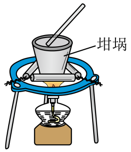
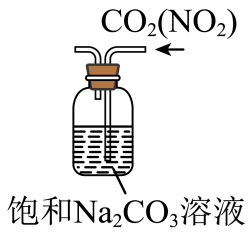
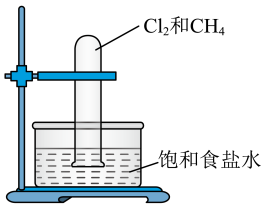
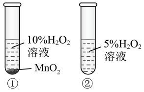

# Chemistry - 题目 328

**ID**: 334f577bf2824ae5947ca2605506e280
**年级**: Grade 10
**难度**: Medium
**题型**: Multiple-choice

## 题目
下列实验装置能达到实验目的的是（      ）装置目的提取碘时将海带灼烧为灰烬除去 ${\rm{C}}{\rm{O}}{{}_{2}}$ 中少量 ${\rm{N}}{\rm{O}}{{}_{2}}$ 杂质选项AB装置目的光照条件下制取纯净 ${\rm{C}}{\rm{H}}{\rm{C}}{\rm{l}}{{}_{{{3}}}}$证明 ${\rm{M}}{\rm{n}}{\rm{O}}{{}_{2}}$ 是 ${\rm{H}}{{}_{2}}{\rm{O}}{{}_{2}}$ 分解的催化剂选项CD​​​​​​​‌

## 解答

1. A．将海带灼烧为灰烬在坩埚中进行，故A正确；
2. B． ${\rm{C}}{\rm{O}}{{}_{2}}$ 能与饱和碳酸钠溶液反应生成碳酸氢钠，故B错误；
3. C．甲烷和氯气光照条件下生成CH_{3}Cl、CH_{2}Cl_{2}、CHCl_{3}、CCl_{4}，不能制取纯净 ${\rm{C}}{\rm{H}}{\rm{C}}{\rm{l}}{{}_{{{3}}}}$ ，故C错误；
4. D． ${\rm{H}}{{}_{2}}{\rm{O}}{{}_{2}}$ 浓度不同，不能证明 ${\rm{M}}{\rm{n}}{\rm{O}}{{}_{2}}$ 是 ${\rm{H}}{{}_{2}}{\rm{O}}{{}_{2}}$ 分解的催化剂，故D错误；
5. 故选A。

## 知识点

**中文**:
  - 实验方案的评价

**English**:
  - Evaluation of Experimental Proposals

---
