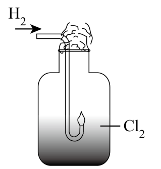

# Chemistry - 题目 213

**ID**: 696ba57d2ff9432497c56e4304b8f40d
**年级**: Grade 10
**难度**: Medium
**题型**: Multiple-choice

## 题目
氢气在氯气中燃烧实验装置如图所示，有关说法错误的是（      ）​​​​​​​‌

## 解答

1. A．氢气要验纯，否则点燃氢气时会爆炸，选项A错误；
2. B．由于有氯气(有毒气体)参加反应，为了安全，必须在通风橱中(或排风条件好的环境中)实验，选项B正确；
3. C．氢气在氯气中燃烧火焰呈苍白色，选项C正确；
4. D．氢气与氯气反应生成氯化氢，氯化氢易溶于空气中的水，形成盐酸的酸雾，选项D正确；
5. 答案选A。

## 知识点

**中文**:
  - 氯气与金属、非金属单质的反应

**English**:
  - Reaction with Metals and Non-metals

---
