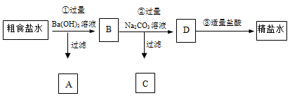

# Chemistry - 题目 348

**ID**: b89911a016d7491eb26ab1de036bbe60
**年级**: Grade 10
**难度**: Medium
**题型**: Multiple-choice

## 题目
为从粗食盐水中除去Ca^{2+}、Mg^{2+}、SO_{4}^{2}^{－}等离子，以制得精盐水。​​​​​​​‌某同学设计如下方案：以下说法正确的是（      ）

## 解答

1. A. 为从粗食盐水中除去Ca^{2+}、Mg^{2+}、SO_{4}^{2}^{－}等离子，加入过量氢氧化钡，Mg^{2+}与OH^{-}反应生成氢氧化镁沉淀，SO_{4}^{2}^{－}与Ba^{2+}生成硫酸钡沉淀，Ca(OH)_{2}的溶解度较小，Ca^{2+}与OH^{-}也会生成少量Ca(OH)_{2}沉淀，故A正确；
2. B. B中含有Ca^{2+}，Ba^{2+}，OH^{-}，中加入过量Na_{2}CO_{3}溶液的主要目的是为了除去Ca^{2+}，Ba^{2+}，故B错误；
3. C. B中含有Ca^{2+}、Ba^{2+}、OH^{-}，加入过量Na_{2}CO_{3}后，D中含有Cl^{－}、Na^{+}、CO_{3}^{2}^{－}、OH^{-}，故C错误；
4. D. D中加入适量盐酸，除去CO_{3}^{2}^{－}、OH^{-}，则③发生的反应有2H^{+}+CO_{3}^{2}^{－}= H_{2}O +CO_{2}↑，H^{+}+OH^{-}_{=}H_{2}O，故D错误；
5. 答案选A。

## 知识点

**中文**:
  - 离子推断

**English**:
  - Inference of Ions

---
