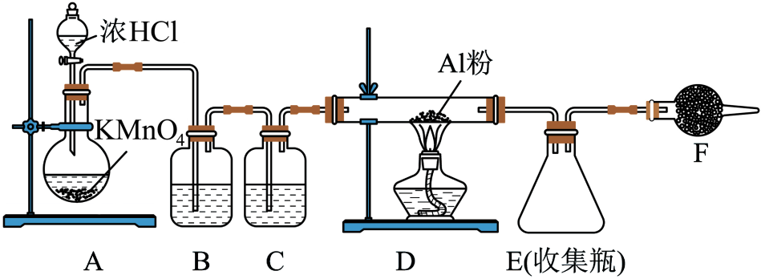

# Chemistry - 题目 106

**ID**: db682339fcf04032803f34140d980466
**年级**: Grade 10
**难度**: Medium
**题型**: Multiple-choice

## 题目
某实验小组利用下图装置制备少量AlCl_{3}固体，已知：AlCl_{3}易升华，易与水反应。​​​​​​​‌下列说法错误的是（      ）

## 解答

1. A．B装置是饱和食盐水，除去氯气中的HCl，C装置为浓硫酸干燥氯气， F中试剂为碱石灰，作用是吸收尾气防止污染空气，同时防止空气中的水蒸气进入干扰实验，A正确；
2. B．AlCl_{3}易升华，冷却后生成固体容易堵塞导管，应该在D、E之间使用粗的导气管实验，B正确；
3. C．先点燃A处酒精灯，待装置充满黄绿色气体时，再点燃D处酒精灯，防止Al与空气中的氧气反应，C正确；
4. D．稀盐酸溶液与MnO_{2}不反应，50mL12mol/L的盐酸与足量的  ${\rm \mathrm{M}\mathrm{n}\mathrm{O}₂}$   反应生成的Cl_{2}小于0.15mol，制取的AlCl_{3}的物质的量小于0.1mol，D错误；
5. 答案选D。

## 知识点

**中文**:
  - 仪器使用与实验安全
  - 制备实验

**English**:
  - Instrument Usage and Safety
  - Preparation Experiments

---
