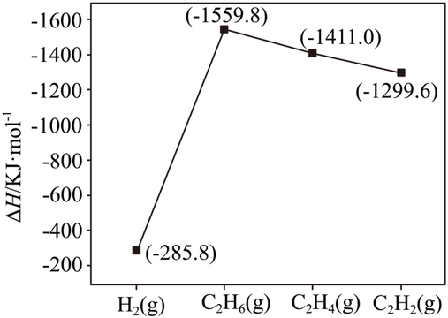

# Chemistry - 题目 85

**ID**: e68e57a98ecd4d3baecd8e03fff7a673
**年级**: Grade 10
**难度**: Medium
**题型**: Multiple-choice

## 题目
乙烷 $\left ({{\rm{C}}{{}_{{{2}}}}{\rm{H}}{{}_{{{6}}}}}\right )$ 、乙烯 $\left ({{\rm{C}}{{}_{{{2}}}}{\rm{H}}{{}_{{{4}}}}}\right )$ 、乙炔 $\left ({{\rm{C}}{{}_{{{2}}}}{\rm{H}}{{}_{{{2}}}}}\right )$ 和 ${\rm{H}}{{}_{{{2}}}}$ 均为常见的气体燃料，四种物质各 ${{1}}{\rm{m}}{\rm{o}}{\rm{l}}$ 完全燃烧的焓变 $(Δ{\rm{H}})$ 如图所示。​​​​​​​‌已知：单位体积气态可燃物完全燃烧时放出的热量叫作该可燃物的热值。下列叙述正确的是

## 解答

1. A．由分析，根据氢元素守恒可知，生成 ${{1}}{\rm{m}}{\rm{o}}{\rm{l}}$ 液态水放出热量最多的是乙炔，A错误；
2. B．燃烧热强调 ${{1}}{\rm{m}}{\rm{o}}{\rm{l}}$ 可燃物，表示乙烷燃烧热的热化学方程式为 ${\rm{C}}{{}_{2}}{\rm{H}}{{}_{6}}({\rm{g}})+\frac {7}{2}{\rm{O}}{{}_{2}}({\rm{g}})=2{\rm{C}}{\rm{O}}{{}_{2}}({\rm{g}})+3{\rm{H}}{{}_{2}}{\rm{O}}(1)\quad Δ{\rm{H}}=-1559.8{\rm{k}}{\rm{J}}\cdot {\rm{m}}{\rm{o}}{\rm{l}}{^{-1}}{\rm ，B}$ 错误；
3. C．结合阿伏伽德罗定律，由分析可知，相同体积的四种气态可燃物完全燃烧时放出热量最多的是 ${\rm{C}}{{}_{2}}{\rm{H}}{{}_{6}}{\rm ，C}$ 正确；
4. D．表示氢气、乙烯和乙烷燃烧热的热化学方程式分别为① ${\rm{H}}{{}_{2}}({\rm{g}})+\frac {1}{2}{\rm{O}}{{}_{2}}({\rm{g}})={\rm{H}}{{}_{2}}{\rm{O}}({\rm{l}})\quad Δ{\rm{H}}=-285.8{\rm{k}}{\rm{J}}\cdot {\rm{m}}{\rm{o}}{\rm{l}}{^{-1}}$ 、② ${\rm{C}}{{}_{2}}{\rm{H}}{{}_{4}}({\rm{g}})+3{\rm{O}}{{}_{2}}({\rm{g}})=2{\rm{C}}{\rm{O}}{{}_{2}}({\rm{g}})+2{\rm{H}}{{}_{2}}{\rm{O}}({\rm{l}})\quad Δ{\rm{H}}=-1411.0{\rm{k}}{\rm{J}}\cdot {\rm{m}}{\rm{o}}{\rm{l}}{^{-1}}$ 、③ ${\rm{C}}{{}_{2}}{\rm{H}}{{}_{6}}({\rm{g}})+\frac {7}{2}{\rm{O}}{{}_{2}}({\rm{g}})=2{\rm{C}}{\rm{O}}{{}_{2}}({\rm{g}})+3{\rm{H}}{{}_{2}}{\rm{O}}({\rm{l}})\quad Δ{\rm{H}}=-1559.8{\rm{k}}{\rm{J}}\cdot {\rm{m}}{\rm{o}}{\rm{l}}{^{-1}}$ ，根据盖斯定律，将 $③-①-②$ 得： ${\rm{C}}{{}_{2}}{\rm{H}}{{}_{6}}({\rm{g}})={\rm{C}}{{}_{2}}{\rm{H}}{{}_{4}}({\rm{g}})+{\rm{H}}{{}_{2}}({\rm{g}})\quad Δ{\rm{H}}=+137{\rm{k}}{\rm{J}}\cdot {\rm{m}}{\rm{o}}{\rm{l}}{^{-1}}{\rm ，D}$ 错误；
5. 故选C。

## 知识点

**中文**:
  - 热化学方程式的正误判断

**English**:
  - Verification of Thermochemical Equations

---
