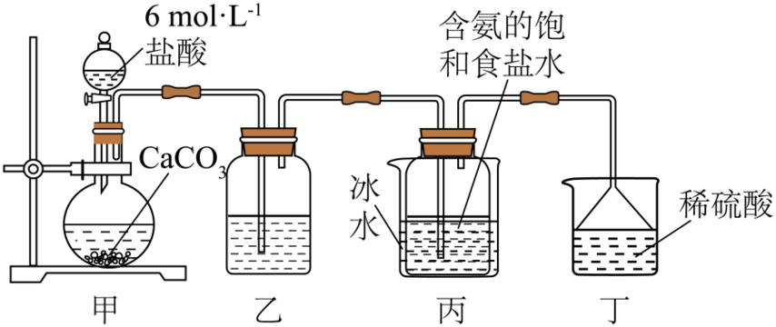

# Chemistry - 题目 116

**ID**: f6a6d71f79dc4b84a18097b32604118e
**年级**: Grade 10
**难度**: Medium
**题型**: Multiple-choice

## 题目
实验室用下图装置模拟侯氏制碱法原理，以NaCl、 ${\rm{N}}{\rm{H}}{{}_{{{3}}}}$ 、 ${\rm{C}}{\rm{O}}{{}_{{{2}}}}$ 等为原料制取少量 ${\rm{N}}{\rm{a}}{\rm{H}}{\rm{C}}{\rm{O}}{{}_{{{3}}}}$ 。​​​​​​​‌下列有关说法正确的是（      ）

## 解答

1. A． ${\rm{C}}{\rm{O}}{{}_{{{2}}}}$ 能够和饱和 ${\rm{N}}{\rm{a}}{{}_{{{2}}}}{\rm{C}}{\rm{O}}{{}_{{{3}}}}$ 溶液反应，不能用饱和 ${\rm{N}}{\rm{a}}{{}_{{{2}}}}{\rm{C}}{\rm{O}}{{}_{{{3}}}}$ 溶液除去 ${\rm{C}}{\rm{O}}{{}_{{{2}}}}$ 中的少量HCl，可以用饱和 ${\rm{N}}{\rm{a}}{\rm{H}}{\rm{C}}{\rm{O}}{{}_{{{3}}}}$ 溶液，A错误；
2. B．装置丙中CO_{2}和含氨的饱和食盐水发生反应生成 ${\rm{N}}{\rm{a}}{\rm{H}}{\rm{C}}{\rm{O}}{{}_{{{3}}}}$ ， ${\rm{N}}{\rm{a}}{\rm{H}}{\rm{C}}{\rm{O}}{{}_{{{3}}}}$ 的溶解度随着温度的下降而减小，则用冰水浴冷却丙装置可以降低 ${\rm{N}}{\rm{a}}{\rm{H}}{\rm{C}}{\rm{O}}{{}_{{{3}}}}$ 的溶解度，有利于析出 ${\rm{N}}{\rm{a}}{\rm{H}}{\rm{C}}{\rm{O}}{{}_{{{3}}}}$ 固体，B正确；
3. C．丙装置中析出 ${\rm{N}}{\rm{a}}{\rm{H}}{\rm{C}}{\rm{O}}{{}_{{{3}}}}$ 固体的上层清液为 ${\rm{N}}{\rm{a}}{\rm{H}}{\rm{C}}{\rm{O}}{{}_{{{3}}}}$ 的饱和溶液，其中含有 ${\rm{H}}{\rm{C}}{\rm{O}}{{}_{3}^{-}}{\rm ，C}$ 错误；
4. D． ${\rm{C}}{\rm{O}}{{}_{{{2}}}}$ 不和稀硫酸反应，装置丁的作用是吸收丙装置中逸出的 ${\rm{N}}{\rm{H}}{{}_{{{3}}}}$ ，不能吸收 ${\rm{C}}{\rm{O}}{{}_{{{2}}}}{\rm ，D}$ 错误；
5. 故选B。

## 知识点

**中文**:
  - 侯氏制碱法

**English**:
  - Hou's Process for Soda Production

---
