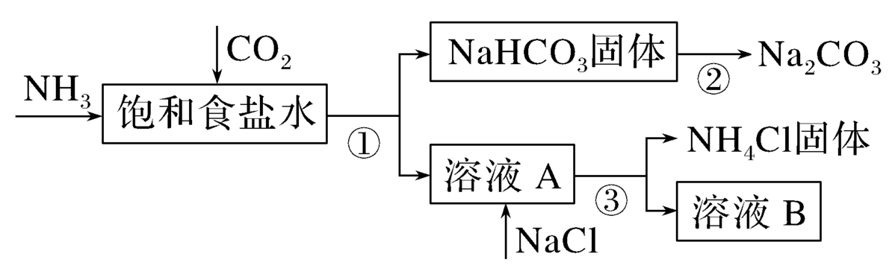

# Chemistry - 题目 130

**ID**: 52b984e5e8da45aa8c3d9efa631f2536
**年级**: Grade 10
**难度**: Medium
**题型**: 纯碱生产历史与侯氏制碱法

## 题目
(2023·石家庄正定中学高一月考)如图所示是工业制纯碱的部分物质转化示意图，下列推测错误的是（      ）​​​​​​​‌

## 解答

1. A.分离固体和液体的操作是过滤，①～③涉及的操作方法中，包含过滤的是①③，分别得到碳酸氢钠和氯化铵固体，A正确；B.溶液B中含氯化钠和氯化铵等，可循环使用，B错误；C.副产物NH_{4}Cl中含氮元素，可用作肥料，C正确；D.NH_{3}极易溶于水，CO_{2}在水中的溶解度不大，因此向饱和食盐水中先通NH_{3}使溶液呈碱性，从而增大CO_{2}的溶解度，有利于提高NaHCO_{3}的产量，D正确。

## 知识点

**中文**:
  - 侯氏制碱法

**English**:
  - Hou's Process for Soda Production

---
