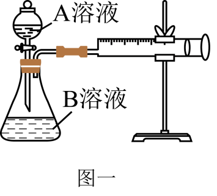
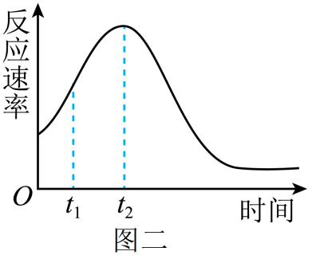

# Chemistry - 题目 277

**ID**: a6b63c01d81e4cd7a12fc7fc52399a32
**年级**: Grade 11
**难度**: Medium
**题型**: Calculation

## 题目
用酸性KMnO_{4}和H_{2}C_{2}O_{4}(草酸)反应研究影响反应速率的因素，离子方程式为 ${\rm 2}{\rm{M}}{\rm{n}}{\rm{O}}{{}_{{{4}}}^{{{-}}}}{\rm ＋5H_{2}C_{2}O_{4}＋6H^{＋}=2Mn^{2+}＋10CO_{2}↑＋8H_{2}O}$ 。​​​​​​​‌一实验小组欲通过测定单位时间内生成CO_{2}的速率，探究某种影响化学反应速率的因素，设计实验方案如下(KMnO_{4}溶液已酸化)：实验序号A溶液B溶液①20 mL0.1 mol/LH_{2}C_{2}O_{4}溶液30 mL0.01 mol/LKMnO_{4}溶液②20 mL0.2 mol/LH_{2}C_{2}O_{4}溶液30 mL0.01 mol/LKMnO_{4}溶液（1）该实验探究的对化学反应速率的影响；如图一，相同时间内针筒中所得CO_{2}的体积大小关系②①。（2）若实验①在2 min末收集了4.48 mL CO_{2}(标准状况下)，则在2 min末，c( ${\rm{M}}{\rm{n}}{\rm{O}}{{}_{{{4}}}^{{{-}}}}$ )为。（3）除通过测定一定时间内CO_{2}的体积来比较反应速率外，本实验还可通过测定来比较化学反应速率。（4）小组同学发现反应速率总是如图二，其中t_{1}～t_{2}时间内速率变快的主要原因可能是。

## 解答

1. （1）对比①②实验可知：该实验是探究草酸浓度对化学反应速率的影响；
2. 实验②中A溶液的浓度比实验①中大，其他条件都相同，根据影响化学反应速率的因素：在其他条件不变时，增大反应物的浓度，化学反应速率大，则在相同时间内所得CO_{2}的体积大，因此反应产生CO_{2}的体积：②＞①；
3. （2）在2 min末收集的CO_{2}的物质的量为 ${\rm \mathit{n}(CO_{2})=}\frac {{{4}}{{.}}{{4}}{{8}}\times {{1}}{{0}}{^{{{-}}{{3}}}}{\rm{L}}}{{{2}}{{2}}{{.}}{{4}}{\rm{L}}{\rm{/}}{\rm{m}}{\rm{o}}{\rm{l}}}{\rm{=}}{{2}}{{.}}{{0}}\times {{1}}{{0}}{^{{{-}}{{4}}}}{\rm{m}}{\rm{o}}{\rm{l}}$ ，根据反应方程式 ${\rm 2}{\rm{M}}{\rm{n}}{\rm{O}}{{}_{{{4}}}^{{{-}}}}{\rm ＋5H_{2}C_{2}O_{4}＋6H^{＋}=2Mn^{2+}＋10CO_{2}↑＋8H_{2}O}$ ，可知： ${\rm{M}}{\rm{n}}{\rm{O}}{{}_{{{4}}}^{{{-}}}}$ 与CO_{2}反应的物质的量的比是2：10，故反应消耗 ${\rm{M}}{\rm{n}}{\rm{O}}{{}_{{{4}}}^{{{-}}}}$ 物质的量为n( ${\rm{M}}{\rm{n}}{\rm{O}}{{}_{{{4}}}^{{{-}}}}$ )= $\frac {2}{10}{\rm \mathit{n}(CO_{2})=4.0×10^{-5}}$  mol，反应后剩余的 ${\rm{M}}{\rm{n}}{\rm{O}}{{}_{{{4}}}^{{{-}}}}$ 的物质的量为n( ${\rm{M}}{\rm{n}}{\rm{O}}{{}_{{{4}}}^{{{-}}}}$ )=30×10^{-3}L×0.01 mol·L^{-1}-4.0×10^{-5}mol =2.6×10^{-4 }mol，混合溶液的总体积V=20 mL+30 mL=50 mL=5.0×10^{-2}L，故 ${\rm{M}}{\rm{n}}{\rm{O}}{{}_{{{4}}}^{{{-}}}}$ 的物质的量浓度为c( ${\rm{M}}{\rm{n}}{\rm{O}}{{}_{{{4}}}^{{{-}}}}$ )= $\frac {n}{{\rm{V}}}{\rm{=}}\frac {{{2}}{{.}}{{6}}\times {{1}}{{0}}{^{{{-}}{{4}}}}{\rm{m}}{\rm{o}}{\rm{l}}}{{{5}}{{.}}{{0}}\times {{1}}{{0}}{^{{{-}}{{2}}}}{\rm{L}}}{\rm{=}}{{5}}{{.}}{{2}}\times {{1}}{{0}}{^{{{-}}{{3}}}}{\rm{m}}{\rm{o}}{\rm{l}}{\rm{/}}{\rm{L}}$ ；
4. （3）由于在实验中H_{2}C_{2}O_{4}过量，因此要测定该反应的化学反应速率，除了可以通过收集一定时间内产生的CO_{2}的体积，还可以通过测定KMnO_{4}溶液完全褪色所需时间或产生相同体积气体所需时间来比较化学反应速率；
5. （4）该反应是放热反应，反应放出热量使混合溶液温度升高，升高温度，化学反应速率加快，因此在反应开始不久的t_{1}～t_{2}时间内，化学反应速率加快；
6. 该反应产生Mn^{2+}，产物Mn^{2+}是该反应的催化剂，也会加快化学反应速率，因此可以导致t_{1}～t_{2}时间内，化学反应速率加快。

## 知识点

**中文**:
  - 催化剂对于化学反应速率的影响
  - 浓度对于化学反应速率的影响

**English**:
  - Effect of Catalyst
  - Effect of Concentration

---
