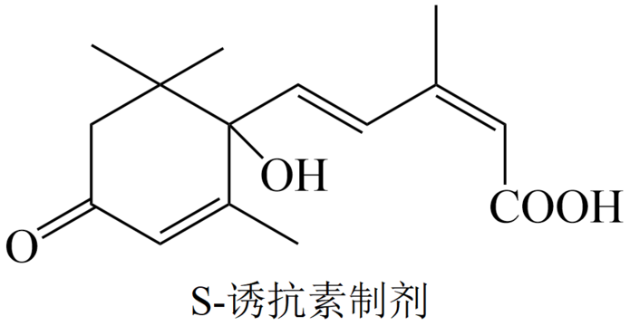

# Chemistry - 题目 169

**ID**: 2679624a59244581ba75a1ce5e38e926
**年级**: Grade 11
**难度**: Medium
**题型**: Fill-in-the-blank

## 题目
S-诱抗素制剂有助于保持鲜花盛开，其分子结构如下图，该分子含有的官能团是​​​​​​​‌

## 解答

1. 根据分子的结构简式可以看出，该分子中含有碳碳双键、羟基、酮羰基、羧基。

## 知识点

**中文**:
  - 常见官能团名称、组成及结构

**English**:
  - Names, Composition and Structure of Functional Groups

---
