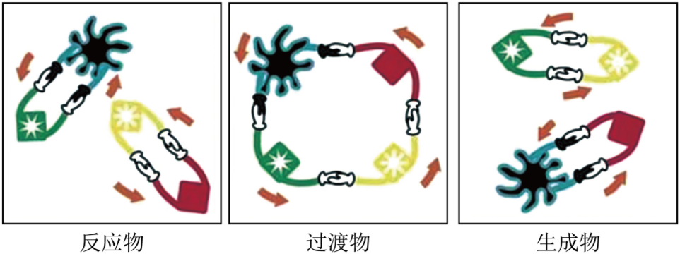

# Chemistry - 题目 202

**ID**: 03260588062649a7b676bf4566adc4b2
**年级**: Grade 11
**难度**: Medium-Hard
**题型**: Multiple-choice

## 题目
一定条件下，烯烃分子间可发生如图所示的“复分解反应”，形象的称为“交换舞伴的反应”。​​​​​​​‌这一过程可以用化学方程式表示为： ${\rm R_{1}CH=CHR_{2}+R_{3}CH=CHR_{4}}\xrightarrow []{\mathrm{{\rm{催}}{\rm{化}}{\rm{剂}}}}{\rm R_{1}CH=CHR_{3}+R_{2}CH=CHR_{4}}$ ，据此判断，下列反应的方程式不正确的是

## 解答

1. 根据题意可知，与的碳碳双键按照虚线处断裂，相互交换生成和CH_{2}=CH_{2}，A正确；的碳碳双键按照虚线处断裂，相互交换生成和CH_{2}=CH_{2}，B正确；n个的碳碳双键按照虚线处断裂，相互交换生成聚合物，C正确；n个的碳碳双键按照虚线处断裂，相互交换生成聚合物，同时有n个CH_{2}=CH_{2}生成，D错误；

## 知识点

**中文**:
  - 烯烃的结构与性质

**English**:
  - Structure and Properties of Alkenes

---
