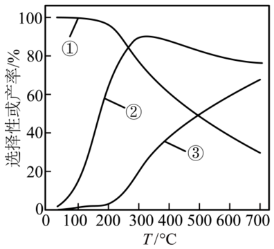

# Chemistry - 题目 165

**ID**: 1cad5a68e5474b82935d182c8b9dc4f6
**年级**: Grade 11
**难度**: Medium-Hard
**题型**: Multiple-choice

## 题目
乙醇-水催化重整可获得H_{2}，其发生的主要反应为：① ${\rm{C}}{{}_{2}}{\rm{H}}{{}_{5}}{\rm{O}}{\rm{H}}\left ({{\rm{g}}}\right )+3{\rm{H}}{{}_{2}}{\rm{O}}\left ({{\rm{g}}}\right )\rightleftharpoons 2{\rm{C}}{\rm{O}}{{}_{2}}\left ({{\rm{g}}}\right )+6{\rm{H}}{{}_{2}}\left ({{\rm{g}}}\right )$    ${\rm{Δ}}{\rm{H}}=+173.3{\rm{k}}{\rm{J}}\cdot {\rm{m}}{\rm{o}}{\rm{l}}{^{-1}}$② ${\rm{C}}{\rm{O}}{{}_{2}}\left ({{\rm{g}}}\right )+{\rm{H}}{{}_{2}}\left ({{\rm{g}}}\right )\rightleftharpoons {\rm{C}}{\rm{O}}\left ({{\rm{g}}}\right )+{\rm{H}}{{}_{2}}{\rm{O}}\left ({{\rm{g}}}\right )$    ${\rm{Δ}}{\rm{H}}=+41.2{\rm{k}}{\rm{J}}\cdot {\rm{m}}{\rm{o}}{\rm{l}}{^{-1}}$在 $1.0\times 10{^{5}}{\rm{P}}{\rm{a}}、{\rm{n}}{{}_{始}}\left ({{\rm{C}}{{}_{2}}{\rm{H}}{{}_{5}}{\rm{O}}{\rm{H}}}\right ):{\rm{n}}{{}_{始}}\left ({{\rm{H}}{{}_{2}}{\rm{O}}}\right )=1:3$ 时，若仅考虑上述反应，平衡时CO_{2}和CO的选择性及H_{2}的产率曲线随温度的变化如图所示。​​​​​​​‌CO的选择性 $\left ({{\rm{\%}}}\right )=\frac {{\rm{n}}{{}_{生成}}\left ({{\rm{C}}{\rm{O}}}\right )}{{\rm{n}}{{}_{生成}}\left ({{\rm{C}}{\rm{O}}{{}_{2}}}\right )+{\rm{n}}{{}_{生成}}\left ({{\rm{C}}{\rm{O}}}\right )}\times 100{\rm{\%}}$ 。下列说法中正确的是（      ）

## 解答

1. A．由分析可知，图中曲线②表示平衡时H_{2}产率随温度的变化，A正确；
2. B．由分析可知，曲线③表示CO的选择性随温度的变化，故降低温度，平衡时CO的选择性减小，B错误；
3. C．一定温度下，增大 $\frac {{\rm{n}}\left ({{\rm{C}}{{}_{2}}{\rm{H}}{{}_{5}}{\rm{O}}{\rm{H}}}\right )}{{\rm{n}}\left ({{\rm{H}}{{}_{2}}{\rm{O}}}\right )}$ 即反应①平衡正向移动，H_{2}O(g)的平衡转化率增大，而乙醇平衡转化率却减小，C错误；
4. D．一定温度下，加入CaO(s)吸收CO_{2}，导致反应①平衡正向移动，反应②平衡逆向移动，平衡时H_{2}的产率增大，但选用高效催化剂，不能使平衡发生移动，故H_{2}平衡产率不变，D错误；
5. 故答案为：A。

## 知识点

**中文**:
  - 温度对化学平衡的影响

**English**:
  - Effect of Temperature

---
