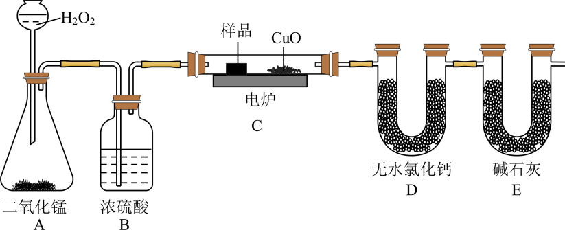
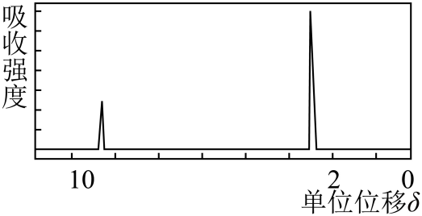
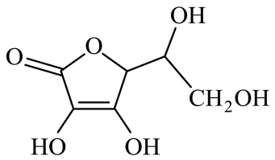

# Chemistry - 题目 100

**ID**: 204b13a07eb94516a3b71f165f50e406
**年级**: Grade 11
**难度**: Medium-Hard
**题型**: 非选择题

## 题目
如图装置中有机物样品在电炉中充分燃烧，通过测生成的CO_{2}和H_{2}O的质量，确定有机物分子式。​​​​​​​‌(1)A装置是提供实验所需的O_{2}，B装置中浓硫酸的作用是。(2)若实验中所取样品只含C、H、O三种元素中的两种或三种，称取0.44g样品，经充分反应后，D管质量增加0.36g，E管质量增加0.88g，已知该物质的相对分子质量为44，则该样品的化学式为。(3)若该有机物的核磁共振氢谱如图所示，峰面积之比为1：3则其结构简式为；若符合下列条件，则该有机物的结构简式为。①环状化合物   ②只有一种类型的氢原子(4)经测定维生素C又称为抗坏血酸其分子结构如图所示。①根据电负性大小，抗坏血酸中显+1价的碳原子有个，该分子中有个手性碳原子。②维生素C易溶，在水中呈酸性，其易溶于水的原因是。呈酸性的原因是碳碳双键(填“推电子”或“吸电子”)使氧氢键更易断裂呈酸性。

## 解答

1. （1）A装置提供实验所需的O_{2}，浓硫酸具有吸水性，B装置中浓硫酸的作用是干燥氧气；
2. （2）若实验中所取样品只含C、H、O三种元素中的两种或三种，称取0.44g样品，已知该物质的相对分子质量为44，则样品的物质的量是 $\frac {0.44{\rm{g}}}{44{\rm{g}}/{\rm mol}}=0.01{\rm mol}$ ，经充分反应后，D管质量增加0.36g，即反应生成水0.36g，水的物质的量是 $\frac {0.36{\rm{g}}}{18{\rm{g}}/{\rm mol}}=0.02{\rm mol}$ ，有机物分子中含有4个H原子；E管质量增加0.88g，即反应生成二氧化碳0.88g，二氧化碳的物质的量是 $\frac {0.88{\rm{g}}}{44{\rm{g}}/{\rm mol}}=0.02{\rm mol}$ ，有机物分子中含有2个C原子，有机物分子中氧原子数 $\frac {44-1\times 4-12\times 2}{16}=1$ ，则该样品的化学式为C_{2}H_{4}O；
3. （3）若该有机物的核磁共振氢谱如图所示，峰面积之比为1：3，说明有2种环境不同的H原子，则其结构简式为CH_{3}CHO；①环状化合物；②只有一种类型的氢原子，说明结构对称，符合条件的结构简式为；
4. （4）根据电负性大小即O＞C＞H，即H显+1价，O显-2价，则抗坏血酸中显+1价的碳原子有2个，如图所示：；连有4个不同原子或原子团的碳原子为手性碳原子，分子中有2个手性碳原子(用*标出)。维生素C为极性分子，水也是极性分子，相似相溶，且维生素可与水形成氢键，所以维生素C易溶于水；碳碳双键吸电子，使氧氢键更易断裂呈酸性。

## 知识点

**中文**:
  - 手性分子与手性碳原子

**English**:
  - Chiral Molecules and Chiral Carbons

---
