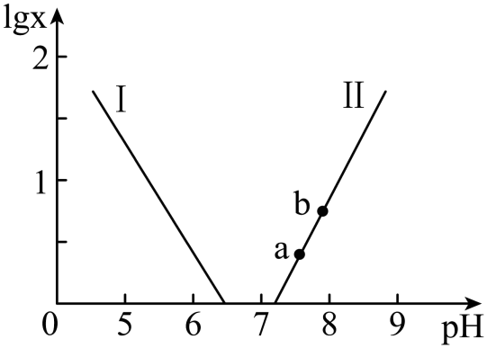

# Chemistry - 题目 245

**ID**: 22e2444953c24678a42c92d8b8896345
**年级**: Grade 11
**难度**: Medium-Hard
**题型**: Multiple-choice

## 题目
人体血液存在 ${\rm{H}}{{}_{2}}{\rm{C}}{\rm{O}}{{}_{3}}/{\rm{H}}{\rm{C}}{\rm{O}}{{}_{3}^{-}}$ 和 ${\rm{H}}{\rm{P}}{\rm{O}}{{}_{4}^{2-}}/{\rm{H}}{{}_{2}}{\rm{P}}{\rm{O}}{{}_{4}^{-}}$ 等缓冲对。​​​​​​​‌常温下，水溶液中各缓冲对的微粒浓度之比的对数值lgx[x表示 $\frac {{\rm{c}}\left ({{\rm{H}}{{}_{2}}{\rm{C}}{\rm{O}}{{}_{3}}}\right )}{{\rm{c}}\left ({{\rm{H}}{\rm{C}}{\rm{O}}{{}_{3}^{-}}}\right )}$ 或 $\frac {{\rm{c}}\left ({{\rm{H}}{\rm{P}}{\rm{O}}{{}_{4}^{2-}}}\right )}{{\rm{c}}\left ({{\rm{H}}{{}_{2}}{\rm{P}}{\rm{O}}{{}_{4}^{-}}}\right )}]$ 与pH的关系如图所示。已知： ${\rm{p}}{\rm{K}}{{}_{{\rm{a}}1}}\left ({{\rm{H}}{{}_{2}}{\rm{C}}{\rm{O}}{{}_{3}}}\right )=6.4$ ， ${\rm{p}}{\rm{K}}{{}_{{\rm{a}}2}}\left ({{\rm{H}}{{}_{2}}{\rm{C}}{\rm{O}}{{}_{3}}}\right )=10.2$ ， ${\rm{p}}{\rm{K}}{{}_{{\rm{a}}1}}\left ({{\rm{H}}{{}_{3}}{\rm{P}}{\rm{O}}{{}_{4}}}\right )=2.1$ ， ${\rm{p}}{\rm{K}}{{}_{{\rm{a}}2}}\left ({{\rm{H}}{{}_{3}}{\rm{P}}{\rm{O}}{{}_{4}}}\right )=7.2$ ， ${\rm{p}}{\rm{K}}{{}_{{\rm{a}}3}}\left ({{\rm{H}}{{}_{3}}{\rm{P}}{\rm{O}}{{}_{4}}}\right )=12.3\left ({{\rm{p}}{\rm{K}}{{}_{{\rm{a}}}}=-{\rm{l}}{\rm{g}}{\rm{K}}{{}_{{\rm{a}}}}}\right )$ 。下列说法正确的是（      ）

## 解答

1. A．由分析可知，曲线I表示 ${\rm lg}\frac {{\rm{c}}\left ({{\rm{H}}{{}_{2}}{\rm{C}}{\rm{O}}{{}_{3}}}\right )}{{\rm{c}}\left ({{\rm{H}}{\rm{C}}{\rm{O}}{{}_{3}^{-}}}\right )}$ 与pH的变化关系，A正确；
2. B．曲线 II 表示  ${\rm lg}\frac {{\rm{c}}\left ({{\rm{H}}{\rm{P}}{\rm{O}}{{}_{4}^{2-}}}\right )}{{\rm{c}}\left ({{\rm{H}}{{}_{2}}{\rm{P}}{\rm{O}}{{}_{4}^{-}}}\right )}$ 与 pH 的变化关系，a→b 的过程中，c( ${\rm{H}}{\rm{P}}{\rm{O}}{{}_{{{4}}}^{{{2}}{{-}}}}$ ) 逐渐增大，由题干数据可知， ${\rm{H}}{\rm{P}}{\rm{O}}{{}_{{{4}}}^{{{2}}{{-}}}}$ 的水解程度大于电离程度，则对水的电离促进作用增大，所以水的电离程度逐渐增大，B正确；
3. C．反应 ${\rm{H}}{{}_{3}}{\rm{P}}{\rm{O}}{{}_{4}}+{\rm{H}}{\rm{P}}{\rm{O}}{{}_{4}^{2-}}\rightleftharpoons 2{\rm{H}}{{}_{2}}{\rm{P}}{\rm{O}}{{}_{4}^{-}}$ 的平衡常数 ${\rm{K}}=\frac {{\rm{c}}\left ({{\rm{H}}{{}_{2}}{\rm{P}}{\rm{O}}{{}_{4}^{-}}}\right ){\rm{c}}\left ({{\rm{H}}{{}_{2}}{\rm{P}}{\rm{O}}{{}_{4}^{-}}}\right )}{{\rm{c}}\left ({{\rm{H}}{{}_{{{3}}}}{\rm{P}}{\rm{O}}{{}_{4}}}\right ){\rm{c}}\left ({{\rm{H}}{\rm{P}}{\rm{O}}{{}_{4}^{2-}}}\right )}=\frac {{\rm{c}}\left ({{\rm{H}}{{}_{2}}{\rm{P}}{\rm{O}}{{}_{4}^{-}}}\right ){\rm{c}}\left ({{\rm{H}}{^{+}}}\right ){\rm{c}}\left ({{\rm{H}}{{}_{2}}{\rm{P}}{\rm{O}}{{}_{4}^{-}}}\right )}{{\rm{c}}\left ({{\rm{H}}{{}_{{{3}}}}{\rm{P}}{\rm{O}}{{}_{4}}}\right ){\rm{c}}\left ({{\rm{H}}{\rm{P}}{\rm{O}}{{}_{4}^{2-}}}\right ){\rm{c}}\left ({{\rm{H}}{^{+}}}\right )}=\frac {{\rm{K}}{{}_{{\rm{a}}1}}\left ({{\rm{H}}{{}_{2}}{\rm{C}}{\rm{O}}{{}_{3}}}\right )}{{\rm{K}}{{}_{{\rm{a}}2}}\left ({{\rm{H}}{{}_{2}}{\rm{C}}{\rm{O}}{{}_{3}}}\right )}=\frac {10{^{-6.4}}}{10{^{-10.2}}}=10{^{3.8}}{\rm ，C}$ 错误；
4. D．由题给信息可知，当 ${\rm{c}}\left ({{\rm{H}}{\rm{P}}{\rm{O}}{{}_{4}^{2-}}}\right )={\rm{c}}\left ({{\rm{H}}{{}_{2}}{\rm{P}}{\rm{O}}{{}_{4}^{-}}}\right )$ 时， ${\lg}\frac {{\rm{c}}\left ({{\rm{H}}{\rm{P}}{\rm{O}}{{}_{4}^{2-}}}\right )}{{\rm{c}}\left ({{\rm{H}}{{}_{2}}{\rm{P}}{\rm{O}}{{}_{4}^{-}}}\right )}{\rm =0}$ ，此时的pH约为7.2，由图可推断， ${\rm{p}}{\rm{H}}{\rm{=}}{{7}}{{.}}{{2}}$ 时， ${\rm{K}}{{}_{{\rm{a}}2}}\left ({{\rm{H}}{{}_{2}}{\rm{C}}{\rm{O}}{{}_{3}}}\right )=\frac {{\rm{c}}\left ({{\rm{C}}{\rm{O}}{{}_{3}^{2-}}}\right ){\rm{c}}\left ({{\rm{H}}{{}^{+}}}\right )}{{\rm{c}}\left ({{\rm{H}}{\rm{C}}{\rm{O}}{{}_{3}^{-}}}\right )}=\frac {{\rm{c}}\left ({{\rm{C}}{\rm{O}}{{}_{3}^{2-}}}\right )10{^{-7.2}}}{{\rm{c}}\left ({{\rm{H}}{\rm{C}}{\rm{O}}{{}_{3}^{-}}}\right )}=10{^{-10.2}}$ ， $\frac {{\rm{c}}\left ({{\rm{C}}{\rm{O}}{{}_{3}^{2-}}}\right )}{{\rm{c}}\left ({{\rm{H}}{\rm{C}}{\rm{O}}{{}_{3}^{-}}}\right )}=10{^{-3}}<0$ ，说明 ${\rm{c}}\left ({{\rm{C}}{\rm{O}}{{}_{3}^{2-}}}\right )<{\rm{c}}\left ({{\rm{H}}{\rm{C}}{\rm{O}}{{}_{3}^{-}}}\right ){\rm ，D}$ 错误；
5. 故选AB。

## 知识点

**中文**:
  - 影响水电离的因素
  - 溶液中微粒浓度大小比较

**English**:
  - Factors Affecting Water Ionization
  - Comparison of Particle Concentrations

---
