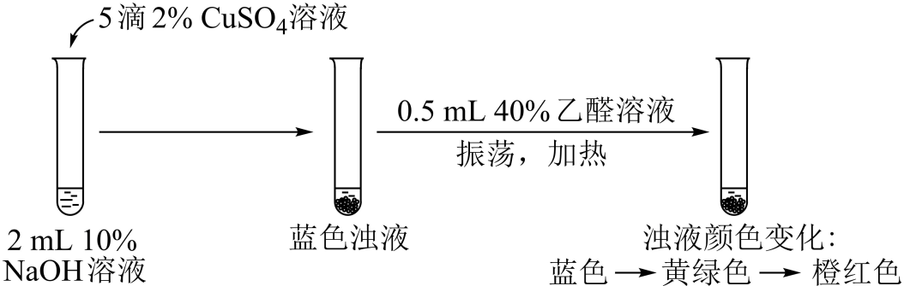

# Chemistry - 题目 320

**ID**: 29d89476ce2f478498ae5f321168775e
**年级**: Grade 11
**难度**: Medium-Hard
**题型**: 非选择题

## 题目
兴趣小组欲探究乙醛被新制 ${\rm{C}}{\rm{u}}\left ({{\rm{O}}{\rm{H}}}\right ){{}_{{{2}}}}$ 氧化的反应，进行了如下实验。​​​​​​​‌Ⅰ．探究反应产物(1)甲同学认为橙红色浊液中含有Cu_{2}O，理由是(用化学方程式表示)。(2)乙同学推测浊液的颜色变化不只与Cu_{2}O的生成有关，证据是。小组同学查阅资料发现，乙醛在碱性条件下可发生聚合，生成多烯醛聚合物，其化学式为 ${\rm{C}}{\rm{H}}{{}_{3}}\left ({{\rm{C}}{\rm{H}}={\rm{C}}{\rm{H}}}\right ){{}_{n}}{\rm{C}}{\rm{H}}{\rm{O}}$ 。随聚合程度增大，聚合物颜色由橙黄色加深至红褐色。为检验浊液成分，小组同学进行了如下实验。已知：ⅰ．Cu_{2}O可与酸反应，不溶于乙醇。ⅱ．CuCl是白色难溶固体，在含Cl^{-}溶液中存在平衡： ${\rm{C}}{\rm{u}}{\rm{C}}{\rm{l}}+{\rm{C}}{\rm{l}}{^{-}}\rightleftharpoons {\rm{C}}{\rm{u}}{\rm{C}}{\rm{l}}{{}_{2}^{-}}$(3)经检验，橙红色浊液中含Cu_{2}O和多烯醛聚合物。①黄色滤液可使酸性KMnO_{4}褪色，但不能据此证明多烯醛聚合物的存在，原因是。②上述实验中，随着盐酸的加入，先产生白色沉淀，后沉淀消失。从平衡移动角度解释白色沉淀消失的原因：。Ⅱ．探究反应条件丙同学减少碱的用量以避免多烯醛聚合物的生成，但反应后浊液变黑。小组同学调整NaOH溶液的浓度，重新进行原实验(CuSO_{4}和乙醛溶液的浓度、体积均不变)，反应过程中的现象记录如下：组别20%NaOH溶液用量蒸馏水用量加热前加热至沸过滤，经乙醇洗涤后10mL2mL淡蓝色溶液淡蓝色溶液无固体22滴2mL淡蓝色浊液土色发黑的浊液黑色固体30.2mL1.8mL半透明蓝色浊液黑红色浊液黑红色固体41mL1mL半透明蓝色浊液橙红色浊液砖红色固体52mL0mL深蓝色溶液橙红色浊液砖红色固体(4)经检验，第2组实验中的黑色沉淀CuO，将检验的操作和现象补充完整：取洗涤后的黑色沉淀，。(5)实验现象说明，碱性增强有利于乙醛被氧化。①第5组实验中，加热前溶液成深蓝色，原因是(用离子方程式表示)。②第4、5组实验中，反应过程中未观察到黑色物质产生，可能的原因是(写出一条即可)。(6)小组同学反思乙醛被新制Cu(OH)_{2}氧化的实验，提出下列促使实验成功的注意事项。其中合理的是(填序号)。a．制备时NaOH不宜过量，避免乙醛在碱性条件下缩聚b．制备时应使NaOH过量，促进乙醛的氧化反应c．反应后，宜用乙醇洗涤生成的固体，再观察固体颜色

## 解答

1. （1）根据分析，乙醛可与新制Cu(OH)_{2}发生氧化还原反应生成羧酸钠、Cu_{2}O和水，则反应的方程式为： ${{2}}{\rm{C}}{\rm{u}}{\rm{(}}{\rm{O}}{\rm{H}}{\rm{)}}{{}_{{{2}}}}{{+}}{\rm{C}}{\rm{H}}{{}_{{{3}}}}{\rm{C}}{\rm{H}}{\rm{O}}{{+}}{\rm{N}}{\rm{a}}{\rm{O}}{\rm{H}}\xrightarrow []{\mathrm{{\rm{Δ}}}}{\rm{C}}{\rm{u}}{{}_{{{2}}}}{\rm{O}}{{+}}{\rm{C}}{\rm{H}}{{}_{{{3}}}}{\rm{C}}{\rm{O}}{\rm{O}}{\rm{N}}{\rm{a}}{{+}}{{3}}{\rm{H}}{{}_{{{2}}}}{\rm{O}}$ 。故答案为： ${{2}}{\rm{C}}{\rm{u}}{\rm{(}}{\rm{O}}{\rm{H}}{\rm{)}}{{}_{{{2}}}}{{+}}{\rm{C}}{\rm{H}}{{}_{{{3}}}}{\rm{C}}{\rm{H}}{\rm{O}}{{+}}{\rm{N}}{\rm{a}}{\rm{O}}{\rm{H}}\xrightarrow []{\mathrm{{\rm{Δ}}}}{\rm{C}}{\rm{u}}{{}_{{{2}}}}{\rm{O}}{{+}}{\rm{C}}{\rm{H}}{{}_{{{3}}}}{\rm{C}}{\rm{O}}{\rm{O}}{\rm{N}}{\rm{a}}{{+}}{{3}}{\rm{H}}{{}_{{{2}}}}{\rm{O}}$ ；
2. （2）浊液颜色从蓝色变为黄绿色，再变为红色（而不是从蓝色直接变为红色），说明有中间有其他产物生成；
3. （3）①
4. 黄色滤液中含有洗涤时加入的乙醇和多烯醛聚合物的混合液体，洗涤时加入的乙醇也有还原性，可使使酸性KMnO_{4}褪色，不能据此证明多烯醛聚合物；盐酸的加入先产生白色沉淀，方程式为2Cu_{2}O+2HCl=2CuCl+H_{2}O，CuCl是白色难溶固体，在含Cl^{-}溶液中存在平衡： ${\rm{C}}{\rm{u}}{\rm{C}}{\rm{l}}{{+}}{\rm{C}}{\rm{l}}{^{{{-}}}}\rightleftharpoons {\rm{C}}{\rm{u}}{\rm{C}}{\rm{l}}{{}_{{{2}}}^{{{-}}}}$ ，继续加盐酸使c(Cl^{-})增大，平衡 ${\rm{C}}{\rm{u}}{\rm{C}}{\rm{l}}{{+}}{\rm{C}}{\rm{l}}{^{{{-}}}}\rightleftharpoons {\rm{C}}{\rm{u}}{\rm{C}}{\rm{l}}{{}_{{{2}}}^{{{-}}}}$ 正向移动，白色沉淀溶解；
5. （4）CuO为碱性氧化物可与酸反应生成Cu^{2+}，向其中加入稀盐酸（或稀硫酸），沉淀溶解，得到蓝绿色/蓝色溶液；
6. （5）加热前溶液呈深蓝色是因为过量碱与Cu(OH)_{2}反应生成 ${\rm [Cu(OH)_{4}]^{2-}，}{\rm{C}}{\rm{u}}{^{{{2}}{{+}}}}{{+}}{{4}}{\rm{O}}{\rm{H}}{^{{{-}}}}{\rm{=}}\left [{\rm{C}}{\rm{u}}\left ({{\rm{O}}{\rm{H}}}\right ){{}_{{{4}}}}\right ]{^{{{2}}{{-}}}}$ ；Cu(OH)_{2}分解生成CuO，碱性较强时，Cu(Ⅱ)氧化乙醛的速率大于Cu(OH)_{2}分解速率；或碱性较强时，部分Cu(OH)_{2}转化为[Cu(OH)_{4}]^{2-}，不易分解生成CuO；
7. （6）a．反应环境中碱性弱时，容易生成CuO，因此该反应需要在过量碱中进行，a不合理；
8. b．过量的碱可以防止CuO的生成，同时还可以促进乙醛的氧化，b合理；
9. c．反应后，生成的Cu_{2}O可与酸反应，不溶于乙醇，因此可用乙醇洗涤生成的固体，洗去多烯醛聚合物，再观察固体颜色，c合理；
10. 故选bc。

## 知识点

**中文**:
  - 乙醛与新制氢氧化铜悬浊液的反应
  - 离子方程式的书写及正误判断

**English**:
  - Reaction with Cu(OH)2
  - Writing and Verifying Ionic Equations

---
