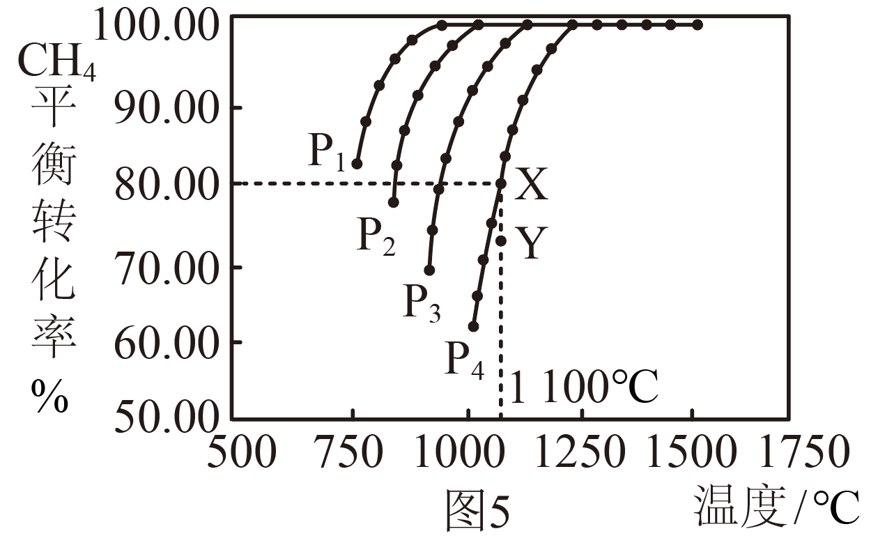

# Chemistry - 题目 229

**ID**: 2a77a5f36b2d433a8c97cd4645385b33
**年级**: Grade 11
**难度**: Medium-Hard
**题型**: Multiple-choice

## 题目
在恒容密闭容器中通入物质的量浓度均0.​​​​​​​‌1mol·L^{-1}的CH_{4}与CO_{2}，在一定条件下发生反应： ${\rm CO_{2}(g)+CH_{4}(g)}\rightleftharpoons {\rm 2CO(g)+2H_{2}(g)}$ ，测得CH4的平衡转化率与温度及压强的关系如图5，下列有关说法正确的是（      ）

## 解答

1. P相同时，温度越高，CH_{4}平衡转化率越大，说明升温平衡右移，ΔH>0，A正确；增大压强，平衡左移，CH_{4}的平衡转化率减小，p_{4}>p_{3}>p_{2}>p_{1}，B错误；X点CH_{4}平衡转化率为80%，则列三段式 $\hspace{-0.5em}\begin{array}{}\;\\起始{\rm{(}}{\rm{m}}{\rm{o}}{\rm{l}}{\rm{/}}{\rm{L}}{\rm{)}}\\变化{\rm{(}}{\rm{m}}{\rm{o}}{\rm{l}}{\rm{/}}{\rm{L}}{\rm{)}}\\平衡{\rm{(}}{\rm{m}}{\rm{o}}{\rm{l}}{\rm{/}}{\rm{L}}{\rm{)}}\end{array}\hspace{-0.5em}\begin{array}{}{\rm{C}}{\rm{O}}{{}_{{{2}}}}{\rm{(}}{\rm{g}}{\rm{)}}\\{{0}}{{.}}{{1}}\\{{0}}{{.}}{{0}}{{8}}\\{{0}}{{.}}{{0}}{{2}}\end{array}\hspace{-0.5em}\begin{array}{}{{+}}\\\;\\\;\\\;\end{array}\hspace{-0.5em}\begin{array}{}{\rm{C}}{\rm{H}}{{}_{{{4}}}}{\rm{(}}{\rm{g}}{\rm{)}}\\{{0}}{{.}}{{1}}\\{{0}}{{.}}{{0}}{{8}}\\{{0}}{{.}}{{0}}{{2}}\end{array}\hspace{-0.5em}\begin{array}{}\rightleftharpoons \\\;\\\;\\\;\end{array}\hspace{-0.5em}\begin{array}{}{{2}}{\rm{C}}{\rm{O}}{\rm{(}}{\rm{g}}{\rm{)}}\\{{0}}\\{{0}}{{.}}{{1}}{{6}}\\{{0}}{{.}}{{1}}{{6}}\end{array}\hspace{-0.5em}\begin{array}{}{{+}}\\\;\\\;\\\;\end{array}\hspace{-0.5em}\begin{array}{}{{2}}{\rm{H}}{{}_{{{2}}}}{\rm{(}}{\rm{g}}{\rm{)}}\\{{0}}\\{{0}}{{.}}{{1}}{{6}}\\{{0}}{{.}}{{1}}{{6}}\end{array}\hspace{-0.5em}$ ，则 ${\rm K＝}\frac {{{0}}{{.}}{{1}}{{6}}{^{{{2}}}}\times {{0}}{{.}}{{1}}{{6}}{^{{{2}}}}}{{{0}}{{.}}{{0}}{{2}}\times {{0}}{{.}}{{0}}{{2}}}{\rm ＝1.6384，C}$ 错误；Y点CH_{4}转化率小于CH_{4}平衡转化率，则此点平衡正在正向移动，所以v(正)>v(逆)，D错误；
2. 。

## 知识点

**中文**:
  - 压强对化学平衡的影响
  - 吸热反应和放热反应
  - 温度对化学平衡的影响

**English**:
  - Effect of Pressure
  - Endothermic and Exothermic Reactions
  - Effect of Temperature

---
